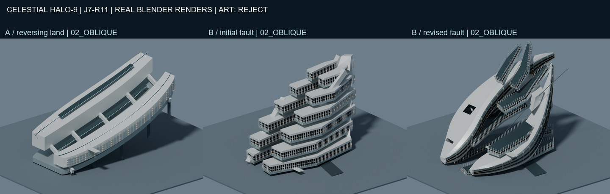
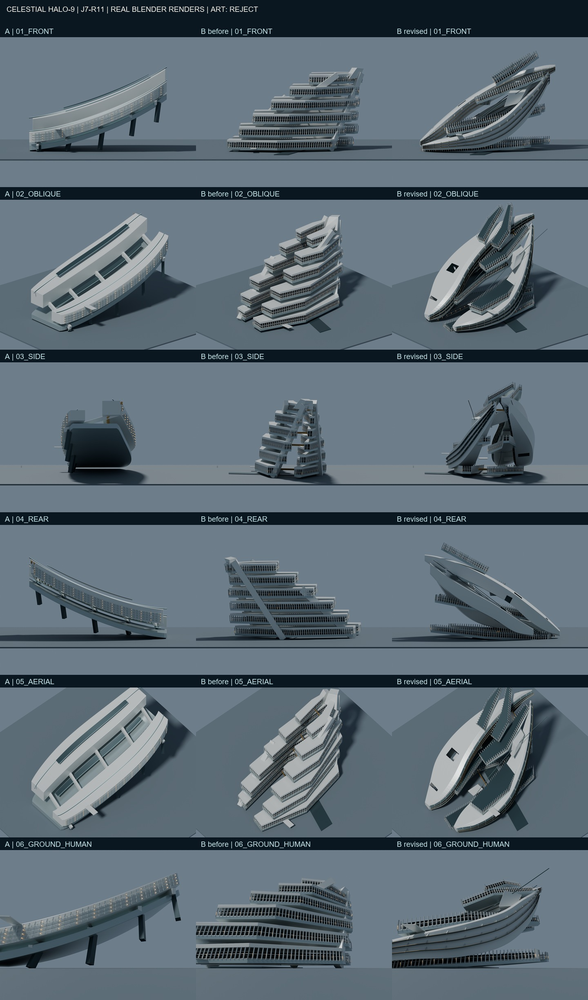
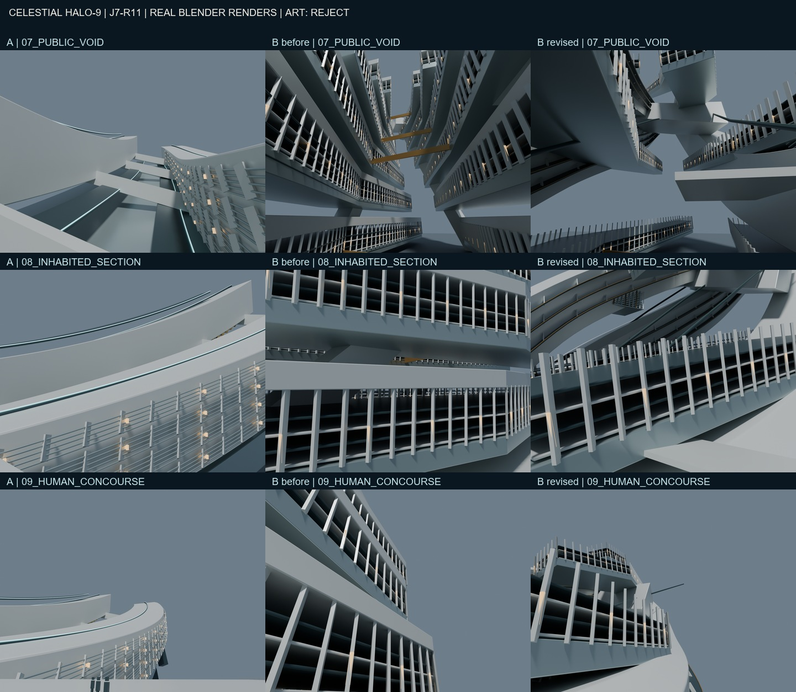
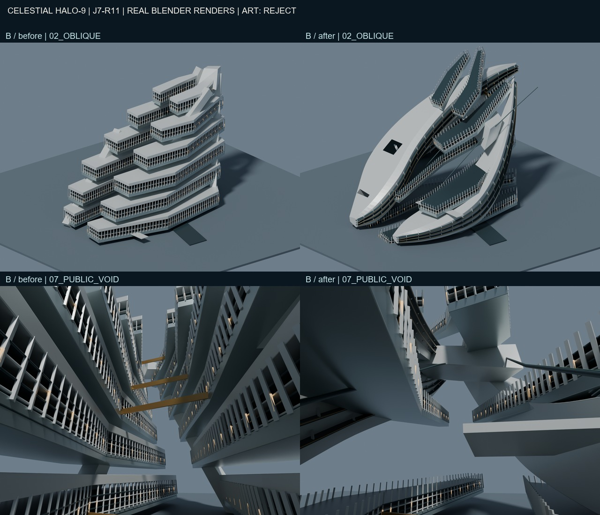

# J7-R11 — 実Blender二案と主形状修正の美術審査

2026-10-25 JST／独立研究／**A・B・B修正版すべて中央美術REJECT**。

編集可能な実BLEND、実GLB、多視点画像と実際の主形状編集は制作した。しかし「従来を大きく超える超未来文明都市の美術品質」という最優先目標は達成していない。技術的な納品完了と美術的な失敗を区別する。正式中央美術採択0件、Minecraft施工HOLD、10km City Master未完成。

## 1. 根拠と原本保護

- GitHub PR #42を実取得し、Draft/open、R10 HEAD `c57c0b419d91fe44e75bcd945ed596800023cd4f`を確認。この履歴からR11専用ブランチを作成した。
- mainのSTART_HERE、PROJECT_CONSTITUTION、CITY_MASTER_3D_STANDARD、CURRENT_STATUS、DECISION_LOG、AGENTSとR10の指示・ゲート・latestを読んだ。mainをGitでも取得し、`a2f88995eee8d10ee4830dbdf33ccb9c0790de8f`を記録。CURRENT_STATUS本文は2026-10-23の古い状態なので、R10の現状はPR APIの実HEADを優先した。
- `LOCAL_WORK_RULES.md`、`SETUP_STATUS.txt`、既存セットアップ報告を確認。今回のユーザー指示によりローカルBlender制作、新規研究ブランチのpush、新規Draft PR作成が許可された。既存PRの更新やmainへの書込・マージはしない。
- 既存ローカルの未追跡研究を保持。M121 upstreamの46ファイルは元Git blobと全バイト照合。archives・handoffで生成器やレンダラーを実行していない。
- 実Minecraftセーブへのアクセスなし。Freeze、保護物、M247-C正式研究方向、正式W0/H/SB配置は変更なし。

## 2. 二案の空間思想と実物

| 状態 | 実装した思想 | 実際に見えた失敗 |
|---|---|---|
| A《反転天陸》 | 曲がって上昇する厚い地盤に、上下・前後の都市断面と長い内部峡谷を設けた。Bの水平な断層群とは別の断面原理。 | 二本の巨大な曲線ランプ／橋に見える。裏側は広い無地面で、反転した都市世界としての説得力に欠ける。 |
| B《斜光断層》初回 | 前後に分かれた複数高度の居住地盤を斜めの骨格で束ね、中央に実3Dの裂け目を残した。 | 長い公共施設を等間隔に積んだ棚。現代建築の単純拡大という失敗を克服できていない。 |
| B修正版 | 横長層2段・全旧キャノピー・単純斜材を撤去。残る断面を個別に傾斜・旋回させ、連続する厚い都市体と交差する上部接続体、実採光孔へ組み替えた。 | 均等な棚の輪郭は崩れたが、巨大な刃／翼と床帯の集合にも見える。高密度な文明都市、神聖な存在感80%としては不足。 |

全モデルの正面・斜視・側面・背面・俯瞰・地上を、同じカメラ位置・画角・照明・1440×1100解像度で描画した。最初の5視点は正投影幅8700m、地上は同位置・24mm・視高1.7mの透視投影。透視視点は距離によって見かけの縮尺が変わるので、正投影と同じ意味の一定縮尺とは称さない。

巨大公共空洞、居住断面、人間視点を別に撮影した。全27枚の原画像は各モデルフォルダにあり、コラージュは縮小とラベルだけで、画像生成・補完・美術的な画像修整はしていない。

## 3. 実画像を見て何を変更したか

Blender 5.2.1 LTSとMCPの実接続を確認。アドオン1.6／protocol 5はサーバー想定15より古いが、シーン読取・モデル表示・Python編集・保存は動作した。既存GUIには未保存のクリーンな初期シーン3オブジェクトだけがあり、研究原本を開いていなかった。

初回は独立したバックグラウンドBlenderでA/Bを制作し、各4方向の実レンダーを観察。両者の美術失敗を判断した上で、相対的に断面空間を比較しやすいBをGUIへ開き、MCPの実カメラ表示でも確認した。

その後、**ライブBlender内で612オブジェクトを撤去、1013個の保持メッシュを実頂点編集**。R01〜R04の新たな主構造と採光孔を実メッシュとして追加し、別の`refined/R11_B_REFINED.blend`へ保存した。内容は`qa/main_form_revision.json`に記録。これは単なる色替えやカメラ変更ではなく、体積配置・空洞・輪郭の変更である。

改善は、等間隔の段構成を破り、長い斜めの空の裂け目と上昇する連続体を見せたこと。残る失敗は、都市体が依然として大きな抽象部材で、居住密度と多層生活地形の階層が不足していること。斜めになった生活床の使い方、内部の実経路、接合も未解決。**したがって美術REJECTを維持し、追加装飾による延命を止めた。**

本工程はbpyによる制作とライブメッシュ編集・実画像審査の組合せである。手動スカルプトやGUI編集モード操作をしたとは主張しない。MCP経由でPythonを動かした事実を革新的手法の成功と扱わない。

## 4. 実寸法・保存・検証

建築コレクションの評価済み全頂点を世界座標へ変換して計測。地面・照明・カメラは寸法に含めない。入口床・交通・手すり・人型は含む。値の厳密版は各`measured.json`と`qa/BLEND_GLB_READBACK.json`を参照。

| 状態 | 幅X × 奥行Y × 高さZ（約km） | 保存ファイル |
|---|---|---|
| A | 6.12 × 3.61 × 3.67 | [BLEND](concept_A/R11_A.blend) / [GLB](concept_A/R11_A.glb) |
| B初回 | 6.10 × 4.34 × 3.71 | [BLEND](concept_B/R11_B.blend) / [GLB](concept_B/R11_B.glb) |
| B修正版 | 6.01 × 4.89 × 4.46 | [BLEND](refined/R11_B_REFINED.blend) / [GLB](refined/R11_B_REFINED.glb) |

上表は人間視点の補修後の概数。実モデル計測を優先し、研究目安の高さ4kmに収めたと偽らない。B修正版は目安を超える。一部の部材は中立地面の下に入り、正式地形への接地を解決していない。

- 3つの保存BLENDをBlenderで再読込。3つのGLBを空シーンへ実インポート。
- オブジェクト数・三角形数一致、全頂点有限、世界境界差0.02m未満を確認。最大差は約0.000004m。
- 最終27PNGの存在・解像度・非黒画像、広域6カメラ設定の完全一致、ソース構文を検査。
- 空洞内候補から6方向の実シーン表面ray probeも保存。ただし少数のrayは、全体積クリアランスや歩行可能性を証明しない。
- ネイティブ曲線、編集可能な個別メッシュ、ベベルと材質を保持。GLBは評価済み形状。

技術PASSの範囲は**保存・読戻し・基本寸法・画像一式**。曲線端、別ソリッドの交差、boolean面等を含み、全体を水密の施工用形状とは扱わない。構造、全衝突、全空洞、都市交通の連続性、住戸や公共室の詳細、アクセシビリティ、実歩行は未認証。

最初の人間視点の一部はソリッド内部に入り黒画像になった。これを合格画像にせず、都市縁に実寸の観察床・1.1m手すり・1.75m人型を配置し、床上1.7mのカメラで補修・全景も再描画した。正式な都市公共経路の完成証拠ではない。

## 5. 10km都市・正式座標との関係

今回は研究用のメートル座標。台帳の出典と憲章を確認したが、M204とW0/H/SBの認証済み共通アンカーは確定できていない。公式配置を推測して本モデルへ接合していない。

10kmの平面は**比較用の中立地面**であり、W0や完成都市ではない。W0の北山岳・西断崖・東人工内海・南西負空間、H1〜H6、SB01〜SB16、HERO4、CELESTIAL SPINE、三軸・V1〜V3は義務として保持するが、今回それらの詳細3Dを実装・統合したとは主張しない。これはR11の未完成範囲である。

## 6. R1〜R9に対する前進と失敗

前進は、隔離されたローカルBlenderで、二つの異なる空間原理を同条件で実比較し、その場の主形状修正を新しい実BLEND/GLBへ保存して再読込したこと。画像生成による見かけの補完は不要だった。

しかし、R1の棚、R2の岩塊、R3の翼、R5〜R6の二塔、R8の単独文化施設、R9の高架模型という失敗に対し、R11もランプ・棚・刃の造形へ縮退した。**「R1〜R9の美術を明確に超えた」とは評価できない。** 巨大な数字、出力ファイル、MCP接続、技術QAだけでは解決していない。

## 7. 引継ぎとJ7-R12の最優先

`R11_HANDOFF.json`、再制作ソース、画像、モデル、ハッシュを同じ研究ブランチに保存。最後の状態は`refined/R11_B_REFINED.blend`から再開できるが、これを採択形状として細密化しない。

**J7-R12の最優先は、ランプ・棚・翼に見えない主質量と、そこに埋め込まれた生活都市・巨大空洞の同時造形。** 一般的な数式断面や同じ長屋を重ねる方法を延長せず、異なる高さ・向き・深さの街区が互いに内部空間を作る一つの強い断面を、最初から側面・背面・地上で審査する。大量の窓や小建築の追加、細密化、次の形式的なモデル量産を先行させない。

正式中央美術採択0件。CITY MASTER 3D FIRST維持。Minecraft施工HOLD。
