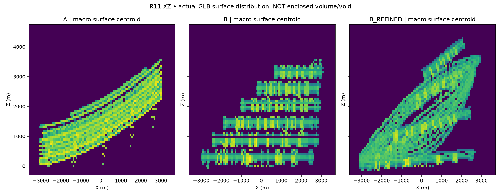
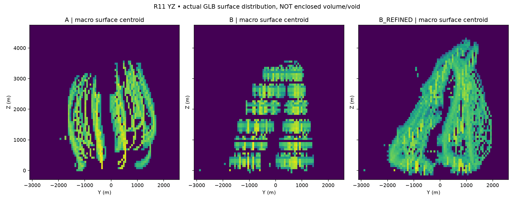

# J7-R12 — R11実GLB独立造形診断・結果レビュー

**実行日 2026-10-25 JST。A/B/B修正版の実GLBを新規コードで読んだ独立検査。ART REJECT／施工HOLD。**

## 1. 結果
GitHub Actions [#40147599395](https://github.com/ryomashibaba/celestial-halo-9/actions/runs/40147599395) の最終PASSを受け、R11のオリジナルGLBを3つ、Trimeshシーンとして直接読んだ。**今回Blender新美術モデルは制作していない。**

| メッシュ区分 / 実モデル | A反転天陸 | B斜光断層 | B修正版 |
|---|---:|---:|---:|
| Trimeshが検査した幾何ノード | 1,041 | 1,695 | 1,387 |
| 実際に走査した三角形 | 132,304 | 30,860 | 47,724 |
| X×Y×Z外形実測（km） | 6.120×3.612×3.672 | 6.103×4.345×3.712 | 6.008×4.894×4.464 |
| 1.5km以上の部材が占める面積率 | **91.77%** | **93.88%** | **88.58%** |
| 100〜500mの部材が占める面積率 | **0.21%** | **5.25%** | **10.10%** |
| 500〜1500mの部材が占める面積率 | **3.80%** | **0.60%** | **1.07%** |
| GLB由来の全メッシュ表面積合算 | 約112.52百万㎡ | 約439.30百万㎡ | 約322.82百万㎡ |

**分類方法**：各幾何ノードの実世界座標AABBの最大辺をサイズとし、そのノードを構成する全三角形面積を同じクラスへ計上する。したがって、巨大メッシュに100mの都市模様が彫り込まれていても「巨大メッシュ」の側へ面積が計上される。**この数字は小地区の少なさや居住空間の質を直接証明せず、主構造への幾何と面積の偏りを示す補助証拠**である。各部材の重複面も別々に数えるため空間体積や露出面の厳密値ではない。

## 2. 2つの診断画像を直接確認した結論

両画像は**実メッシュから取得した100㎡以上の三角形の面積重み付け重心分布**であり、塗られていない箇所が空洞であるとの証拠ではない。正面/側面の広域実レンダーと合わせて評価した。

- A：XZ側からは連続して右上がりの都市帯に集中、YZからは2つの太い湾曲帯へ集約。**都市の多層世界というより巨大輸送路／橋**というR11の視覚判断と整合。
- B：XZ側から6段程の規則的な水平帯が顕著。YZからも段ごとに面の塊が分離。**巨大棚の反復構造**と整合。
- B修正版：XZでは右上がりの2〜3の大きな対角帯。YZでも尖った2重構造が主役で、内部の居住世界が主要空間として実像化されていないことが分かる。初回Bの整列した棚は実際に崩れているが、**巨大な刃・翼**という別の不合格形へ移行した。

「模型の寸法が6kmである」「頂点編集を1000件以上行った」ことは、数百m〜1kmの都市地区世界が内蔵されていることや美術的な魅力を保証しない。

## 3. 検査上の事故とその修正

GLBはglTFのY-up座標であり、Trimeshをそのまま読むとY（奥行）とZ（高さ）が入れ替わったデータになった。初期試行では寸法の軸交換が発生した。

コードを**Blender Z-upへ戻す回転 `[x,-z,y]`**に変更し、R11のBLEND直接実測`measured.json`の寸法と各軸を照合するFail Closed Gateを追加。最終の寸法差はA **0.0029m**、B **0.0048m**、B修正版 **0.0044m**。原点や符号を含む公式都市座標の一致を保証するものではない。

B修正版についてTrimeshで見た幾何ノードは1,387、前R11のBlender対象オブジェクトは1,384。集計対象のノードとBlender側で数えた対象が厳密には同一とは言えず、**同じオブジェクト数であるとは主張しない**。三角形数47,724は一致。源のBLEND/GLBを直接再ロードしたR11の検査も継承する。

## 4. 美術的な結論

R11の根本原因は今回の数値と画像の両方で裏付けられた。**圧倒的な大きさを「巨大形状だけ」で表現し、内部の生活・巨大空洞・中スケールの都市世界を形態単位として同時に生成していない。**

改修案：次回Blenderでは、まず空洞に隣接する300〜1200mの複数居住世界、それらを内包して表面も構成する数km級の建築質量を本当の3Dとして同時に造形する。外殻・内部・都市は別々の装飾ステップではなく**一つの造形問題**として扱う。形状カテゴリは一律禁止せず、斜視・横・背面・空洞・人間からの見え方で判断する。

詳細は `R12_HABITABLE_VOLUME_ART_METHOD_JA.md`。
`J7R12_WORK_GATE.json`はユーザーの段階的Work使用方針に沿う次工程へのハンドオフ仕様。

## 5. 継続時のルール

- **R12はChatでの監査・新美術制作方法の確定工程。BlenderやWorkの新造形を実行したと主張しない。**
- **次のJ7-R13ではローカルWorkを使う予定であることを、このR12中に明示する。** 次のチャットの継続要求で、ローカルWorkへ貼り付ける実行プロンプトを提示。ChatからWork選択UIを出さない。
- 本物の新BLEND/GLBと多視点、前後編集、断面、正式GitHub研究保存はR13で実行すること。GitHubのR11原本と現在のR12研究成果は保持し、R11失敗形状を新中央の採択形状へ昇格しない。
- 10km全域City Master 3D First、W0、H1〜H6、SB01〜SB16/HERO4、正式土地・原本不変。中央正式美術採択0、Minecraft施工HOLD。

## 6. 永続証拠

- 元GLB：`../R11/concept_A/R11_A.glb`、`../R11/concept_B/R11_B.glb`、`../R11/refined/R11_B_REFINED.glb`。
- 再実行コード：`audit_r11_macro_surface.py`（合成box自己テストあり、実GLB使用時は境界と寸法対照を必須検証）。
- GitHub workflow：`.github/workflows/halo9-j7-r12-r11-realglb-audit.yml`。
- 機械可読：`outputs/R12_R11_MACRO_SURFACE_AUDIT.json`（モデル識別SHA256、部材トップ15、サイズ区分、250m標高別面積）。
- 共通縮尺診断：`outputs/R12_R11_MACRO_SURFACE_XZ.png`、`outputs/R12_R11_MACRO_SURFACE_YZ.png`。
- 初回軸誤りを検出した後の**最終成功実行**：[Actions #40147599395](https://github.com/ryomashibaba/celestial-halo-9/actions/runs/40147599395)。

R12：技術的独立実データ監査PASS。新しい美術作品はまだなし。**中央美術判定はREJECT、施工HOLD**。
