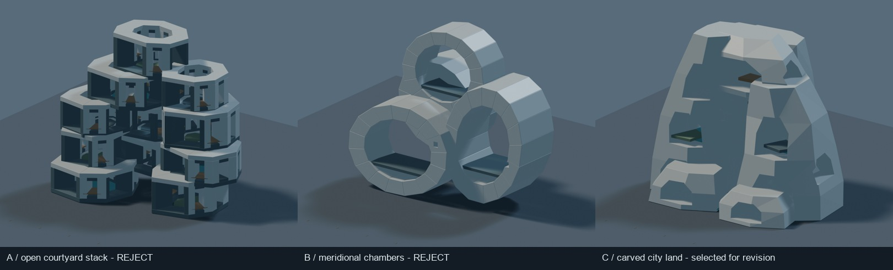
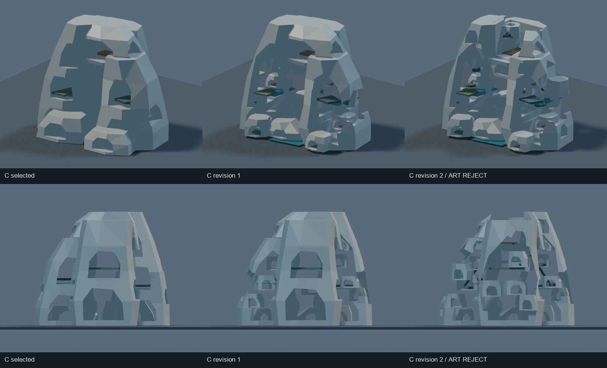
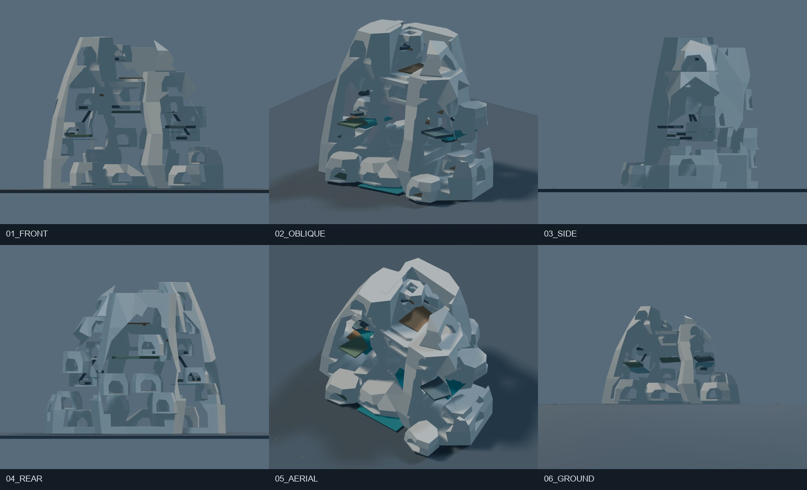
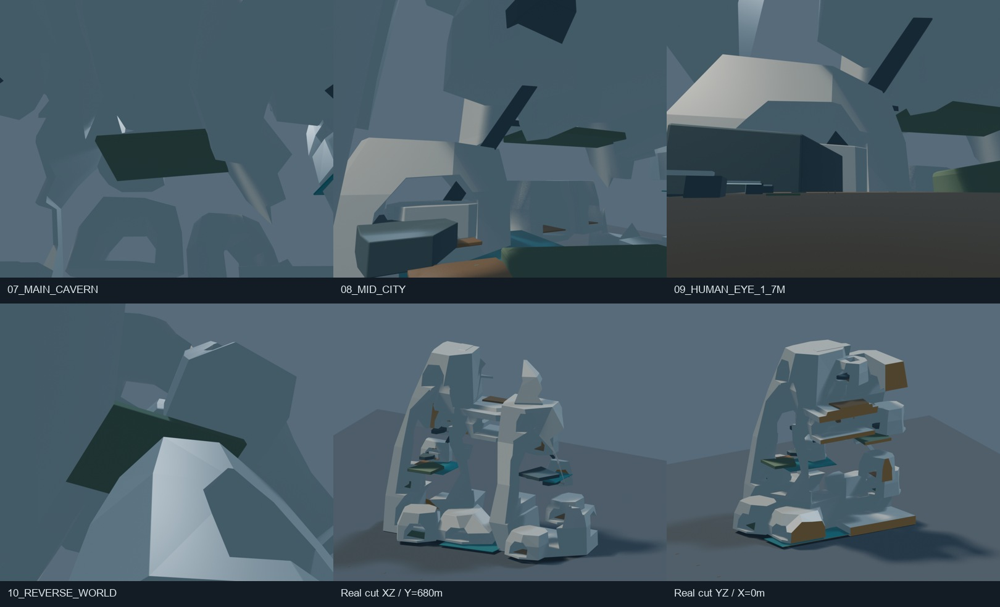

# J7-R13 — 実Blender居住質量・巨大空洞研究

2026-10-25 JST。**研究自己評価：ART REJECT。正式中央美術採択0件、Minecraft施工HOLD、10km都市マスター未完成。**

実Blender制作、A/Bの比較、第三案Cへの集中、2回の主形状修正、実切断2方向、内部・人間視点、BLEND/GLB読戻しを実施した。しかし最上位目標の「人が都市の中にいると感じられる、独創的な超未来文明建築」には達していない。技術的に保存できたことと美術の成功を分ける。

## 引継ぎ・保護

- 作業前に LOCAL_WORK_RULES.md、SETUP_STATUS.txt を読んだ。セットアップ報告は現在の研究ブランチには存在しないため、保存されている integration/local-work-m121-setup-20261014 の docs/LOCAL_WORK_SETUP_20261014_JA.md を読んだ。
- GitHub PR #44を接続機能で取得し、Draft/open/unmerged、最新R12 HEAD **f8af02a57c3370ed3d5c38b1496757d6a913b0b4** を確認。Gitでも同じR12を取得し、その履歴からR13専用ブランチを作成。
- mainを明示取得し、HEAD **a2f88995eee8d10ee4830dbdf33ccb9c0790de8f** の START_HERE、PROJECT_CONSTITUTION、CITY_MASTER_3D_STANDARD、AGENTS、CURRENT_STATUS、DECISION_LOG を確認。CURRENT_STATUS本文に残る2026-10-23の研究進捗を最新R12状態と混同していない。
- R11_ART_REVIEW、R12_REAL_GLB_ART_DIAGNOSTIC、R12_HABITABLE_VOLUME_ART_METHOD、J7R12_WORK_GATE、latest.jsonを読んだ。
- 今回のユーザー明示指示により、ローカルBlender制作、新しい研究ブランチのpush、新しい独立Draft PR作成を実行対象とした。main、既存Draft PR、正式研究方向は変更しない。
- 既存の未追跡 research/ を保持。archives、handoff/M121、research/m121/upstreamに生成・描画・編集を行っていない。実Minecraftセーブへのアクセスなし。Freeze、正式座標・保護形状、M247-C、W0/H/SB/HERO4/三軸/Vの義務は変更なし。
- 研究モデルは独立メートル座標。中立地面はW0ではない。認証済み共通アンカーを確定していないため、公式都市に接合したとは主張しない。

## 実制作環境

既存の **Blender 5.2.1 LTS**、Python/bpy、EEVEE、GLB出力を確認。MCPのバージョン照会はハンドシェイク失敗を返した一方、シーン情報とPython編集は動作した。最初のGUIは未保存のCube/Camera/Lightのみで、原本を開いていなかった。

Computer UseでBlenderの実画面を直接確認。初期モデルと修正版をMCP経由で実GUIへ開き、主質量の切削・地区の置換を実行した。保存後の再現・トポロジー修復・多方向描画には独立バックグラウンドBlenderを併用した。手動スカルプトやGUI編集モードによる造形を行ったとは主張しない。

切削方向とBoolean処理順の不具合を実画像で検出し、失敗出力は別フォルダでローカル保持。最終版は外向き面・三角形化・接続修復を施し、「差分切削で元形状の境界が拡大しない」検査を追加して再制作した。またGLB初回出力が面取り修飾子を含まないことを読戻しで検出し、評価済み形状で再出力した。最終QAは修復後のバイナリに対する結果である。詳細は qa/TECHNICAL_REPAIRS.json。

## 初期二方向と集中対象

| 案 | 実3Dの空間原理 | 実画像の判断 |
|---|---|---|
| A | 水平に開く大中庭と厚い周縁の地区を、異なる高さで連ねる。地区の内側に別の空がある。 | 八角形の中庭付きブロックの反復に見える。側面は巨大な積み木で、数kmの文明都市として弱い。REJECT。 |
| B | 縦向きの大きな空を抱く4つの子午面型都市胞を交差させる。Aの上向き中庭とは空間の向きが異なる。 | 巨大な筒・輪の集合。側面は幅の薄い無地の板に縮退し、都市胞内部も十分に都市化されていない。REJECT。 |
| C | 厚い非対称の都市地形を、縦横の公共空洞と数百mの内部地区が削り出す。空洞同士を後の修正で統合できる構成。 | 無地の岩壁・巨大アーチへの縮退があるが、A/Bより内外空間の連続を作り直す余地がある。集中修正対象として選択。選択は美術採択ではない。 |

A/Bの両方が弱かったため、形式的にどちらかを勝者にせずCを粗く追加した。過去R11のメッシュを拡大・変形して始めていない。初期案に大量の窓・住宅を追加していない。

## 主形状の2回の修正

**修正1**：西側の分離洞室を高さ約2.7kmにわたる不規則な連続峡谷へ切り開いた。東側も別の傾斜空間へ統合し、前後3つの都市地形を横断する公共空間を開いた。前面の無地の低い地形2体を撤去し、300〜1000m級の実際の内部街路空間を持つ地区へ置換した。窓や照明の変更ではなく、主質量と空洞の連結関係の変更である。

修正1の実画像では、内部地区が見えるようになった反面、背面に大きな閉鎖面、上部に無地の蓋、側面に一様な厚壁が残った。小さな洞室が同じ六角形の入口へ反復され、都市というより穴を開けた彫刻にも見えた。

**修正2**：天頂に約1.5km幅の切込みを作って上空への連続を変更。背面の厚い都市地形を高さ約3kmの別の大空間へ切り開き、東側面にも大きな横向きの開口を作った。背面・天頂に新たな内部地区を組み込み、中央には厚さ800mの中空の共用都市体を配置して上下の空間関係を変えた。複数地区の屋根にも本物の採光井を貫通させた。

さらに内部の100〜500m級共用地形と少数の接続体、実寸の人間視点の共用床を作った。人間尺度の部分は全体の生活密度を達成した証拠ではなく、局所のスケール確認である。

## 最終実画像の美術審査

| 視点 | 確認した改善 | 残った問題・判定 |
|---|---|---|
| 正面・斜視 | 独立洞室から連続する内外空間へ変化し、異なる高度の内部地区が露出した。 | 巨大な外縁アーチ・岩状の面が依然主役。神聖な文明都市としての独創性と中間スケールの密度が不足。REJECT。 |
| 側面 | 閉じた面を大きく開き、厚さ方向の空間が見える。 | 地区・外郭の接合が粗く、形の残片や不自然な浮遊に見える部分がある。REJECT。 |
| 背面 | 大空洞と背面地区を設け、無地の背面を改善。 | 同型の穴と塊が反復し、独立した生活世界の性格が十分に異ならない。REJECT。 |
| 俯瞰 | 天頂の閉じた蓋を開き、上方から内部が読める。 | 頂部は建築都市というより切断された地形。屋上・内側の生活地盤は未設計部分が多い。REJECT。 |
| 地上 | 数kmの上下関係と大開口が見える。 | 寸法に対し模型感が残る。接近体験・基部の都市連続性が弱い。REJECT。 |
| 巨大空洞内部・中高度 | 実メッシュの周壁、上部の建築、別高度の地盤が存在する。 | 広い無地面と浮いた床の印象が強い。用途の異なる地区は研究上の配置に留まり、生活・交通・都市公共空間として成立していない。REJECT。 |
| 1.7m近景 | 同じモデル内部の床上1.7mから撮影し、実寸の人型・閾・手すりがある。 | 人型が極端に小さく、巨大な抽象空間と日常の間が埋まっていない。小物追加で解決したとは扱わない。REJECT。 |

広域5方向は正投影幅8100m、全段階で同位置・同目標・同照明・1200×1000。地上は同位置・視高1.7m・20mm透視で、正投影の一定縮尺とは区別する。43枚のモデル・断面PNGとGLB再インポート確認1枚を作成。比較画像は縮小・配列・ラベルのみ。画像生成・建築補完・合成による美術修整は使用していない。

## R11の巨大部材偏重はどこまで改善したか

R12と同様に、各メッシュの最大世界寸法で分類した三角形面積を補助指標として計測した。最終値は **1.5km以上67.66%、500〜1500m 30.24%、100〜500m 2.11%**。C選択初回の1.5km以上95.06%からは低下した。R11修正版の88.58%より数値は小さい。

しかし、メッシュの分け方と造形形式が異なり、これを直接の美術改善率や居住体積へ置換してはいけない。実際、今回Aは1.5km以上0%でも積み木に見え、美術不合格だった。最終Cも外郭が主役であり、**巨大部材偏重は部分的な緩和に留まり、根本克服とは評価しない**。

## 巨大空洞の実在と検証範囲

- sections/ に同一R2の評価済みメッシュからBMeshで切断した **XZ方向（Y=680m）とYZ方向（X=0m）** の別BLEND/GLBを保存。画像だけの断面や透明化ではない。切断縁に実際のキャップ面を張り、黄土色を付けた。元R2のSHA256と各オブジェクトの切断前後頂点数を記録。
- 断面と内部画像は、開口が本当の立体形状であり、周囲に厚い建築と複数高度の別地区があることを示す。ただし空洞のすべてが閉鎖空間というわけではなく、上空・外部に連なる部分もある。
- 内部表面レイを記録。中高度視点では上方約268m、下方810m、東方約2589.5mに実表面が存在。1.7mカメラの直下は Human common floor、距離 **1.699951m**。
- これらは少数の表面測定であり、全空洞の体積・連結クリアランス・全経路の歩行可能性・居住可能面積は**未検証**。名目的な地区用途や無交差のメッシュだけで居住可能性を認証していない。

## 実寸・保存検証

建築コレクションの評価済み全頂点を世界座標で計測。地面・照明・カメラは除外。内部地盤・接続体・人型は含む。単位1m。

| 実モデル | 幅X × 奥行Y × 高さZ（km） | メッシュ / 三角形 |
|---|---|---|
| A | 5.304 × 3.498 × 4.480 | 532 / 58,416 |
| B | 5.600 × 2.710 × 4.661 | 68 / 7,734 |
| C選択初回 | 5.430 × 4.269 × 4.560 | 13 / 9,484 |
| 修正1 | 5.430 × 4.170 × 4.560 | 32 / 18,316 |
| 修正2 | **5.430 × 4.204 × 4.560** | **111 / 34,806** |

5段階と断面2体の、計7組の保存BLENDを実Blenderで再読込し、それぞれのGLBを空シーンへ実インポートした。すべてで境界差0m、三角形数一致、有限頂点を確認。検査した各独立ソリッドの非多様体辺0。ただし別ソリッド同士の交差・支持・建築的整合を保証しない。

最終GLBを元と同じ照明・カメラ環境へ独立に読み込み描画し、BLEND画像との平均絶対RGB差は各チャンネル **0.000015未満（0〜255）**。GLBが省略した修飾子を含む、同じ見た目の実形状であることを確認した。ハッシュと厳密値は qa/BLEND_GLB_READBACK.json、MODEL_IMAGE_MANIFEST.json、OFFLINE_EVIDENCE_QA.json。

## 再開・再現・次工程

最終編集可能原本：revision_2/R13_C_R2.blend。補助ソースは build_r13.py、sculpt_c.py、revise_r13.py。再現時は独立R13フォルダだけを出力対象とする。exploration_A/B/C、selected、revision_1/2、sectionsは失敗を含む保存成果であり、既存成果を上書きせず別作業コピーで実行する。

オフライン確認は Python の **-B -X utf8** 付きで package_review.py を実行。Blenderのスクリプトでもキャッシュ書込を抑止する。verify_r13.pyは保存ファイルを読む検査で、実ワールドを読まない。

**J7-R14の最優先**は、この外郭を装飾して延命することではない。300〜1000mの一地区において、厚い居住質量・共有空間・複数高度の地盤・入口・上下移動を一体で造形し、人間視点と地区全景の双方で「生活世界」と読める密度を得る。その地区の内外関係が数kmの主形状を構成するよう再設計する。今回のような同型の六角開口、薄い外縁、無地の岩面を反復しない。

GitHub納品の実HEAD・Draft PR・再取得結果は R13_HANDOFF.json と qa/GITHUB_READBACK.json に分離する。本文の美術不合格は、納品・技術QAの成否で変更しない。

**ART REJECT。研究記録として保存。正式採択なし、Minecraft施工HOLD。**
