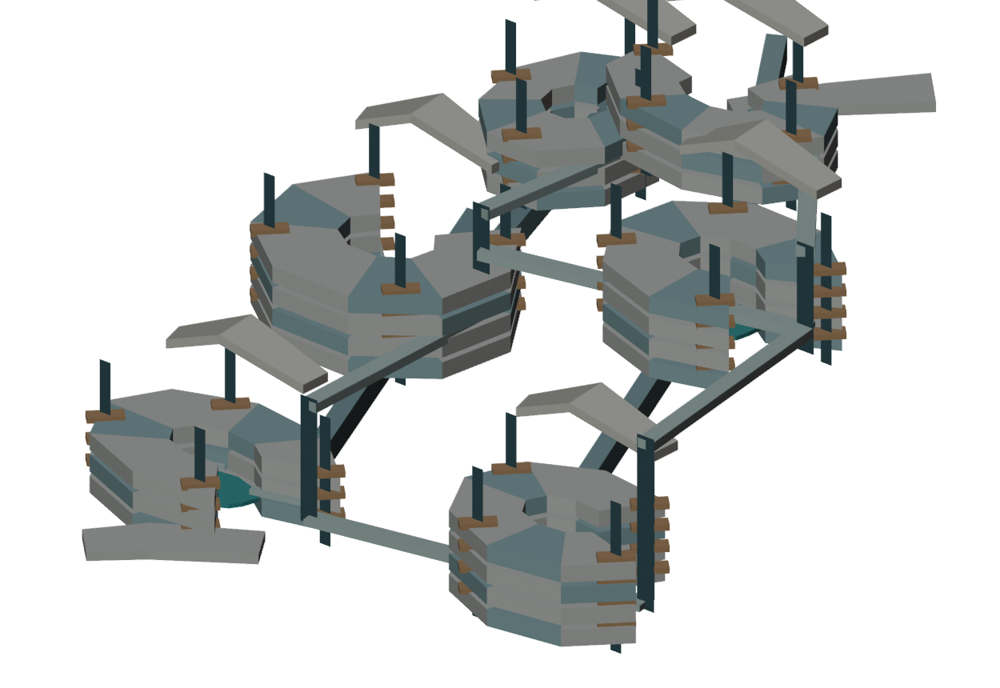
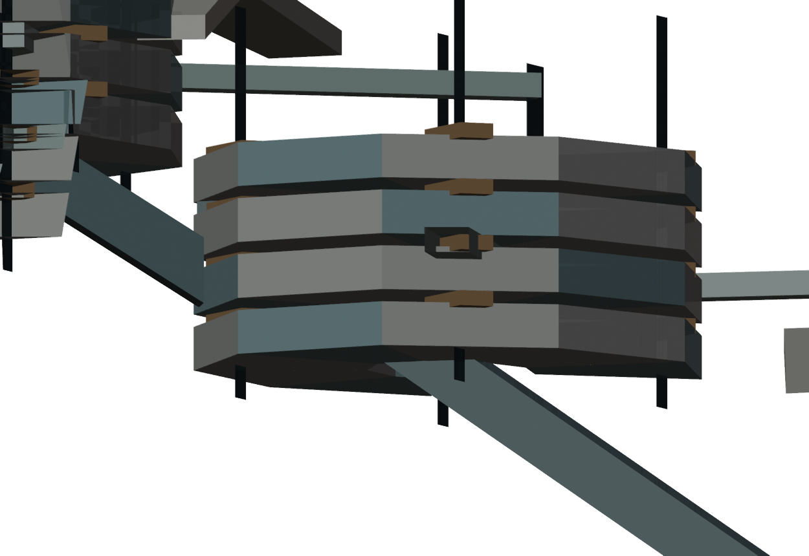
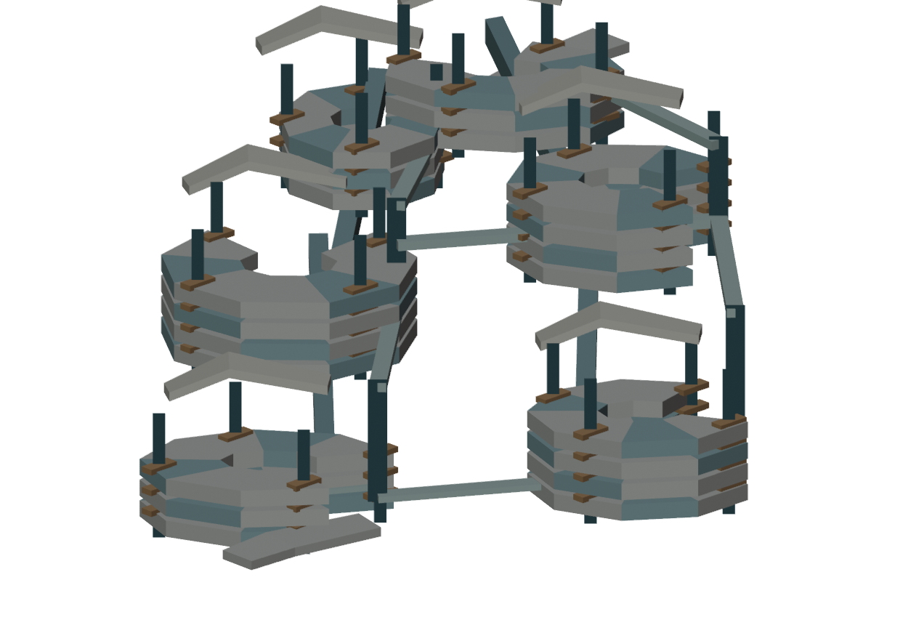

# J7-R14 — 実Blender「立体居住地区」試作の美術審査

2026-10-25 JST。独立研究／Art REJECT／中央正式採択0／Minecraft施工HOLD／CITY MASTER 3D FIRST維持。

## 基準

本工程はR13の外殻Cを装飾せず、300〜1000m級の居住空間を先に組み、都市級の空洞・高低差・移動路と結びつける試行。Blenderの実3D出力と同一シーンレンダーを保存する。ユーザーPCの前面操作を占有するComputer Useは**一切使用していない**。環境はGitHub ActionsのBlender4.0.2。

## 実制作（初回、次のカメラ修正は別ラン）

- 新規スクリプト `build_lived_world_blender.py` から実モデルを生成。過去R13のBLENDや不合格シルエットを改造したものではない。
- 6つの地区をZおよそ60〜515mの異なる高度へ仮配置し、複数層の居住地盤・中央に開いた公共庭／内部通路・上部ランドマークを作成。
- 地区間に7本の設計グラフ上のリンクを配置。高さ差の小さい関係では公共路面、大きい箇所では架空の上下移動部材と連絡デッキを表示。これは実移動可能なリフトや完全な橋とは異なる。
- 実メッシュ：**316、頂点2,644、三角形4,024**。研究AABBは約**1.122×1.495×0.732km**。実BLEND 173,034 bytes、GLB 376,020 bytes。
- GLBを別のBlenderシーンへ再インポートして316メッシュが戻ることを検査。実レンダーは8枚、うち広域正面・斜視・側面・背面・俯瞰、公共空洞近景、地区近景、人間近景。
- 技術初回PASS：[GitHub Actions #40154645603](https://github.com/ryomashibaba/celestial-halo-9/actions/runs/40154645603)。別の初回失敗[#40154397868](https://github.com/ryomashibaba/celestial-halo-9/actions/runs/40154397868)は、空フォルダをCIが事前作成したのにPython側が`exist_ok=False`で失敗したもの。再実行で修正。

## 本物の画像を観察した美術判定

**美術：ART REJECT**。

良い点：
- 6地区が一つの座標系へ配置され、最低限、複数高度の公開床・中央の開いた空間・地区間の高架体が実モデルにある。
- スケール情報と工程を、原本が編集可能なBLEND/GLBと8画像で追跡できる。
- R13の巨石外殻をそのまま継承せず、部分都市のつながりをテストしたことは意味がある。

根本問題：
1. **ほぼ同じ多角形・円形の地区が6つ繰り返される**。R13の同形開口からの美術上の離脱ができていない。
2. 個々の地区は**丸い層状の模型**に見え、居住・公共・自然などの異なる生活世界として認識しにくい。
3. 地区間の連絡は**平板な梁・垂直棒**で、空洞の立体空間体験や都市交通になっていない。
4. 壁・床・建物内部に十分な都市の密度・機能が存在しない。近景も繰り返しの板・棚に見える。
5. これは中央HALO-9の主役となる数km級一体文明建築ではなく、あくまで局所配置のラフスタディである。
6. 広い白背景が「都市の空洞」として見えるが、**立体的に囲まれた公共空洞の体積や内部形態を保証するものではない**。
7. 初回の`08_HUMAN_SCALE`は人間の目の高さ1.7mが保証されず、根拠として不合格だった。修正版は実床上1.7mのレイキャスト検査を追加してから採用する。**最終実行結果の検証前に成功と主張しない**。

## 結果の意味

今回の実3Dは、R13の美術失敗を修正した最終案ではない。むしろ**汎用アルゴリズムで6地区を同時生成すると、同じ形の地区が生まれてしまう**という明確な失敗を画像で確認できた。

この結果は「既存Pythonによる一括生成」を延長することが美術効率上の解決にならないという強い追加根拠である。次の制作で地区ごとの空間哲学を本当に別々にし、画像を見て主造形そのものを作り直す必要がある。

## 次の主役は再び「居住可能な世界」の美術

**R15では、今回の6つの同型円形地区を詳細化しない。** 3D内に存在する一つの巨大空間を、外装・中高度の地区・公共通路・人間尺度の世界から同時に設計する。使用中のBlenderをMCP/別Blenderプロセスで扱う**非占有方式を標準**とする。あらかじめ明確に許可がないComputer Useの前面マウス・キーボード操作は禁止。

**R15はローカルWork集中造形として進める予定であることを、R14時点で事前宣言する。** ユーザーの次の継続指示に対し、ローカルWorkに貼り付けられる実行プロンプトを提示する。ChatからWork選択画面は出さない。

## 正式ルール

R14は研究のみ。main／M247-C／W0／H1〜H6／SB01〜SB16/HERO4／都市アンカー／Freeze／既存研究原本は不変。公式Minecraftワールドの操作もない。CITY MASTER 3D FIRST継続。正式美術採択0件、施工HOLD。
