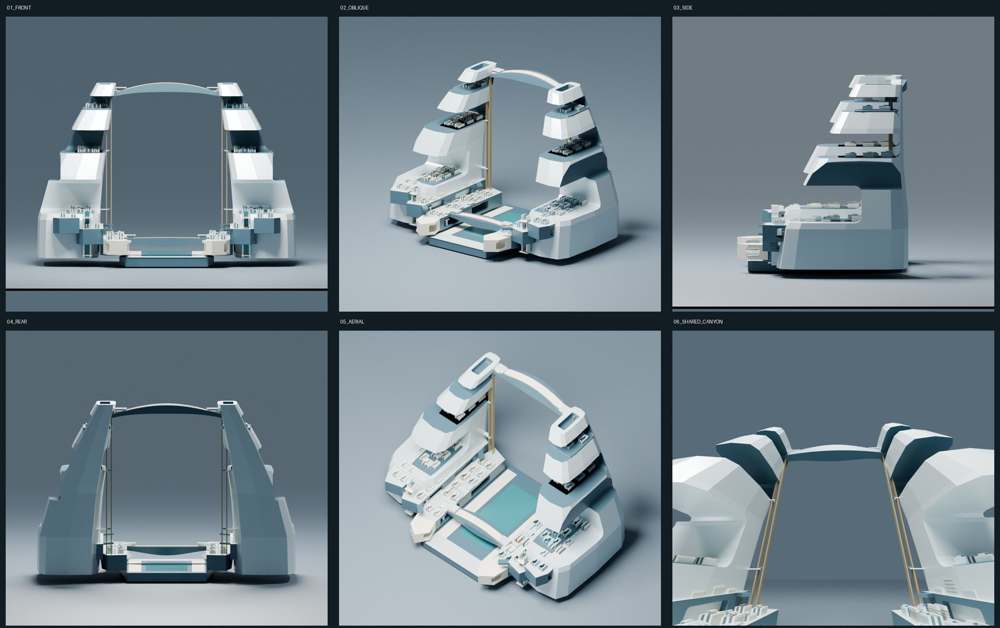
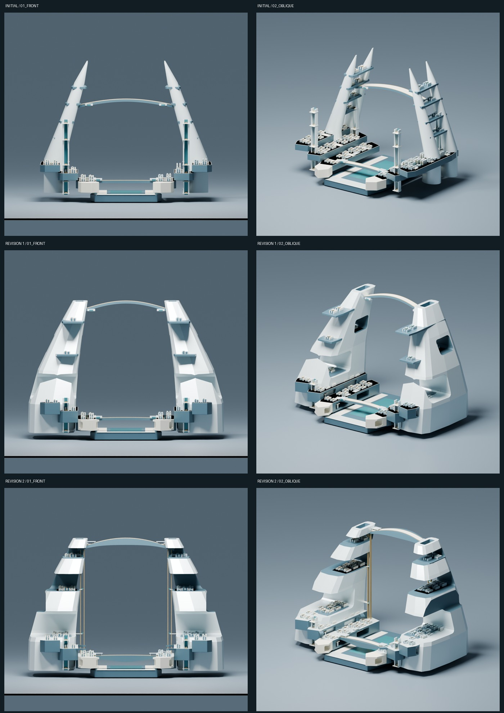
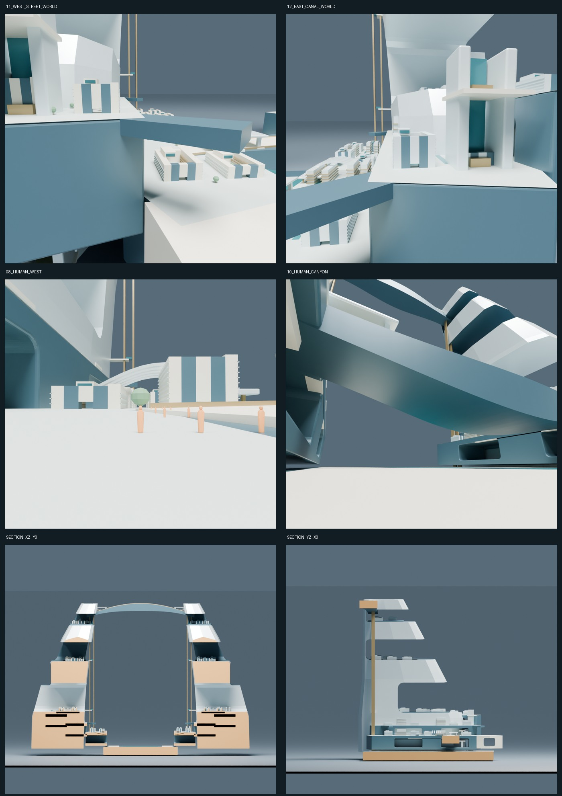

# J7-R15 — 双岸光峡《TWIN LIT CANYON》

2026-10-25 JST。独立研究。**最終自己判定 ART REJECT**。技術保存QAの合格と、美術の不合格を分ける。正式中央美術採択0件、Minecraft正式施工HOLD、CITY MASTER 3D FIRST維持。

## 出発点と作業境界

作業開始時にGitHubを再照会。R14最新HEADは `81cdbc878300f7a5a7e3b2309f90b395213bf604`。依頼に記された `22b6a00` の後に実モデル・画像保存コミットが加わっていた。mainは `a2f88995eee8d10ee4830dbdf33ccb9c0790de8f`。mainの正式方針4文書、CURRENT_STATUS・DECISION_LOG、R13/R14引継ぎ、latest.jsonを確認。正確な版・ハッシュは `qa/STARTUP_PROVENANCE.json`。

R14の最新QAでは実床上1.7mレイは成功していた。報告書の「再確認中」は古い記述として区別した。R14の美術REJECTは変わらない。

新規ブランチ `research/m3d1s-j7-r15-symmetric-lived-world-20261025` は最新R14から分岐。変更対象をR15フォルダへ限定。Blender 5.2.1 LTSの別バックグラウンドプロセス、bpy、Cycles実レンダーを使用。前面GUI・Computer Use・ユーザーのマウス／キーボード操作は使用していない。ライブBlenderシーンも変更しない。レンダー8スレッド、独立検証は4スレッド。

main、Freeze、M247-C、W0、H1〜H6、SB01〜SB16、HERO4、三大軸、V1〜V3、既存研究原本は変更していない。これらの都市義務は維持するが、本研究に配置・詳細実装済みとは主張しない。実Minecraft保存先は読んでいない。研究座標はメートル単位の仮座標で、正式アンカー未接合。10kmマスターは未完成。

## 採用した対称性と、美術判断

X=0の中央軸を挟んで、左右の居住断崖が同じ上昇角・地盤高度・公共空洞の階層を持つ**鏡映骨格**を採用した。中央の約840mの下部間隔、左右の厚い足元、上部の公共横断層と低層の公共大路が、正面で一つの大きな空白を囲む。上下は同形コピーではなく、低い水平な公共水盤と高い湾曲する公共層の応答関係とした。

美しさの根拠として狙ったのは、中心に物を積む代わりに空間を主役にすること、左右の傾斜を揃えて静けさと方向性をつくること、下部の重さと上部の軽さを対比すること。正面で軸と序列は読める。**ただし、これを最終的に美しい超未来文明建築へ到達したという判定にはしていない。** 大きな斜壁・段状の口・細い横断体としての単純さが残る。

変奏は、西岸の中庭住宅・並木の街路と、東岸の水路・対の縦庭建築に置いた。高さ22〜50m級を中心とする中層建築、入口の実開口、中庭、奥行きのある公共地下廊を設けた。骨格の対称性を崩すのではなく、生活内容を変える意図。ただし遠景で地区の違いは弱く、中庭建築の反復も残る。追加中景でも水路や並木の存在が主役になるほど読めず、地区性格の視覚化は未達。

## 生活世界の実体

左右を2大生活世界とし、それぞれ240／355／470m高度の3段の地盤を持たせた。各段に約230×930mの生活コアを配置し、広い公共空間、建築群、街路の前後関係を設計した。これは6個の独立した同型円形地区を並べた構成ではないが、**3段の似た基壇が左右で繰り返される弱点は残った**。下部の全地盤長は約1355mであり、「全体が1000m以下」とはしていない。

510／1130／1590mの公共空洞床にも中庭街区を置き、上部の街路を断崖内へ引き込んだ。切り抜いた大空洞には実際の床・側壁・天井がある。共有の中央峡谷は前後・上空へ開く半屋外空間であり、密閉された巨大ホールや連続空洞体積を認証したものではない。

低層・上層の横断部は到着地盤、開いた公共上屋、変断面の深い船体状質量を持つ。上下移動核にはシャフトの形状・停止階床・キャビンの研究形状を置いた。**動作する昇降機、全階の到達性、避難・無段差・経路全域の衝突は未認証**。実形状があることと、住める都市の完成は異なる。

## 実画像を見て行った主形状修正

1. **修正1**：初期画像の細い尖塔・宙に浮く棚を不合格と判断。尖塔4本を2つの幅広い連続居住断崖へ置換。165m厚の地盤に公共地下廊の実空洞を切削し、前端の中実塊を開いた公共ポルティコへ変更。上部横断層を1250mから1700mへ上げ、中央空間の縦比率を強めた。
2. **修正2**：修正1では正面の公共空洞が無地の壁に隠れたため、低・中・上層の切り込みを正面まで開く。上層床を断崖内側へ段階的に後退させ、棚の突出を抑制。上部横断層をY=570mへ後退。峡谷際へ段状の受け地形と市場の公共天蓋を追加。横断体を一定厚の梁から、中央が広く深い公共船体へ変更し、到着部を実際に開いた上屋へ改めた。

修正2の途中画像で残った棚と床面の不具合も観察し、同段階内で再修正した。途中結果は `revision_2/observed_before_refinement/`、その時点のソースは `qa/BUILD_SOURCE_BEFORE_R2_REFINEMENT.txt` に保存。色・材質だけの変更を主形状修正の回数へ算入していない。

## 人間視点と実断面

最終モデルを別プロセスで開き直し、実メッシュへレイキャストした。

- 西岸：実歩行地盤Z=240.059998m、カメラZ=241.759995m、距離 **1.699996945m**。
- 峡谷：実歩廊Z=62.000000m、カメラZ=63.700001m、距離 **1.700000732m**。
- 視点直下と10m上方からの2本のレイが同じ上向き床面へ当たることも確認。途中の峡谷カメラは南広場床に埋まっていたためY=-650→-620mへ移し、再描画。初期の単独レイ成功を合格根拠へ流用していない。西岸は床の同一面重複を6cmの舗装厚で解消した。

人間視点では、中層住宅の入口、中庭へ向かう街路、人型に対する建築高さ、公共天蓋と巨大断崖の共存が見える。一方、広すぎる無地の路面、単純な住宅外観、都市活動と目的地の弱さが残り、「実際に住まれる場所」の説得力は不足。人型や並木を追加したことを生活世界の完成とはしていない。

XZ（Y=0）とYZ（X=0）の2方向をBMeshで実切断し、境界に実キャップを張った別BLEND／GLBを保存。画像だけのクリップや透過ではない。黄土色は切断面。正側半分を保持。ただし**XZ断面には非多様体辺88本が残る**。YZ断面と未切断の最終モデルは0本。XZを完全に閉じたソリッド断面や体積計測用モデルとしては扱わない。元BLENDのSHA256と切断数は `qa/ACTUAL_SECTIONS.json`。補助の地区中景2枚は保存原本を読み、姿勢だけを変えて描画。姿勢は `qa/ADDITIONAL_CAMERA_POSES.json` に記録した。

## 実寸と技術QA

建築コレクションの世界座標全頂点から計測。スタジオ地面・光源・カメラは除外。人型・植栽・接続部は含む。最終寸法は **2740.000 × 1699.854 × 1884.000m**。

| 保存モデル | 幅X × 奥行Y × 高さZ（m） | メッシュ / 三角形 | GLB境界差最大 |
|---|---|---|---|
| R15_CONCEPT | 2400.000 × 1646.838 × 1910.000 | 3,537 / 64,496 | 0.000000m |
| R15_REVISION_1 | 2740.000 × 1699.854 × 1884.000 | 3,761 / 74,276 | 0.000000m |
| R15_OPEN_CLEFT_ATTEMPT | 2740.000 × 1699.854 × 1884.000 | 5,355 / 96,198 | 0.000000m |
| R15_FINAL | 2740.000 × 1699.854 × 1884.000 | 4,708 / 86,478 | 0.000000m |
| SECTION_XZ_Y0 | 2740.000 × 745.000 × 1884.000 | 2,929 / 45,976 | 0.000000m |
| SECTION_YZ_X0 | 1370.000 × 1699.854 × 1884.000 | 2,134 / 36,886 | 0.000000m |

以上6組を実Blenderで保存原本から再読込し、各GLBを空シーンへ実インポート。境界差2cm未満・三角形数一致・有限頂点をすべて確認。個別ソリッドの非多様体辺は最終モデルで0。この検査はソリッド間の重なり、支持、空洞体積、全経路の安全性を保証しない。

GLBだけから読み込んだ建築へ、原本のスタジオ・カメラ・照明だけを加えて独立再レンダーした（`qa/GLB_REIMPORT_OBLIQUE.png`）。色差の実値は `qa/GLB_NATIVE_IMAGE_COMPARISON.json`。画像を描き足したり、生成画像で建築を補完したりしていない。

最終の12視点＋実断面2方向は1200×1100の実レンダー。GLB独立画像も別に保存。コンタクトシートは縮小・配置・英語ラベルのみ。`python -B -X utf8 studies/M3D-1S/J7/R15/package_review.py` でオフライン検証、PNG読込、ハッシュmanifestを作成する。生成器は既存成果を上書きし得るため、再制作はR15をコピーした独立作業先で行う。

## 最終美術判定と次工程

**ART REJECT（研究自己評価）。正式採択なし。**

対称軸、中央の空間、左右の上昇性は明快になった。保存・実寸・再読込は成立した。しかし、巨大小口と広い斜壁、下部基壇、同型の中庭群の印象がなお強い。近景の生活内容が主質量を十分につくっておらず、独自の超未来文明の威厳と300〜1000m生活世界が同じ強さで成立したとは判断しない。接続も前より厚みを持ったが、遠景では細い横断部に見える。8成功基準のうち技術保存と対称の可読性は満たすが、美術・生活・接続の説得力は未達である。

次工程の最優先は、左右骨格の装飾ではなく、**一方の500〜900mの地区で、公共室・街路・斜面地盤・昇降到着部・中層街区が一続きの空間になるよう主要質量を再構成すること**。中景と1.7m視点を先に評価し、それが都市級対称構図を生むよう外形へ戻す。単純な大断崖へ住宅アイコンを載せる方式を延長しない。R15の形状は採用前提にしない。

編集可能原本：[BLEND](revision_2/R15_FINAL.blend) ／ [GLB](revision_2/R15_FINAL.glb)。技術証拠は `qa/BLEND_GLB_READBACK.json`、床証拠は `revision_2/BUILD_EVIDENCE.json`。新規Draft PRと固定成果コミットは納品追記を参照。

## GitHub納品記録

新規[Draft PR #47](https://github.com/ryomashibaba/celestial-halo-9/pull/47)。baseはR14、既存PR #44／#45／#46は編集していない。成果固定コミットは `96ba4880ce28317b2d7fcb618d3f9cfeab304d00`。納品メタデータはその後のコミットで追加するため、最終ブランチHEADはPRのheadを参照する。

固定成果：[BLEND](https://github.com/ryomashibaba/celestial-halo-9/blob/96ba4880ce28317b2d7fcb618d3f9cfeab304d00/studies/M3D-1S/J7/R15/revision_2/R15_FINAL.blend) ／ [GLB](https://github.com/ryomashibaba/celestial-halo-9/blob/96ba4880ce28317b2d7fcb618d3f9cfeab304d00/studies/M3D-1S/J7/R15/revision_2/R15_FINAL.glb) ／ [広域比較](https://github.com/ryomashibaba/celestial-halo-9/blob/96ba4880ce28317b2d7fcb618d3f9cfeab304d00/studies/M3D-1S/J7/R15/qa/R15_MACRO_VIEWS.jpg) ／ [主形状修正比較](https://github.com/ryomashibaba/celestial-halo-9/blob/96ba4880ce28317b2d7fcb618d3f9cfeab304d00/studies/M3D-1S/J7/R15/qa/R15_MAIN_FORM_REVISIONS.jpg) ／ [人間視点と実断面](https://github.com/ryomashibaba/celestial-halo-9/blob/96ba4880ce28317b2d7fcb618d3f9cfeab304d00/studies/M3D-1S/J7/R15/qa/R15_SPATIAL_EVIDENCE.jpg)。

GitHubの固定コミットから独立HTTPSで **45ファイル・82,453,298 bytes** を再取得し、サイズとSHA256がすべて一致。記録は `qa/GITHUB_READBACK.json`。これは保存と受渡しの確認であり、美術の不合格を変更しない。
