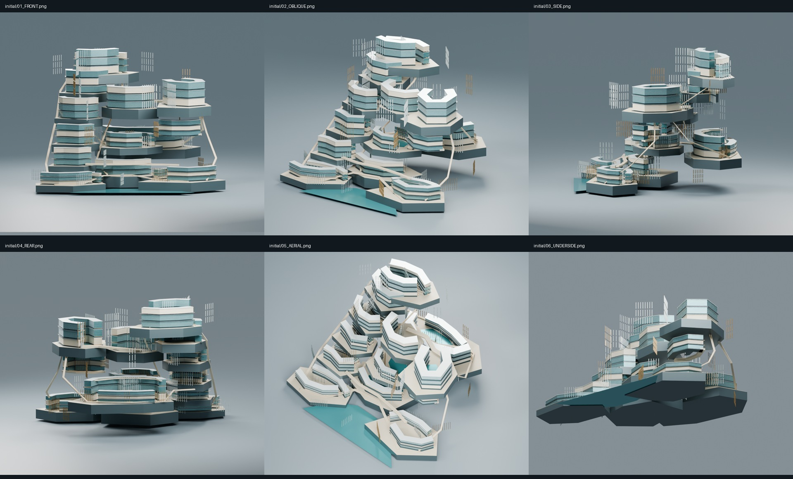
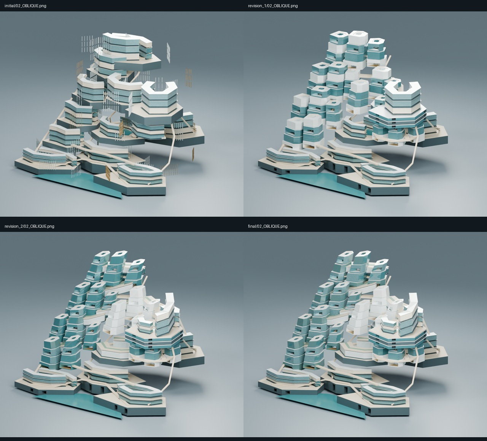
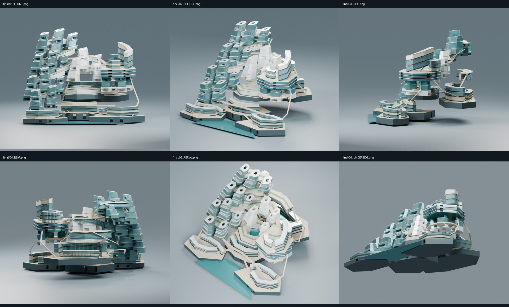
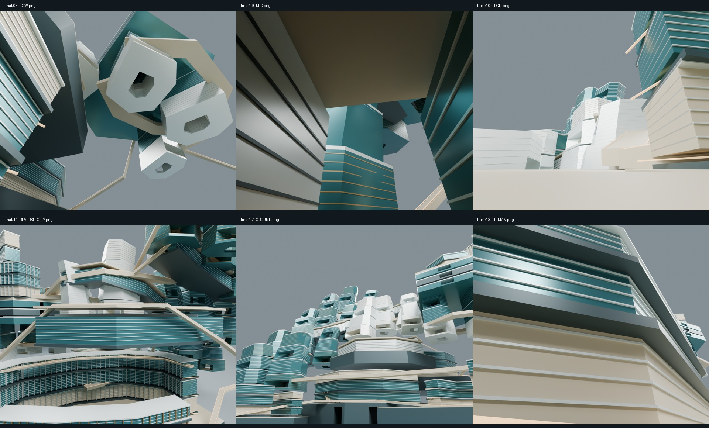
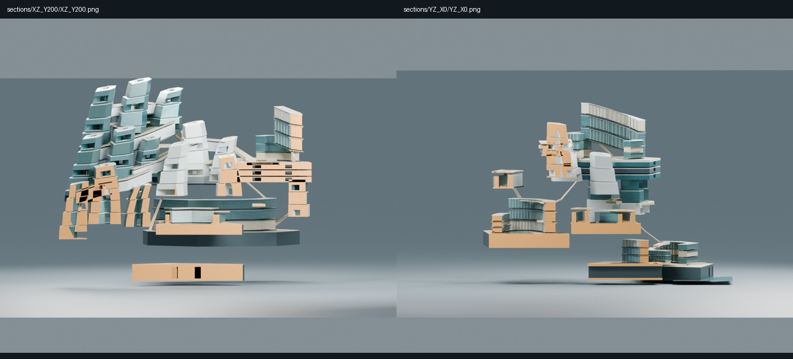
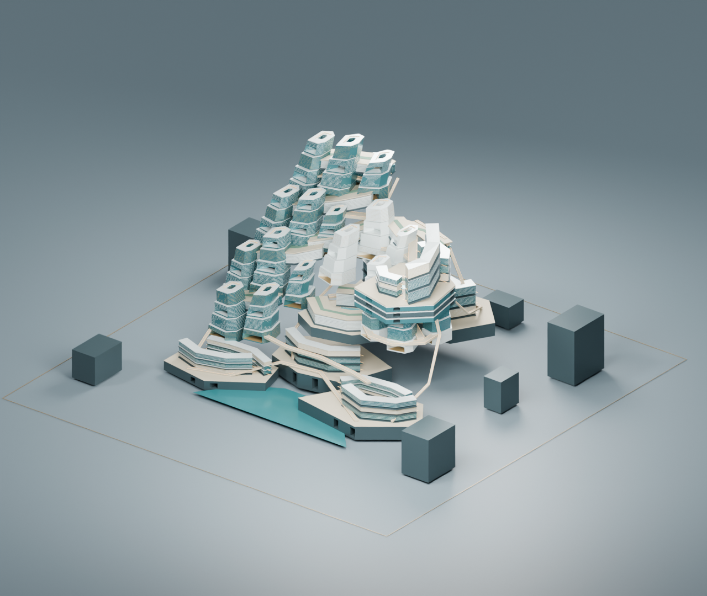

# J7-R19《天環地脈 / LIVING HORIZON》実Blender研究

2026-10-25 JST。**研究自己評価：ART REJECT。中央全体の美術目標は未達。**

実際の編集可能なBLEND、GLB、初期6方向、主形状の置換、修正前後画像、内部・背面・下面・実断面を制作した。しかし、最終も同種の都市断面と水平帯の集合が支配し、「文明全体が一つの中央巨大建築になる」段階には到達していない。技術保存の成功を美術合格に置き換えない。正式中央美術採択0、Minecraft施工HOLD、10km詳細CITY MASTER未完成。

## 1. 最新状態の復元と制作範囲

GitHubのPR #50を照会し、Draft/open/unmerged、R18先端 `dcbe2b3bdb19b1b7c500aab6b3c1ceddd0fb8bca` を確認して取得。mainの実取得HEADは `a2f88995eee8d10ee4830dbdf33ccb9c0790de8f`。main明示refでAGENTS、START_HERE、憲章、CITY_MASTER_3D_STANDARD、CURRENT_STATUSを読み、R18のlatest・美術方針・制作ゲートとR17審査・引継ぎを確認した。CURRENT_STATUS内の古い進捗を最新実績と扱っていない。証跡は [STARTUP_PROVENANCE](qa/STARTUP_PROVENANCE.json)。

SETUP_STATUS.txtは10月14日の古い状態で、実checkoutはR17だった。指定された旧セットアップ報告は現checkoutに存在せず、読了したとは主張しない。未追跡research/は保存・納品対象外。R18から独立した `research/m3d1s-j7-r19-living-horizon-blender-20261025` で作業した。今回の明示依頼によるローカル制作・新規研究ブランチ保存・新規Draft PRに限定する。

R15/R17のBLEND・GLB・主形状・寸法は取り込んでいない。原本は閲覧・比較のみ。新規形状はR19内で制作。main、既存PR、Freeze、M247-C、正式都市計画、既存モデル、archives/handoff/upstream、実Minecraft saveは変更していない。

## 2. 実際に造形した都市世界とその関係

| 都市世界 | 実3Dにしたもの | 残る限界 |
|---|---|---|
| 底界・河口都市陸 | 3本の厚い人工地盤、水際、都市帯、地盤を貫く公共口、立体の渡り地盤 | 台座の大面が残る。地下都市全域の設計ではない |
| 西側・斜昇都市 | 12の個別配置断面、中庭、横断開口、頂部の傾斜、5本の幅480〜640mの厚い共有都市地盤 | 同じ断面系統が反復し、独立した都市世界の多様性が弱い |
| 中央・内空の合流域 | 4つの中高度断面、2つの居住地峡、上下の公開空を隔てる厚い地盤 | 大面と棚の印象が強い。連続歩行は未検証 |
| 東側・高所盆地 | 斜めの峡谷を囲む異なる3本の都市稜線、貯水面、3層の地盤内街路、下面都市 | 一つの大施設に見える傾向が残る。最高品質の未来都市ではない |
| 北側・背界 | 正面とは逆向きの湾曲都市、背面の高所都市、独立した交通形状 | 背面にも街はあるが、正面と全く別の文明景観には届かない |
| 高層・上部世界 | 西側上端の中庭都市、共有高所地盤、東側の別の高度地平 | 頂部が同型の都市断面の列として読める |

低地から西側の上昇路へ、中央の合流域から東の盆地へ、背面の都市から高所へという位置関係を同じ座標・単位で制作した。共有地盤は実メッシュの厚みと内側街路を持つ。ただし、すべての継ぎ目・到着点を認証したものではない。

## 3. 画像審査と実際の主形状変更

**初期：ART REJECT。** 同じU状の都市帯が、離れた厚い床の上に載る。側面は分離、下面は無地、都市全体より巨大な集合施設に見えた。外壁リブの回転中心の誤りもあり、実モデル・画像をそのまま保存してから修正した。

**修正1：成功と数えない。** 西側・頂部・中央西側の都市帯と床を撤去。12の西側断面、4つの中高度断面、3つの下面断面へ置換し、各々に中庭と貫通街路を設けた。東側の地盤に実際の通りを切削し、基底の厚い地盤にも開口を作った。一方、実画像では「同じ断面の柱群」へ失敗が移った。大きな部材の反復を脱していない。

**修正2と最終保存：依然ART REJECT。** 16断面の頂点を直接変形し、先細り・せん断・上端の高低差を与えた。厚い共有都市地盤で西側断面をつなぎ、東のU建築を撤去して斜めの峡谷と3つの異なる都市稜線に変更。中位の都市帯も居住地峡へ交換し、背面に別の高所地区を作った。東側地盤と旧街区の31mの隙間も塞いだ。これらは色変更だけでなく、保存された実メッシュの差分である。

修正2の床縁に同一面の干渉が見えたため、床縁頂点を1.2mずらした技術修理を実施。修理前モデル・画像を `revision_2/` に保持した。これは主形状の美術改善として数えない。外壁の細い帯や端部には、なお描画・納まりの見直し余地がある。

修正1の単独柱群より共有地盤の存在は明確になったが、**全体の美術が合格へ改善したとは判定しない**。同種の中庭断面と水平帯が主役という問題が残る。装飾・家具・小住宅の大量追加による延命はしていない。

## 4. 全方向の美術評価

| 視点 | 実画像による評価 |
|---|---|
| 正面 | 非対称な高低差と中央の公開空は読める。柱状の同型断面が支配し、中央文明の壮大さは未達 |
| 斜視 | 水際、上昇都市、中位、高所盆地の関係は最も読みやすい。ただし施設模型の印象が残る |
| 側面 | 分離した街区と細い連結路が露出する。連続した都市地形として弱く、重大な不合格要因 |
| 背面 | 正面とは逆向きの都市と高所地盤が実在する。無地の背板ではないが、地区の差異が乏しい |
| 俯瞰 | 中庭・盆地・共有地盤は実在する。同じ中庭形の反復が特に目立つ |
| 下面 | 東側の下面都市と街路は存在する。一方、基底下面の大きな無地面が支配し、不合格 |

**R15/R17の「中央の一区画にしか見えない」失敗から、十分に脱却していない。** 6km以上の寸法、数千メッシュ、複数の開口があっても、この結論は変わらない。

## 5. 内部の生活世界と床上視点

最初の内部カメラは高度700/1440/2580mの空中位置だったため、都市の床からの体験とは区別し、修正前画像を `qa/INITIAL_FLOATING_CAMERAS/` に保存した。その後、低位・中位・高位それぞれの実床への下向きレイを使い、床上1.7mのカメラへ置き直した。床オブジェクト、座標、視点は [FLOOR_VERIFIED_CAMERAS](qa/FLOOR_VERIFIED_CAMERAS.json)。別の河口人間視点は `A_PUBLIC_CAUSEWAY_public_deck` Z=152m、眼高Z=153.699997m、床上1.699997mを確認。

最終の低位床はZ=306m、中位床はZ=1218m、高位床はZ=2520m。眼高はそれぞれ307.700012／1219.699951／2521.699951m。低位から下面都市U群、中位から西側W05/W07/W08、高位から西側・合流域の実面へ視線が届いた。ただし、中位は出口の一部から別世界が見える状態で、開放的で豊かな公共都市景観には至らない。

実メッシュの三角形への視線検査で、内部カメラからどの都市群が見えるかを記録した。画角内に入り、最初に当たる実面がその対象であることを確認している。床上へ直した最初の中位視点は自地区Fの面しか見えず、天井に遮られていたため、街路の出口方向へ撮り直した。低位も単調な下面が支配したため位置を修正。失敗画像を `qa/OCCLUDED_FLOOR_CAMERAS/` に残した。最終各視点の到達群は `qa/SPATIAL_SAMPLES.json` に記録する。見える三角形の件数を都市の生活品質として点数化しない。

内部には大きな床・壁・開口・街路形状があるが、未来文明の生活を感じる用途・到着広場・公共内部・細部は不足する。巨大壁の近景や単調な下面が出る視点もある。画像を見て、内部世界の完成や居住可能性を認証してはいけない。

## 6. 実空洞、開口と交通の成立範囲

保存モデル全体の実メッシュBVHから、中央の範囲内に開放空間候補を取り、近傍面・6方向の面距離・表面法線を調べた。低位1000mから中位1700/2050/2400mを経て高位2750mへ続く、7点・6線分の開放空間サンプルが得られた。各線分について中央と25mずらした4本、計5本のレイが面に遮られないことを確認。候補126点、検査グラフ458辺。座標と各線分は [SPATIAL_SAMPLES](qa/SPATIAL_SAMPLES.json)。

これは**実開口を通る有限本の空中視線サンプル**である。半径25mの全体積が空である証明、閉じた2つの空洞体積の認証、歩行経路の認証ではない。公開空は外部天空にも開く。連続空洞体積は **UNVERIFIED／数値未算出**。

上昇路、横断路、背面連絡路、東側ルートは実メッシュで位置を示した。しかし勾配・全接合・車両・昇降設備・避難・実運用は未検証。単に線が存在することを都市交通の完成と扱わない。

## 7. 実断面と技術QA

XZはY=200m、YZはX=0mでBMeshの面・頂点を実切断し、切断面を琥珀色で閉じた。単なる画像クリップや透過ではない。各断面のBLEND・GLBも保存。切断数・原本ハッシュは [ACTUAL_SECTIONS](qa/ACTUAL_SECTIONS.json)。断面は最終の建築形状に対するもので、後のカメラ位置修正は建築メッシュを変更していない。

スタジオ、照明、カメラを除く実メッシュの世界座標実測値：

| モデル | X×Y×Z（m） | メッシュ | 三角形 | 個別メッシュ非多様体辺 |
|---|---:|---:|---:|---:|
| 初期 | 6225.365×5400×4255.600 | 3458 | 53176 | 0 |
| 修正1 | 6100×5400×4311 | 3043 | 74636 | 0 |
| 修正2 | 6100×5400×4372.572 | 2974 | 75632 | 0 |
| 最終 | 6100×5400×4372.572 | 2974 | 75632 | 0 |
| XZ断面 | 5480.306×2700×4332.572 | 1777 | 51744 | 0 |
| YZ断面 | 3000×5400×3809.600 | 1537 | 30590 | 0 |

最終境界：min=[-3100,-2500,-90]m、max=[3000,2900,4282.572266]m。最終原本は [BLEND](final/R19_LIVING_HORIZON.blend)／[GLB](final/R19_LIVING_HORIZON.glb)。

6組の保存BLENDを再読込し、GLBを空シーンへインポート。有限頂点、境界、三角形数、双方向最近傍頂点・三角形重心を照合した。最終の床カメラ修正後も再読込をやり直した。結果は [BLEND_GLB_READBACK](qa/BLEND_GLB_READBACK.json)。GLBだけを読み込んだ [独立レンダー](qa/GLB_REIMPORTED.png) も保存。元の建築を再追加した画像ではない。

個別メッシュ非多様体辺0でも、別ソリッド間の重なり、全接合、構造、居住、歩行、面の干渉を全域保証しない。検証範囲を拡張して宣言しない。

## 8. 10km文脈とPCを占有しない制作

約10km四方の境界と6つの無名比較質量を同じ実3Dに置いた。中央の量的優位は確認できるが、これも美術の合格証拠ではない。比較質量はH1〜H6やSB01〜SB16の設計・正式配置ではない。W0、正式アンカー、交通・地形・16施設の統合は未実施。正式共通座標を登録せず、全都市詳細マスターを完成したとは主張しない。

Blender MCPは開始時に接続確認できたが、addon protocol 5／server expected 15で、開いていたのはR13原本だった。ライブ原本を変更せず、Blender 5.2.1 LTSの独立背景プロセスとbpyで制作・実レンダー審査・実頂点編集を行った。前面Computer Use、マウス・キーボード操作、画像生成による補完は使用していない。

本機は24論理CPU。主制作レンダーは5スレッド、検証レンダー3、空間検査1を指定。背景でもCPU負荷はある。大量Booleanによる都市断面制作が遅く、今回起動した背景プロセスだけを識別して停止し、開口を直接構成するメッシュへ切り替えた。旧試行ログは保存。別途、外壁の干渉修理時に今回の背景レンダーだけを停止して保存し直した。R13の前面Blenderは停止していない。

環境制限によるユーザーフォルダのBlenderサムネイル書込エラーがログにあるが、成果BLEND・GLB・PNGは別途存在・再読込を検証した。

## 9. 保存・再現・次工程

制作ソースは `atelier.py` → `revise_landform.py` → `compose_worlds.py` → `floor_views.py`。検証は `verify_geometry.py`、`probe_space.py`。ソースは独立コピー上で実行すること。同名出力を上書きするため、原本・archives・handoff・upstreamで実行しない。オフライン確認は `python -B -X utf8 studies/M3D-1S/J7/R19/check_package.py`。各モデル・画像のサイズとSHA256は `qa/ASSET_MANIFEST.json`。

**R20への最重要課題は、この柱群・横帯・厚い棚の形状をさらに飾ることではない。** 今回の主質量は結局、湾曲都市帯と同系中庭断面という2種類の生成単位に従属した。次は地形・公開空・交通到着部・住まれる厚みが異なる都市断面を、同型部品の配置からではなく、一続きの都市断面そのものとして個別に造形する必要がある。特に側面の連続性と基底下面を、最初の画像審査から外してはいけない。

**ART REJECTを保持する。正式中央全体として成功したとは報告しない。** 今回の技術的証拠と失敗した美術を保存し、現形状を正式採択・施工へ進めない。[R20引継ぎ](R19_HANDOFF.json) に、達成済みの実制作と未達の美術を分けて記録した。

GitHubの新規Draft PR、固定成果コミット、全ファイル再取得の結果は `qa/GITHUB_DELIVERY.json` と `qa/GITHUB_READBACK.json` に記録する。R18の既存PR #50とmainは変更しない。
