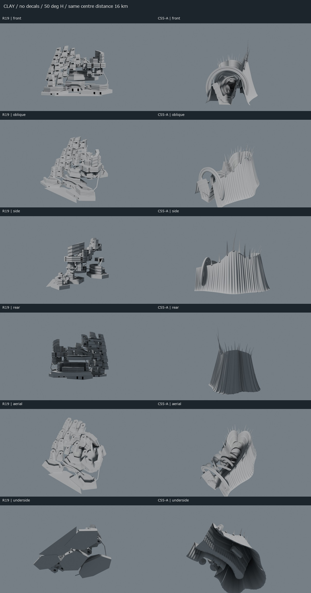
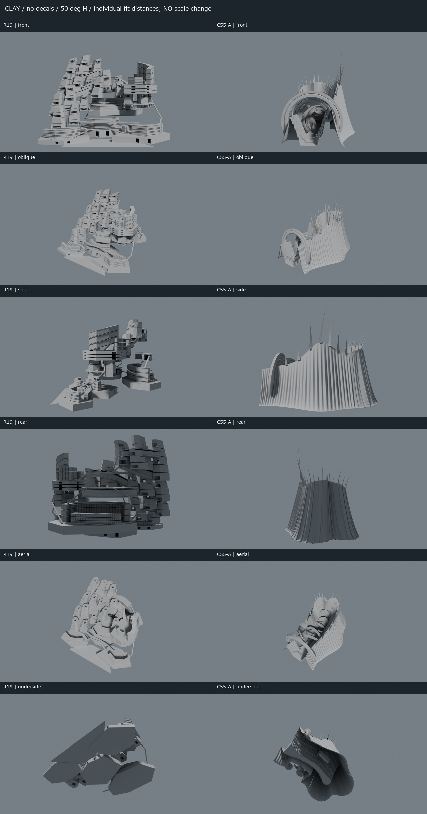
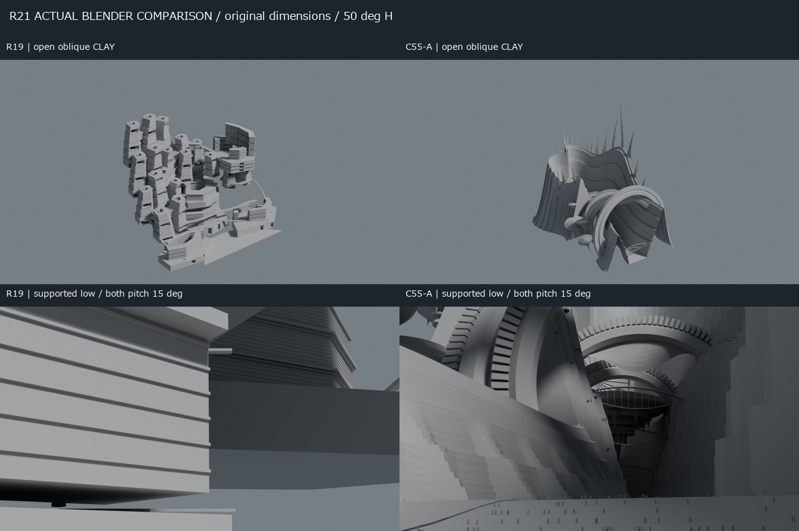
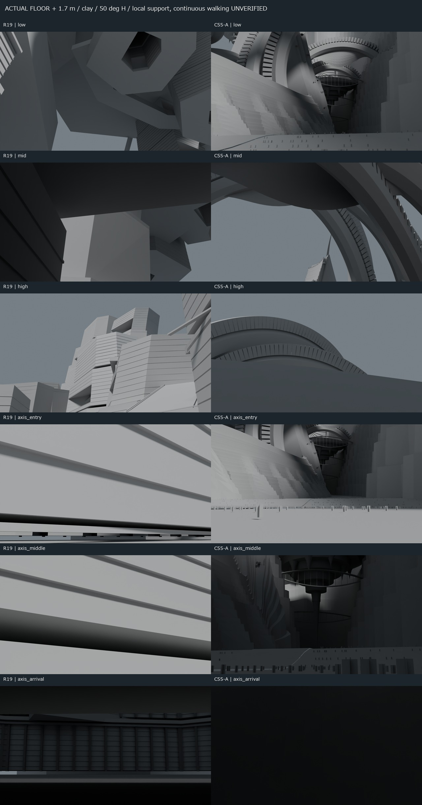
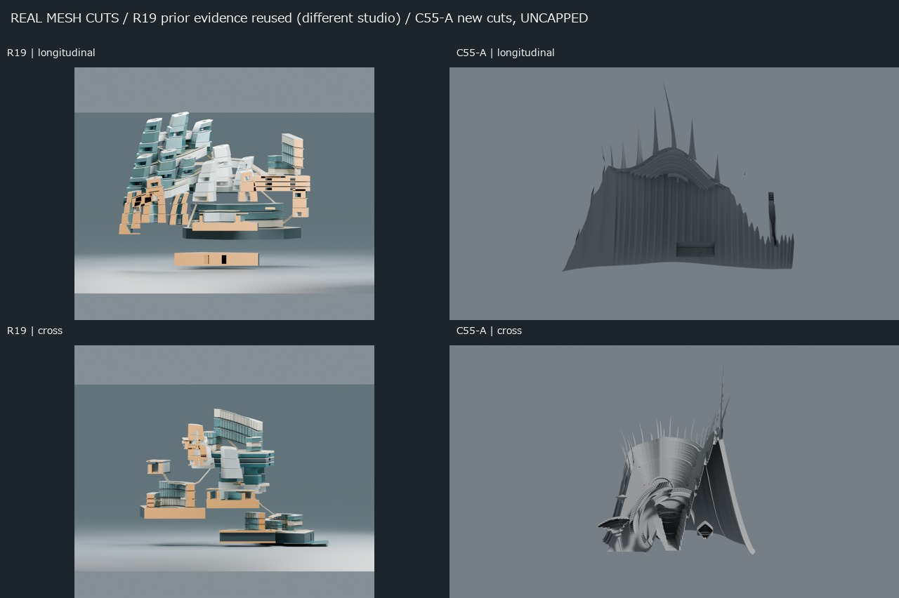
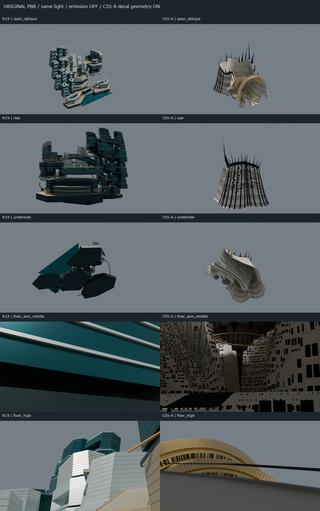

# J7-R21 — C55-A × R19 実Blender比較

2026-10-25 JST。独立研究。**R19のART REJECTを維持。C55-Aは長軸景観に有効な前進があるが、全体はART HOLD。正式中央美術採択0、Minecraft施工HOLD、10km詳細CITY MASTER未完成。** 本研究はモデルの再設計・採択ではない。

## 実制作と比較条件

C55-Aの指定GLBを取り込み、原材質・303ノードの部位階層を持つ編集可能な [C55A_IMPORTED.blend](models/C55A_IMPORTED.blend) を保存・再読込した。元GLB SHA-256は `4e0d8092c2bbe59ad6553d81e1a44594e7ff0dac3cfbc1ce1a9fb60144b76ae0`。R19も原本から別の [比較BLEND](models/R19_COMPARISON.blend) を制作。C55-Aの [比較BLEND](models/C55A_COMPARISON.blend) とともにカメラ設定を保存する。

| 実寸・形状 | R19 | C55-A |
|---|---:|---:|
| 原座標の中央外形 X×Y×Z | 6100×5400×4372.572m | 6956.756×4729.413×5794.588m |
| 中央メッシュ | 2974 | 278（地形文脈12を除外） |
| 中央三角形 | 75,632 | 591,481（文脈込み668,623） |

数値は美術得点ではない。glTF Y-up→Blender Z-upは標準インポーターで復元。1 unit=1m。比較時のみC55-AをZ軸に−90°回転し、双方をXY方向に中心合わせした。伸縮・正式都市座標登録はしていない。原GLBの895,504頂点中502はインデックス未参照で、Blenderの895,002頂点との差を説明できる。三角形数・寸法・保存再読込の一致を確認した。

Cycles CPU、1600×900、水平50°、同じ中性クレイ・背景・太陽を使用。発光・霧なし。C55-AのLIGHT_DECALSは主クレイで非表示、表示版も別途制作。光芒用の6枚組メッシュを演出として除外し、建築膜3枚は残す。元PBR版も同じ光で発光を止めた。**全体フィット版は撮影距離が違うため、画面占有率を実寸差と解釈しない。** 距離の等しい16km版を別に提示する。

## なぜ「一区画感」が違うのか

R19は、外形を6.1kmへ広げても、同系の中庭断面・柱状街区・水平帯が同じ強さで繰り返される。各部がそれぞれ一つの大施設として完結し、共有床がその集合を棚状につなぐ。側面では隙間と細い連結が露出し、下面では大きな平板が勝つ。遠方にも似た断面が見えるため、「次に違う都市世界へ進む」という距離の手がかりが弱い。床上の中位・軸定点でも、近い床縁や壁の占有が大きい。

C55-Aは、連続する裂け目の両岸が空間の母体となり、その前後に別々の環・橋・浮遊部・終端が重なる。低位からは、手前の床と小さな人物、巨大壁、さらに奥の構造が一つの画面に入り、遮蔽と縮小の連鎖ができる。デカールと発光を止めてもこの序列は残る。したがって、成功の中心は**外寸や七環という記号ではなく、数kmを貫く空間の向き、連続する両岸、複数距離の構造、行先のある奥行き**にある。

ただし、近景の実装済み生活街区から別の完成生活街区へ連続する都市体験まで証明できていない。遠くへのレイが当たる対象には壁・環・外殻が含まれ、「遠い別都市が完成している」ことの証明にはしない。R19にも数km先の実面は見えるが、その距離だけで美術上の問題は解消しない。

## 人間視点・内部の限界

双方の実床上1.7mを下向きレイで確認し、周囲1mの床支持・近傍面・局所的な頭部／身体クリアランスも検査した。R19の軸3点は入口側・中央・背面側の空間サンプルであり、C55-Aと同等の連続主軸が設計済みであるとは扱わない。旧R19低位の上向き構図だけで結論を出さず、同じ床位置から双方を主方向・仰角15°でも撮影した。

C55-A低位には強い巨大回廊景観がある。一方、中位は環と膜の下面、高位は近い床や環の縁が支配し、広場・店・街路・違う都市地区を読み分ける豊かさが不足する。到着点は発光を除くと暗い外殻が大きく、公共的な行先としての完成度が弱い。人物・樹木・小パビリオンは存在するが、用途や立体交通を備えた生活都市の代わりにはならない。

支持床と視線サンプルは、閉じたソリッド内にいないことの全域証明、連続歩行、外部からの到達、避難、交通運用、居住可能性の認証ではない。壁・建物をすり抜けたカメラを歩行経路として提出していない。**連続空洞体積・全歩行・階間アクセスは未検証。**

## 実断面と窓

C55-Aは比較座標X=860m（原座標Y≈1187.533m）の長手断面と、Y=−600m（原座標X≈−409.739m）の横断面を、元メッシュから実際に切断した。交差メッシュは各72／58。新しい塞ぎ面を足しておらず、空洞らしい線を完成ソリッドとして捏造していない。R19は保存済み2断面を再使用し、照明の違う断面画像を統一レンダー扱いしない。

[長手の実切断線](sheets/C55A_SECTION_longitudinal_X860_CONTOUR.png) でも、巨大な段状内面と外皮の間に広い未分節領域がある。下部には約1.1kmの大回廊の床・段状ギャラリー・ヴォールト等が独立して実在するが、壁全体を室・街路・複数の公開空間へ組織した内部都市ではない。大回廊の形状があることと、外の裂け目廊からそこへ入れることは別で、入口からの連続動線は未検証。外観上の厚みを内部居住都市の完成と扱わない。

窓は内壁・外皮の4メッシュから12点ずつ、計48点を実形状へ照射。全48点で2m以内に背後の壁・外皮が存在した。[生のレイ結果](qa/WINDOW_BACKING_SAMPLES.json) と添付元の追加面生成コードが、少なくともこれらの窓が開口ではなく貼付メッシュであることを裏づける。全窓を個別検査したとは主張しない。`west_portal_glow` も名称だけで実扉と扱えず、発光する充填楕円面が実在する。

## 美術判断

| 軸 | R19 | C55-A |
|---|---|---|
| MACRO ART | REJECT。反復断面と棚の集合 | 長軸・低位景観は有望。北側面・背面の外皮は単調で全周未達 |
| SPATIAL ART | 公開空はあるが近い床・壁で分断 | 裂け目廊の奥行きは前進。公共都市の多様性・接続は不足 |
| ARCHITECTURAL ART | 同系断面・納まり・平板下面が弱い | 壁・環・棘の大形は強いが、背面・下面・建築用途の展開が弱い |
| INTERIOR REALITY | 内街路・開口は部分実在。全体未検証 | 大回廊は部分実在。居住壁全域の室・道路・開口・アクセス未完成／未検証 |
| TECH QA | 原形を変えず比較コピー・保存検証 | GLB→BLEND保存再読込・寸法・三角形整合。美術合格ではない |

材質版は構造の比較を置き換えない。C55-Aの灯りを止めると黒い窓面や装飾面が残り、外皮の空白・近景の粗さが明瞭になる。背面は縦襞の大きな閉じた面、下面は外皮と浮遊部の底面が主で、裏側でも独立した生活都市が成立するとは評価できない。

## R22への具体的な制作方針（提案・未実装）

1. **形より先に、複数の都市世界を一つの長距離公共空間でつなぐ。** 入口・中間・終端の実床から、手前の生活空間と遠い異なる地区が同時に読める断面を作る。全体外形・主要内部・地上との関係を並行して審査する。
2. **中央の母体と都市級空洞を一体で造形する。** 単独柱状街区を並べて床で接続する文法を延命せず、異なる厚い都市地盤・公共室・到着広場が輪郭と奥行きを作るようにする。七環・聖堂は固定要件にしない。M247-Cの正式研究方向は保護し、未検証の座標融合はしない。
3. **有望な一組の隣接地区で外部→内部→高所の実接続を解く。** 窓デカールの増量より先に、実入口・公開内部・上下交通・反対側への出口を見せる。普通の私室以外を省略可とする新例外は作らない。
4. **背面・下面・床上を最初の美術ゲートへ含める。** 中性6方向と実床視点で単なる板・棚・巨大模型へ戻るなら、装飾を止めて主質量と空間の配分を直す。有望性を確認してから必要な接続QAを深める。

## 保存・失敗・未実施

R20のGitHub確認済みHEADから独立R21ブランチを作成。mainの方針を明示refで読了したが、CURRENT_STATUSとSETUP_STATUSの古い工程表示は最新実績と扱わない。指定の旧ローカルセットアップ報告は現checkoutに存在しなかった。既存未追跡researchは保持・納品対象外。

初回の10km構図は切れ、初回C55-Aクレイは光芒面を不透明化した。床上の最初の低位・高位にも遮蔽があった。[初回失敗記録](qa/FAILED_INITIAL_SETUP/) を保持し、最終比較は設定修正後に再描画した。これは建築造形の改善として数えない。背景MCP警告と作業外サムネイルキャッシュ書込失敗は出たが、成果BLEND・画像の書込と再読込を別途検証した。

新しい中央モデルの設計、R22実装、全市詳細化、施工適合、正式座標接続、空洞体積・全歩行・交通の認証は実施していない。原モデル、main、既存Draft PR、Freeze、W0/H1–H6/SB01–SB16/HERO4/軸/V、M247-C、archives/handoff/upstream、実Minecraft saveは変更していない。前面Computer Useは使用していない。
