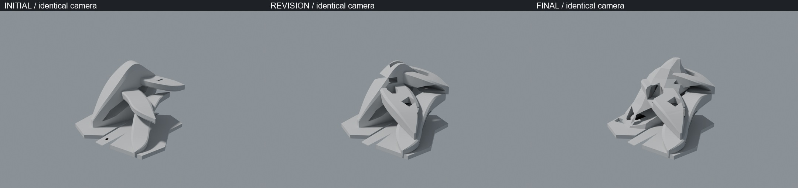
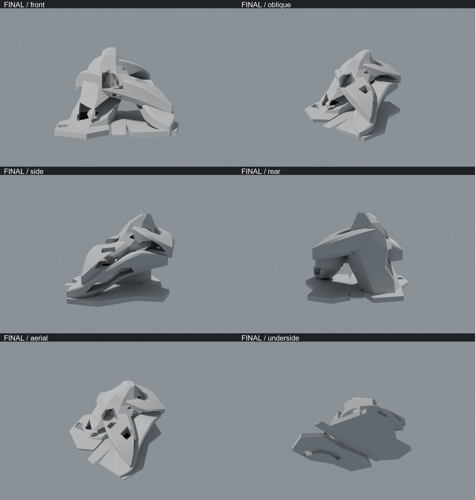
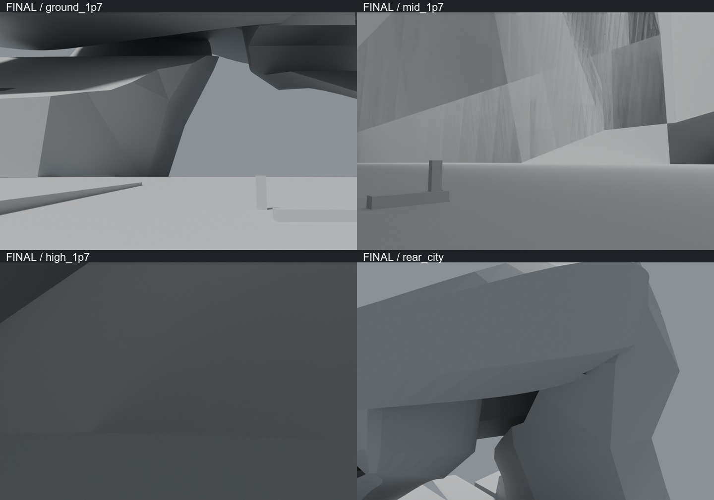
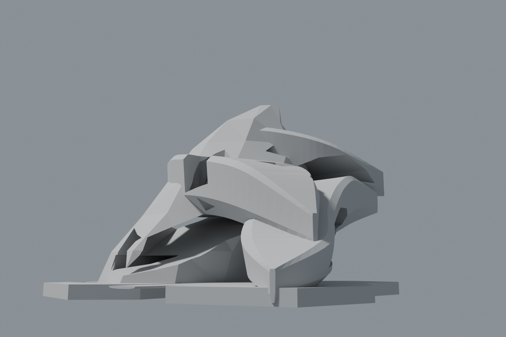
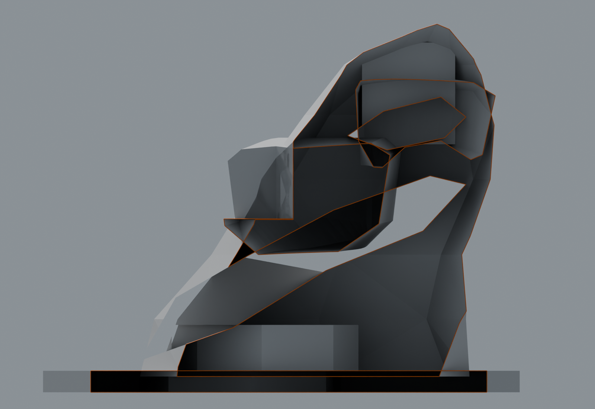
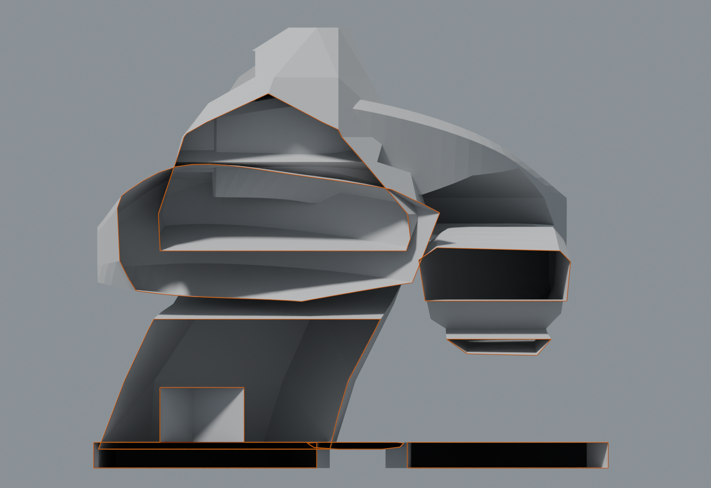

# J7-R23《交叉天陸 / CROSSING HORIZONS》実制作・美術審査

2026-10-25 JST。**AI研究自己評価：ART REJECT。初期美術ゲート不通過。正式採択ではない。**

実BLENDを作り、同一構想に対して主形状を2回作り直し、中性Cycles実レンダーを確認した。最終的にも、異なる都市世界が内包される中央文明としての全体構成を実現できなかった。**R23を完成した中央建築、内部都市、詳細CITY MASTERとして扱わない。** 不合格の形状に住宅・窓・反復リブを追加する第二段階は実施していない。

## 実制作と変更の証拠

初回は、湾曲する上昇母体、横断する高層地盤、東の斜昇地盤、背面高層地盤、地上の両岸と長い公共床を実メッシュで制作した。初期の大空洞も実際のBoolean切削であり、暗い模様ではない。しかし、正面は一枚の刃と突き出した棚、側面は滑らかな帯の重なり、下面は地上基盤の底板に見えた。

修正1では三つの突き出した地盤を撤去し、厚い横断地盤・東側地盤・背面地盤へ再造形。上面の中庭と背面の盆地、東側の公共空洞を切削した。厚みと上下の空きは増したが、中央文明の輪郭にはならず、依然として巨大な滑らかな部材を組み合わせた彫刻だった。

修正2では最初の湾曲母体を完全に撤去。異なる7高さの断面から非対称な断崖母体を新造し、斜行する大空洞、地上の峡谷、高層の公開空、中庭へ開く切れ込みを切削した。横断地盤の中庭を正面へ開き、東側の峡谷と地上の水路状切込みも実メッシュで制作した。これにより母体の大きな穴と地盤相互の重なりは増えた。しかし巨大面の残し方、各地盤の接合、空間の主従が十分に設計されていない。

2回の修正は同一の研究構想の主形状変更であり、類似案の大量生成ではない。高密度の窓・住宅・装飾を加えていない。小さな人尺度マーカー、縁石、座面は床上視点の尺度確認用で、生活街区として数えない。

## 6方向の美術審査

| 観点 | 実物からの判断 |
|---|---|
| 正面・斜視の中央主役 | 上昇する主母体はあるが、輪郭が一つの文明の建築秩序にならず、大きな部材が刺さった集合に見える。REJECT |
| 公共空と奥行き | 斜行空洞と横断中庭は実在する。公共軸床も長い。しかし入口・途中・終端の異なる行先が建築として読めず、C55-Aで有効だった近・中・遠の連続を再現できていない。REJECT |
| 異なる都市世界 | 地上・中間・高所の厚い地盤は異なる方向と高度を持つ。しかし高さの違う地盤だけでは、異なる生活世界・機能・居住都市にならない。未成立 |
| 側面 | 斜昇形状は見えるが、同じ滑らかな断面の帯が支配する。断面間に交通・公開空の建築的関係が不足 |
| 背面 | 高所の中庭を持っても、外観には大きな閉じた壁が残る。正面と異なる独立した都市景観・居住機能は実現していない |
| 下面 | 全体の真下からは地上基盤の広い底面が支配する。上層だけを下から見る補助視点も別途提出するが、これで全体下面の弱さを免除しない |
| 神聖80・異常20 | 傾斜と非対称性による異常さはある。公共空と建築の秩序による神聖・荘厳の印象は不足。配色や発光で補わない |

[初回6方向](initial/SIX.jpg)／[修正1の6方向](revision/SIX.jpg)。これらの全体カメラは同じ位置・焦点距離。最終だけを寄って大きく見せた比較ではない。

## 床上と全方向の限界

地上、中庭、高所の3カメラを実床上1.7mに置いた。実測支持床と限定的な周囲支持・局所クリアランスは [保存・実寸QA](qa/FINAL_VERIFICATION.json) に分離する。初回の中高度位置は地盤との関係が悪く、最終では実切削した横断中庭の位置へ変更している。地上の仰角も調整した。**床上画像は同じカメラ位置・姿勢だけによる前後比較ではない。**

人尺度マーカーは高さ1.75mの角柱であり、人物の身体形状ではない。巨大な近い壁・下面が画面を占有しやすく、人間から見た異なる都市世界の連続を示せていない。床があること、遠い形が見えることだけで「暮らせる数km都市」や連続歩行を認証しない。

最終中庭視点には、母体と横断地盤が重なる近接面による筋状の描画破綻も残っている。主質量の全接合・重複面を解いていないことを示す品質不合格である。中性光源の見栄えだけの問題として処理せず、修正済み・完成済みと主張しない。

この補助視点は地上基盤より上の高度350mから上層を見上げたもの。全体を真下から見た6方向の下面画像と区別する。

## 実断面・技術QAの位置づけ

美術REJECT判断の後に、保存・再読込、GLB書出しと再読込、限定床サンプル、実断面2方向を実施する。技術QAによる美術判定の昇格は行わない。

断面は実メッシュを半分切り落とした別BLEND。橙線は切断平面にできた実際の境界であり、室・壁・塞ぎ面を追加した図ではない。未分節の巨大ソリッドと部分的な空洞を可視化する診断用で、全体の内部都市が完成した証拠ではない。

実寸・メッシュ数・保存一致・GLB再読込の数値は [QA要約](QA_SUMMARY_JA.md)、機械記録は [FINAL_VERIFICATION.json](qa/FINAL_VERIFICATION.json)。**閉じた連続空洞体積、全歩行、交通運用、構造安全、居住室容量、部材相互の全交差、Minecraft施工適合、正式座標への統合は未検証。**

## 失敗と保存

第二修正の初回実行では、非平面の側面を分割せずに切削し、主質量が欠落した。その失敗BLEND・画像を [失敗記録](qa/FAILED_NONPLANAR_MACRO/README_JA.md) に保持した。修正では切削前の三角分割を明示した。この技術修正を美術改善の代替として数えない。

初回地上の黒い面重複、修正1の暗い中高度視点も保持した。最終の支持床は別途検証する。背景Blenderでは既存MCPアドオンの起動不可警告と、作業領域外サムネイルキャッシュの書込み失敗が出た。成果物本体の保存・読込とは分離し、前面操作は行っていない。

## 次工程

この形状への窓・住宅の追加を次工程としない。継承候補は、方向の違う厚い都市地盤と斜行公共空を同時に扱う問いであり、今回の外郭や地盤形状の採用ではない。次研究では、地上入口から異なる中層世界、さらに高所の終端へ向かう**具体的な床上景観・到着先・接合部**を、全体シルエットと並行して再設計する。主形状の少数部材ロフトと後付け切削だけでは十分な造形品質が得られなかった点を引き継ぐ。

main・既存PR・原本・Freeze・M247-C・W0・H1〜H6・SB01〜SB16・HERO4・三大都市軸・V1〜V3・実Minecraft saveは変更しない。正式中央美術採択0、Minecraft正式施工HOLD、一般建物内部以外の10km詳細マスター未完成を維持する。
