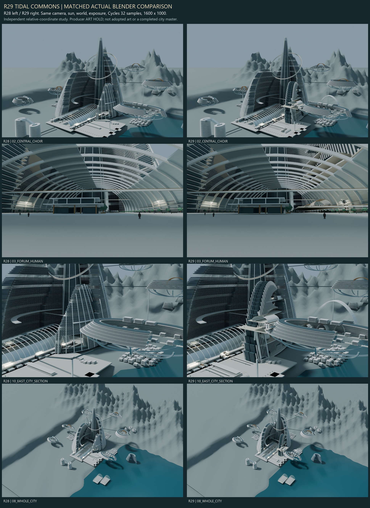
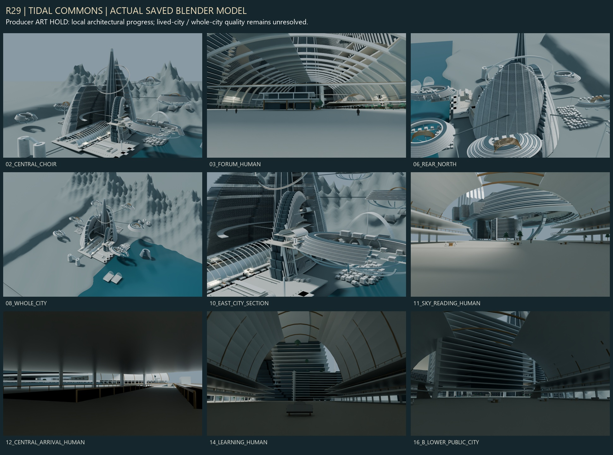

# J7-R29《潮層都 / TIDAL COMMONS》

2026-10-26 JST。R28を親にした独立・相対配置の実Blender建築研究。**制作AIの暫定判定：ART HOLD。東翼の外形・公開空・到着空間には部分的な進歩があるが、「本物の生活都市による中央全体の美術的突破」は未達。** 正式採択ではない。

## 実成果と制作領域

編集可能な `model/R29_TIDAL_COMMONS.blend`、実メッシュ `model/R29_TIDAL_COMMONS.glb`、最終Cycles実レンダー9枚、R28との同条件比較4組、再現コード・実空間QAを保存した。画像生成AI、前面Computer Use、ライブBlender MCP、有料追加サービスは使用していない。

**中央公共院の東縁→東側居住翼→海側公開空→上層到着駅→未割当て空中地区Bの上下公共街区**を選定した。R28に105m・650m・804.5mの実床があり、翼の輪郭、公開内部、交通到着、対岸の生活断面を同時に変えられるためである。正式H1〜H6の配置・名称・役割を変更したものではない。

R28完成BLENDを実際に開き、床・遮蔽物・既存翼の境界を調査してから編集した。R28 GLBも空シーンに実読込。事前実測は `qa/SOURCE_GEOMETRY.json`、42原本ファイルの保存バイト照合は `qa/STARTUP_AND_SOURCE_INTEGRITY.json`。

| 実測した既存床 | 高度 | 今回の処置 |
|---|---:|---|
| 公共院・海側テラス | 105m | 屋根・側廊・店舗・支柱の3か所に東西通過口 |
| 東側読書回廊 | 119m | 105mから長さ280m・上昇14mの研究用ランプを制作 |
| 上層公共回廊 | 650m | 東翼の空庭・公開室・昇降到着へ接続 |
| 空中地区Bの実街路 | 804.5m | 中央805mからの空中連絡と実到着口を制作 |

机上の路線端点だけではR28の屋根・私室帯・外周に遮られた。実壁へ切削を適用し、床の到達先と代表レイを保存形状で検査した。

## 継承と実形状の変更

継承：西翼・北翼・SPINE・傾斜環、公共院の大きな屋根リブ構成、海へ開く構図、研究地形と大部分の周辺。既存R28の9カメラの位置・向き・レンズ、太陽・背景・露出・画質を維持した。

変更：東翼の4メッシュ、旧B向け斜め交通2メッシュ、小公共島1メッシュを撤去。東翼は異なる階高・幅の居住断面と、斜めに上がる二つの曲線状公開空洞で再構成。新しい空庭・学習公開室・上層駅の配置が、既存の外側の階床と立面を実際に欠き取り、輪郭を変えている。単なる窓・装飾の追加ではない。

| 建築・公共空間 | 実制作寸法・役割 | 現在の限界 |
|---|---|---|
| 東翼の新規主群 | 保存メッシュbbox 約875×1,852×1,316m。上端約1,408m | 大部分の私室帯は簡略化。階帯と縦フィンの反復はなお強い |
| 二つの公開空洞 | 長手方向の切除判定幅約1,110m／888m。異なる高さの街路・公開室・空庭を挟む | 完全な空洞体積・全身クリアランスは未認証。代表横断レイのみ |
| 学習公開室 | 幅145m×長さ255m、床345m、屋根頂部約459m。側廊・展示棚・机・階段 | 室内の実在は前進。ただし正面の奥景は階帯に支配される |
| 空庭・読書室 | 主床650m、読書室幅125×長さ160m、空へ開く屋根スリット | Bへ視線は届くが、広い床と大きな外周下面が強い |
| 中央上層到着 | 主床805m、450×305mの到着地盤、公開屋根・側廊・昇降機構 | 到着の建築はあるが、床面積に対して活動密度が低い |
| 中央→B | 歩行中心線約669m、歩行幅16m、別の車両用デッキ幅22m。805→804.5m | 折曲点のデッキ・案内材は接続したが、車両旋回性能・運行は未検証 |
| Bの到着部 | 約530×120m、床804.5m。既存外周に実開口 | 空中地区全体の生活機能や全入口は未完成 |
| B下面の公開街区 | 約560×290m、床650m。公開工房と約100m厚の居住断面、上街路との昇降形状 | 下面が完全な無地空間ではなくなったが、街区の多様性・生活密度は不足 |
| 公共院東側 | 105m／139mの広場・上街路・3公開室、680mの緩い主ランプ | 駅舎的な巨大公共院という問題を十分には解消できていない |

開口の切削工具は幅58m・高さ88m（下端99m〜上端187m）。これは工具寸法であり、全断面の有効通行寸法を認証した数値ではない。各所の街区内短いランプ・避難・全階アクセスは完成認証していない。

中央・空中地区B以外の5地区や周辺施設を一括で再設計していない。建築分布はR28の約7.48×6.55kmの研究構図を引き継ぎ、約10km都市全域の詳細完成や壮大な統一文明の成立を主張しない。300km四方の遠方地面は背景であり都市の面積ではない。

## 実画像による比較



02中央斜視・03公共院人間視点・08全域俯瞰は、R28の保存済み最終PNGをバイト一致コピーして使用。10東翼斜視は、R28原本を新しい同一カメラから実際に再レンダーした。既存9カメラと照明条件の一致は `qa/ACTUAL_MESH_DELTA.json`。



| 最終画像 | 評価できること |
|---|---|
| 02_CENTRAL_CHOIR | 中央数kmの構図。東翼の曲線状の欠き取りと上層駅が外観を変えた |
| 03_FORUM_HUMAN | 105m床上1.7m。右側の中層街路は増えたが、既存の正面店舗と巨大床が支配的 |
| 06_REAR_NORTH | 背面。西・北翼の大部分は未改修で、均一な階帯の問題が残る |
| 08_WHOLE_CITY | 全域の主従。中央の主役性は維持したが、全市的な改善量は限定的 |
| 10_EAST_CITY_SECTION | 東翼の大きな二つの開口、居住の厚み、中央到着とBの関係 |
| 11_SKY_READING_HUMAN | 650mの公開室から近い側廊・中間の空庭・B下面の新街区を見る |
| 12_CENTRAL_ARRIVAL_HUMAN | 805mの到着床から連絡先を見る。近い側廊の下面が強く、到着体験の美術は未達 |
| 14_LEARNING_HUMAN | 345mの実公開室。室は実在するが、長距離景観の質は弱い |
| 16_B_LOWER_PUBLIC_CITY | Bの650m床から中央を見返すが、近い住居帯が大きく遮蔽。長距離景観は未達 |

最終は1600×1000・Cycles32 samples・CPU4 threads。照明・露出で変更を演出していない。新カメラ12・16は初回に下面・余白を写しすぎたため、同じ実床上で修正。これは `qa/NEW_CAMERA_CORRECTIONS.json` と `process/` の途中画像に記録し、建築造形の改善へ加算しない。最終ビルドコードも修正済み位置を再現する。

## 画像を見た修正と失敗

初回は東翼の開口が水平棚に見え、公開室の側廊が対岸を遮った。開口を曲線状に変え、読書室を眺望方向へ回した。新旧の床が重なる黒い描画と、学習室内部への私室帯の侵入も見つかり、床を和集合化し、室の実体積を切除した。B下面に対岸側の都市断面を設けた。

QAで旧支柱とB外周が通過を塞いでいたため切削を拡張。最後に、歩行中心線とは別の車両用オフセットデッキの折曲点に約24.4mの隙間と、例示車両1両の配置ずれを発見した。接続デッキ・案内材を制作し、車両を実デッキ上へ修正して、最終画像を再出力した。修正を隠して初回から通過したとは扱わない。

プレビュー13枚、納品前の本出力9枚、接続修正後の納品9枚、R28追加比較1枚。中間本出力はログを保持し、全部の重複画像・中間BLENDを納品のために増殖していない。試行数は美術成果の指標ではない。

## 技術QAと未認証事項

- Blender 5.2.1 LTS。保存BLENDを独立に開き、GLBを空シーンへ別読込。512メッシュ・1,448,130三角形。全頂点・全三角形重心の双方向最近傍差0m、境界差0m、個数一致。完全なトポロジー同一性の証明ではない。
- R28にあった244メッシュのうち218はメッシュ配列不変、19を研究コピー内で変更、7を撤去。新規275メッシュ。これは編集バッチ数であり、建物数・美術得点ではない。
- 人間カメラ11点で実床上1.7m、足元5サンプル、頭部近傍22cmの短いレイを確認。最終画像で使わない保存カメラも含む。
- 地上3通過口・東翼2大開口・空中連絡2区間の代表レイ計7本が通過。読書室からBへの別レイは、約680m先の `B lower inhabited floors` に到達した。Bが見える証拠と、そこまで空の通路がある証拠は区別する。
- 読書回廊ランプ・公共院主ランプ・空中歩行路2区間・車両用折曲接続の計5区間を各21点、床高度照合。全105点PASS。全身の掃引や全交通の運用認証ではない。
- R28原本42ファイルの全バイト不変を確認。main・既存研究・保護資産への差分なし。既存未追跡 `research/` は納品対象外。

全公共内部、全経路、避難、全衝突、構造安全、車両運行・旋回半径、空洞の全体積、公式都市アンカー、全H/SB/V/軸との統合、Minecraft対応は未認証。研究用の相対座標、1 unit=1m、+X東/+Y北/+Z上を継承する。

## 過去研究との比較と判断

R28より、東翼の内部用途と交通到着が外形を直接変える範囲を広げた。R27Bの閉じた結晶に小建築を添える方式とは異なり、実床・大開口・公開室が外形に組み込まれる。一方、新しい居住断面にも水平階帯が残り、R9・R14・R19・R23の反復・棚・模型感を完全には脱していない。

C55-AはR21の元コード・実画像・断面監査から参照。近中遠の共有尺度という原理を使い、七環・元メッシュを複製していない。本研究はC55-Aと同じ長距離の緊張や豊かな居住壁を達成したとは評価しない。R27B・C55-Aとの今回の新規同条件レンダー競争は行っておらず、歴史画像による定性的比較である。

**次に価値があるのは、中央とBを結ぶ一組の街路・入口・異なる活動を、同じ階帯の増量によらず建築として作り分けること。** 西・北翼へ今回の階床をコピーして全市へ展開する方向は推奨しない。最終採否はChatGPT側の独立監査とユーザーによる画像判断に委ねる。

## 再現・GitHub引継ぎ

repoから実行。原本証拠ディレクトリ内で実行しない。Python検証は `-B -X utf8`、Blenderスクリプトもbytecode書込を無効化している。新規依存のインストールなし。レビューシートに既存Pillowを使用。

```powershell
& 'C:\Program Files\Blender Foundation\Blender 5.2\blender.exe' --factory-startup -b -t 4 --python-exit-code 1 --python studies/M3D-1S/J7/R29/build_commons.py -- build
& 'C:\Program Files\Blender Foundation\Blender 5.2\blender.exe' --factory-startup -b -t 4 --python-exit-code 1 --python studies/M3D-1S/J7/R29/build_commons.py -- render 02_CENTRAL_CHOIR 03_FORUM_HUMAN 06_REAR_NORTH 08_WHOLE_CITY 10_EAST_CITY_SECTION 11_SKY_READING_HUMAN 12_CENTRAL_ARRIVAL_HUMAN 14_LEARNING_HUMAN 16_B_LOWER_PUBLIC_CITY
& 'C:\Program Files\Blender Foundation\Blender 5.2\blender.exe' --factory-startup -b -t 4 --python-exit-code 1 --python studies/M3D-1S/J7/R29/build_commons.py -- render 10_EAST_CITY_SECTION --before
& 'C:\Program Files\Blender Foundation\Blender 5.2\blender.exe' --factory-startup -b -t 1 --python-exit-code 1 --python studies/M3D-1S/J7/R29/verify_saved.py
python -B -X utf8 studies/M3D-1S/J7/R29/capture_sources.py
python -B -X utf8 studies/M3D-1S/J7/R29/package_review.py
```

開始時にGitHubへ実接続し、main `a2f88995eee8d10ee4830dbdf33ccb9c0790de8f`、R28 `da2a2e630b95c939881db7428ac21ac85342346e`、PR #61 Draft/openを確認。正式方針7文書は明示main refで確認した。古いSETUP_STATUSとCURRENT_STATUSの工程表示を最新実績と誤認していない。

新規ブランチ `research/m3d1s-j7-r29-tidal-commons-20261026`、新Draft PRのbaseはR28。同フォルダだけをコミットし、push後は固定HEADから大きなBLEND・GLBを含む全ファイルをHTTPSで再取得、Git保存バイトと照合する。確定PR・HEADと受領結果は最終報告・PR本文、ローカル `deliverables/R29_GITHUB_READBACK_<HEAD8>.json` で共有する。GitHubに保存しただけで別Chatが自動読込するとは主張しない。

main、Freeze、M247-C、正式W0/H1〜H6/SB01〜SB16/HERO4/三軸/V1〜V3、既存Draft PR、旧研究原本、archives/handoff/upstreamは無変更。実Minecraftセーブにはアクセスしていない。**正式中央美術採択0／Minecraft施工HOLD／CITY MASTER 3D FIRST LOCKED。**
