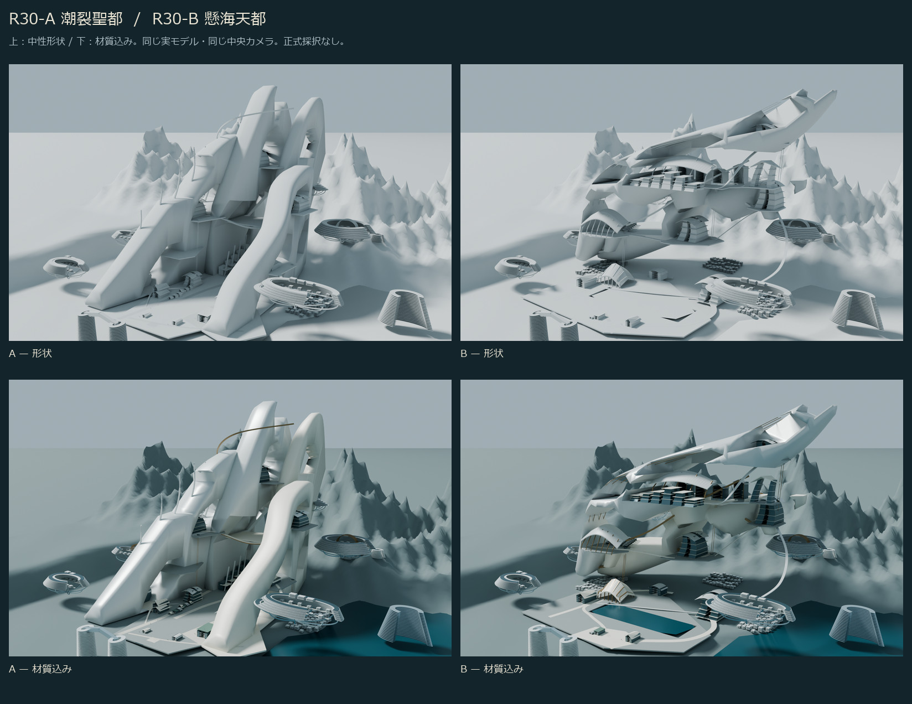

# J7-R30 — 潮裂聖都 / 懸海天都 実3D比較

2026-10-26 JST。独立研究。**Aは中央候補として継続非推奨、Bは研究継続を優先するART HOLD。正式候補の選定・正式美術採択はしていない。** 10km詳細CITY MASTERは未完成、Minecraft施工HOLD。

今回の成果は文章案や画像生成ではなく、保存された二つの編集可能BLENDと、その形状から描画した比較である。A/Bは同じ都市生成関数のパラメータ違いではない。共通なのは低水準メッシュ関数と、比較のためのR29由来の仮地形・周辺都市である。



## 保存物

- `model/R30_A.blend` / `R30_A.glb`：A《潮裂聖都 / TIDAL RIFT》。R29実BLENDを開いた研究コピーで、三翼・SPINE・公共院・交通を再構成。
- `model/R30_B.blend` / `R30_B.glb`：B《懸海天都 / SUSPENDED SEA》。空シーンから独立制作。R29からは比較用の文脈だけを読み込んだ。
- `renders/`：最終実レンダー22枚。中性7視点×2案、材質版4視点×2案。1600×1000、Cycles 48 samples、OPTIX。
- [中性7視点](comparison/AB_NEUTRAL.jpg)、[材質4視点](comparison/AB_ART.jpg)、[初期→最終の形状変化](comparison/ITERATION_SHAPE.jpg)、[途中失敗](comparison/FAILED_EDITS.jpg)、[R29同条件参照](comparison/R29_A_B_REFERENCE.jpg)。
- [美術評価](ART_REVIEW_JA.md)、[編集記録](EDIT_LOG_JA.md)、[Chat引継ぎ](HANDOFF_JA.md)。
- `qa/SAVED_MODELS.json`：保存再読込み・独立GLB読込み・実寸・床上視点。`qa/SOURCE_INTEGRITY.json`：R28/R29原本112ファイルの全バイト不変。
- `MANIFEST_SHA256.json`：本フォルダのファイル指紋（自己ファイルを除く）。GitHub push後の実ダウンロード受領記録は、リポジトリ外のローカル `deliverables/` に保存し、提出時のPR本文で報告する。

GLBは300km四方の遠方背景面 `far ground` だけを省く。建築・交通・周辺地区・地形・海のメッシュは含む。BLENDはオブジェクト名・研究グループ・カメラ・材質を保持した編集可能メッシュで、画像を板に貼った代理モデルではない。外部画像ファイルへの未梱包依存はない。

## 制作と限界

Aは均一な階帯を廃し、厚い都市壁と高低差のある大開口へ改造した。主役の縦方向の量感は強まったが、無地の崖と穿孔された塊という印象が増し、R29より建築的な生活密度が高まったとは言えない。

Bは横断する厚い上部都市、低い背後都市、三つの懸垂した都市部、その間の公共空洞を独立して構成した。1000mの段状港湾公共空間と2190mの街路を別々に設計し直し、上部の閉塞と刃状の単純さを実切削で改善した。都市級の奥行きには有望性があるが、主構造と小施設の尺度の断絶、平らな地盤、下面の未設計面、反復する挿入街区が残る。

共通の6空中地区や周辺街区は、R29の**未割当て研究用プロトタイプ**を比較用に残したもの。正式H1〜H6やSB01〜SB16へ対応づけていない。新しい中央と周辺の接続を試作したが、全都市の生活圏・公共交通・全内部を詳細完成したものではない。

## 比較条件

01全市・02中央斜視・04低位人間視点・05背面・06下面は、A/Bでカメラ行列・レンズ・クリップを一致確認。太陽・空・露出・解像度・中性材質も共通である。

03公共空間、07高所街路は、各案で異なる実床と高度を使う**役割の比較**。同じカメラの形状差ではない。初期→最終シートでは同じ02/04だけを使う。背面05の40→32mm、03とB07の撮影修正は、造形改善へ加算しない。材質版は同じ光のまま元材質に戻した別評価であり、中性形状の判定を置換しない。

## 限定QA

1 unit = 1m、+X東 / +Y北 / +Z上の研究用相対座標。新規・改造グループと橋を含む実分布は、A約4.22×4.99×4.13km、B約5.38×4.80×3.97km。背景地形や遠方背景面の大きさを都市完成規模へ数えない。正式座標との認証済みアンカーは0件。

保存BLENDと空シーンへ読み込んだGLBについて、メッシュ数、三角形数、1mm量子化した全ワールド頂点の集合、境界を照合した。法線・UVによるGLB頂点分割を頂点数の増加と区別する。Aの面分割差は、三つの主構造について実GLBの三角化を研究用BLENDへ戻して安定化した。初期のゼロ面積仮説は確認できず、その原因を確定したとは主張しない。

6つの人間カメラは実床上1.7m、足元5点、頭部近傍23cmの短いレイを検査した。B高所の追加2中心線では街路→橋口は遮蔽なし、橋→行先は約560m先の到着ギャラリーに達する。これは全身通過や到着地盤の納まりの認証ではなく、入口・段差も未解決対象である。全身掃引、全経路の連続性、全衝突、避難、荷重・構造、全室の閉じた体積、交通運行・勾配、Minecraft施工適合は未認証。保存成功・GLB一致はART PASSではない。

## 再制作・再編集

Blender 5.2.1 LTSをバックグラウンド実行する。各スクリプトは `sys.dont_write_bytecode=True` を設定し、元研究は読取りだけで、R30へ別保存する。以下の順で再制作可能。既存R30成果は再生成されるため、編集した場合は先に別の研究コピーを保存する。

```text
A: build_a.py -- build
   refine.py -- A
   final_pass.py -- A
   finish_spaces.py -- A
   cleanup_degenerate.py
   build_a.py -- export
   stabilize_a_export.py
   build_a.py -- export

B: build_b.py -- build
   refine.py -- B
   final_pass.py -- B
   open_intersections.py
   finish_spaces.py -- B
   resolve_b_floor_overlap.py
   clear_b_destination.py
   build_b.py -- export

検証: verify_models.py
描画: render_batch.py
基準: render_r29_reference.py
```

例：`blender -b -t 6 --python-exit-code 1 --python build_a.py -- build`。通常のオフラインPythonは `-B -X utf8` を付ける。`verify_sources.py` は標準ライブラリのみ、`package_review.py` は既存の同梱Pillowを使用する。比較用の初期画像と失敗画像は保存証拠で、修正後コードから失敗を再生成するものではない。

## GitHubと保護

直接の親はR29 `d9f30a36946138359667676a904eba1a9c34da72`。新規ブランチは `research/m3d1s-j7-r30-dual-civilizations-20261026`、新Draft PRのbaseはR29のブランチ。R30専用フォルダだけを追加する。

開始時の実接続でmain `a2f88995eee8d10ee4830dbdf33ccb9c0790de8f` とR29 HEADを再確認し、mainのAGENTS・START_HERE・憲章・完成基準・CURRENT_STATUS・決定ログを読了。CURRENT_STATUSとSETUP_STATUSの古い工程表を最新実績として扱わない。

main、Freeze、正式原本、M247-C、正式W0/H/SB/HERO4/三軸/V1〜V3、既存R28/R29と既存Draft PR、archives/handoff/upstreamは無変更。実Minecraftセーブへのアクセス、前面Computer Use、追加有料サービス、アカウント作成、自動マージは実施していない。Blender MCPは起動時に接続できず、制作は独立バックグラウンドBlenderで行った。
