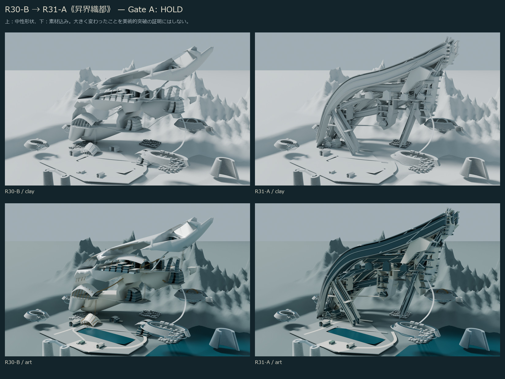

# R31-A《昇界織都 / ASCENDANT CONFLUENCE》

2026-10-26 JST。R30-Bの実BLENDを開いた研究コピーで中央を再構築し、実レンダーを観察して3回の形状修正を行った。**Gate A暫定判定：HOLD。R30を総合的に上回る超未来文明の美術突破は未証明。** 正式中央美術採択0、Minecraft施工HOLD、CITY MASTER 3D FIRSTを維持する。Gate Bの詳細生活都市の量産は行わない。



## 見る順序

1. [R30-B → 初回 → 修正後の固定6視点](comparison/R30_INITIAL_FINAL.jpg)：外形と空間の変化を先に見る。
2. [R30/R31の中性7視点](comparison/R30_R31_NEUTRAL.jpg)、[共通正面](comparison/FRONT.jpg)。
3. [同条件の素材・人間視点](comparison/MATERIAL_HUMAN.jpg)。
4. [実形状の反復](comparison/ITERATIONS.jpg)、[不成立の東乗換室](comparison/FAILED_EAST_PUBLIC.jpg)。
5. [美術評価・Gate A](ART_REVIEW_JA.md)、[制作記録](EDIT_LOG_JA.md)、[次のChat用引継ぎ](HANDOFF_JA.md)。

画像はすべて実BLENDからのCycles描画。画像生成、建築の描き足し、背景合成、欠陥を消すレタッチはない。Pillowはラベルと比較シートの配置にだけ使用する。

## 実3Dと設計原理

`model/R31_A.blend` が編集可能原本、`model/R31_A.glb` が比較用メッシュ。R30-Bの原本・GLBは一切変更していない。**地上と高高度の間を移動する交通建築が、厚い居住地形の両岸と公共峡谷をつくる**という仮説を実体化した。

R30の連続した厚い母体・懸垂塊・上部の大きな棚床を除き、南の上昇居住体、北の帰還居住体、東の下降部、西の分岐、横断公共構造を別々の厚い断面として制作。初回の細い骨組みを、公開ギャラリーを挟む二つの居住岸へ修正した。西港湾、中央交流、東懸垂、北公共肩、上部環境施設には非対称な厚い都市断面と実貫通室を設けた。

105m／1000m／2190m／3020m／3970m付近の乗換駅、斜行昇降設備、実キャビン、街路、庭、懸垂歩廊を制作。ただし全交通の運行・安全・連続性を認証したものではない。2190mの代表95m区間にだけ6m高の人間尺度ポーチを試作した。正式H/SB等に割当てない。

主形状を巨大な単一断面ロフトへBoolean切削する方式は使用していない。直接描いた断面の押出し、別体の厚い周囲部材、開いた街路・公共室、曲がる居住岸から組み立てる。低水準メッシュ関数はR30からR31内へコピーした。曲線補間そのものは部材経路に使用している。この制作方法の変更が美術突破を保証したとは主張しない。

## 比較条件と保存範囲

R30の既存7カメラすべてについて行列・レンズ・クリップを保持した。03公共街路、07高所街路も今回は同一位置・同一視線。太陽、空、露出、単位、画面比率も一致。R30保存画像と最終画像は1600×1000、Cycles/OPTIX、48samples。初回は960×600、16samplesで、シート内で同じ画面比率へ配置する。解像度・ノイズの差を形状改善へ数えない。

08正面はR30実BLENDから追加描画し、R31と共通条件。09東公共室は自由視点で、v3から位置を変更した。v3の近接壁、最終の極端な暗さを失敗として残し、形状改善の比較に使わない。床上1.7mというQAと、内部美術の成立は別である。

最終描画は15枚中13枚が主要審査用、2枚が東室の不成立記録。R30の比較元画像は隣のR30フォルダを参照し、重複コピーしない。初回固定6枚、途中中央2枚と失敗内部1枚、比較7シートを保持する。他の途中プレビュー8枚と巨大ログはGit保存から除外した。途中モデルの複製は保存せず、コードのrevision指定で再制作する。

## 限定QAと未認証

[保存・GLB再読込み](qa/SAVED_MODELS.json) は455メッシュ、758,014三角形、1mm量子化した全ワールド頂点集合、境界の一致を確認した。far groundという300kmの背景面だけGLBから省く。新規R31建築の分布は約5.09×4.70×4.46kmで、周辺の仮地形を詳細完成都市の面積に数えない。下端約−61.58mの根元断面は地盤に入り込む研究状態で、地盤接合・地下設計は未認証。

4つの人間カメラは足元5点と頭部23cm近傍を限定確認し、実床上1.7m。高所中心線49点の床サンプルを確認。これは全身掃引や全経路の証明ではない。外部未梱包画像依存なし、有限値、ゼロ面積に近い三角形0を確認した。全トポロジー・自己交差・全衝突・床重なり・全室・地盤・全接続端・避難・構造荷重・昇降運行・Minecraft適合は未認証。

[原本照合](qa/SOURCE_INTEGRITY.json) はR29/R30の143ファイルと、参照したC55-AシートのGitバイト不変を確認する。コード構文と保存画像の読込みを検査。QA一致はART PASSではない。

## 再制作

Blender 5.2.1 LTS、既設Cycles/OPTIXを背景実行。前面Computer Use・追加有料サービス・新規アカウントは使わない。各コマンドはR31だけを上書きするため、手編集したBLENDを再制作前に別の研究コピーへ退避する。旧研究からジェネレータを実行しない。

```text
blender -b -t 6 --python-exit-code 1 --python build_r31.py -- 4
blender -b -t 6 --python-exit-code 1 --python verify_models.py
blender -b -t 6 --python-exit-code 1 --python render_r31.py -- final 01_CITY 02_CENTRAL 03_PUBLIC 04_HUMAN 05_REAR 06_UNDERSIDE 07_SKY_STREET 08_FRONT 09_EAST_PUBLIC
blender -b -t 6 --python-exit-code 1 --python render_r31.py -- final art 02_CENTRAL 04_HUMAN 05_REAR 06_UNDERSIDE 07_SKY_STREET 09_EAST_PUBLIC
python -B -X utf8 package_review.py
python -B -X utf8 verify_sources.py
```

初回はbuildのrevisionを1、2回目を2、3回目を3として作れる。レンダーの`initial`は初回モデルを開いた状態で実行する。保存済み初回画像は最終モデルを描画したものではない。比較コードは同梱Pillow以外を追加導入しない。通常のオフラインPythonは`-B -X utf8`を使用する。

## GitHubと保護

開始時に実接続でmain `a2f88995eee8d10ee4830dbdf33ccb9c0790de8f`、R30/PR #63 HEAD `792dd34c96f6e9deefb8f8806fea478e5718b793`、open/draft/unmergedを確認。main明示refでAGENTS、START_HERE、憲章、3D完成基準、CURRENT_STATUS、DECISION_LOGを読了。CURRENT_STATUSとローカルSETUP_STATUSの古い工程を現在の実績として扱わない。ローカルセットアップ報告は現ブランチにないため、元integrationブランチのGitオブジェクトで読んだ。

ブランチは`research/m3d1s-j7-r31-ascendant-confluence-20261026`。直接の親と新Draft PRのbaseはR30。差分はR31への追加だけ。今回はユーザーの新指示が独立ブランチ・push・新Draft PRを明示許可している。既存PRの更新・main・自動マージは含まない。

実Minecraftセーブへのアクセスなし。正式原本、Freeze、M247-C、正式W0/H1〜H6/SB01〜SB16/HERO4/三軸/V1〜V3、archives/handoff/upstreamは無変更。全座標は研究相対m、認証済み正式アンカー0。都市全域を一般建物内部以外すべて詳細化する最終基準を緩めない。

GitHub push後は`verify_github.py HEAD RECEIPT_PATH`で固定HEADの全R31ファイルをHTTPSから実取得し、Git保存バイトと照合する。受領記録はコミット自己参照を避けてリポジトリ外のdeliverablesへ置き、結果を新PR本文と終了報告へ記す。
