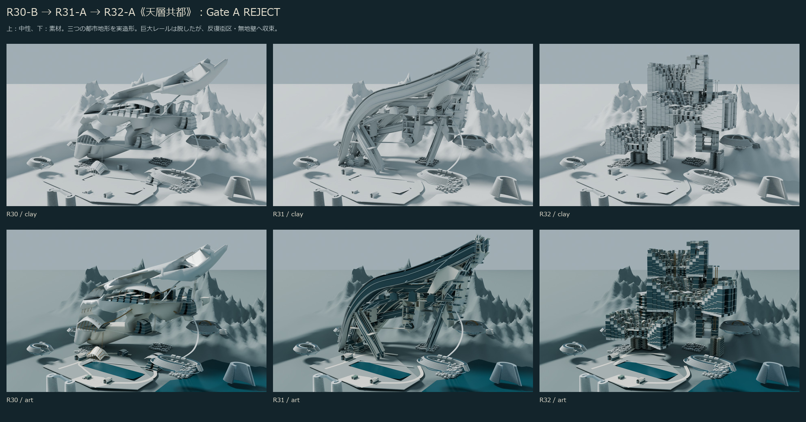

# J7-R32-A《天層共都》— 実3D研究／Gate A REJECT

2026-10-26 JST。R31固定HEAD `69db4bd27f6dc051c5dfdd7b889b819f4e8cc7a3` の研究コピーから、中央主構成を新しく造形。**三つの居住峡谷都市の仮説を実体化したが、R30/R31より成熟した超未来文明には到達せず、詳細化停止。**



- [固定7視点](comparison/FIXED_SEVEN.jpg)：全市・中央・正面・地上・旧高所・背面・下面。中性、同条件。
- [素材と人間視点](comparison/MATERIAL_HUMAN.jpg)：旧高所の無効視点も保存。
- [新しい公共床からの探索](comparison/EXPLORATORY_FORUM.jpg)：旧視点の比較と分離。
- [初回→一度の大改形](comparison/MACRO_REVISION.jpg)。
- [詳細美術評価・失敗分析](ART_REVIEW_JA.md)、[日本語引継ぎ](HANDOFF_JA.md)。
- [編集可能BLEND](model/R32_A.blend)、[比較用GLB](model/R32_A.glb)。

正式中央美術採択0件。正式座標・アンカー未認証。M247-C・都市C構成・全正式都市要素・Freeze・過去原本を変更しない。Minecraftセーブにアクセスせず、施工HOLD。全都市の詳細3D完成基準を緩和していない。

## 再現

既設Blender 5.2.1 LTS／Cycles OPTIX、Windows／Python＋Pillow。新規サービス・追加有料機能・前面Computer Useは使っていない。R32内の低レベルmeshkit以外、旧研究の制作モジュールをimport・実行しない。

repo/を作業フォルダとして、以下を実行する。出力はR32だけを再生成するので、手編集したR32を再実行前に別の研究コピーへ保存すること。元R31 BLENDは読み取りのみ。

```powershell
$blenderR32 = 'C:/Program Files/Blender Foundation/Blender 5.2/blender.exe'
& $blenderR32 -b -t 8 --python studies/M3D-1S/J7/R32/build_r32.py -- 1
& $blenderR32 -b -t 8 --python studies/M3D-1S/J7/R32/render_r32.py -- initial clay preview 02_CENTRAL 05_REAR 06_UNDERSIDE 07_SKY_STREET 08_FRONT
& $blenderR32 -b -t 8 --python studies/M3D-1S/J7/R32/build_r32.py -- 2
& $blenderR32 -b -t 8 --python studies/M3D-1S/J7/R32/render_r32.py -- final clay 01_CITY 02_CENTRAL 08_FRONT 04_HUMAN 07_SKY_STREET 05_REAR 06_UNDERSIDE 09_EXPLORATORY_FORUM
& $blenderR32 -b -t 8 --python studies/M3D-1S/J7/R32/render_r32.py -- final art 01_CITY 02_CENTRAL 08_FRONT 04_HUMAN 07_SKY_STREET 05_REAR 06_UNDERSIDE 09_EXPLORATORY_FORUM
& $blenderR32 -b -t 8 --python studies/M3D-1S/J7/R32/verify_models.py
python -B -X utf8 studies/M3D-1S/J7/R32/verify_sources.py
python -B -X utf8 studies/M3D-1S/J7/R32/package_review.py
python -B -X utf8 studies/M3D-1S/J7/R32/manifest.py
```

独立GLB再読込みは保存BLENDを変更しない。全ての制作スクリプトはbytecode書込みを無効化し、オフライン検証は `-B -X utf8` を使う。

保存は最終BLEND/GLB各1、最終実レンダー16（固定7×中性/素材＋探索1×中性/素材）、初回失敗プレビュー3、比較5シート。最終と同形状の低品質プレビュー、重複モデル、大量ログはGitへ保存しない。

## QA範囲

[形状・カメラ・支持床](qa/SAVED_MODELS.json)と[原本不変](qa/SOURCE_INTEGRITY.json)。2678メッシュ・773198三角形、独立GLBの頂点集合・境界一致。旧03/07は床名・目高が一致しても壁内なのでFAIL。地上04と探索09のみ限定立位PASS。全経路、接続、構造、公共室全域、正式座標、Minecraft適合は未認証。

主構成REJECTのためStage4詳細公共室は未実施。粗造形の公共床を完成公共室とは呼ばない。保存用のQA・マニフェスト作成は、この弱い形状の詳細化を継続する工程ではない。
