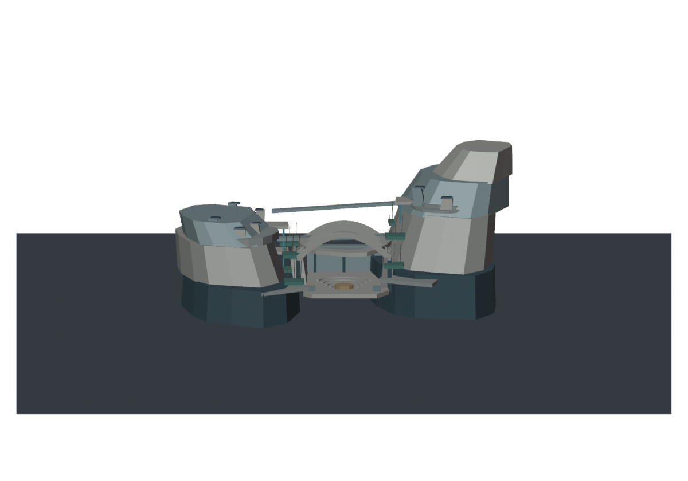
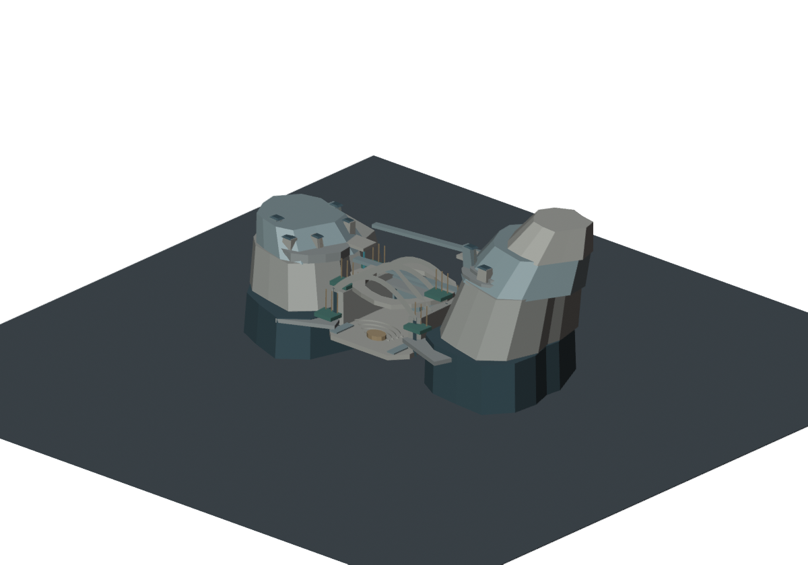
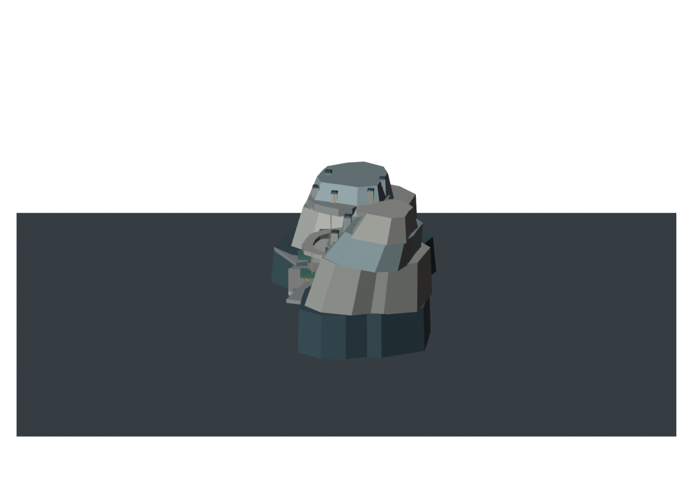
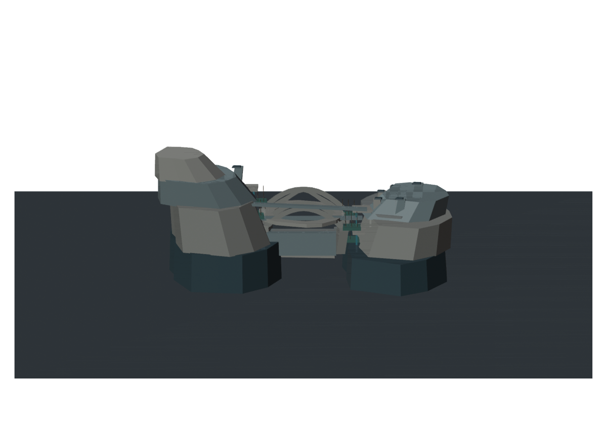
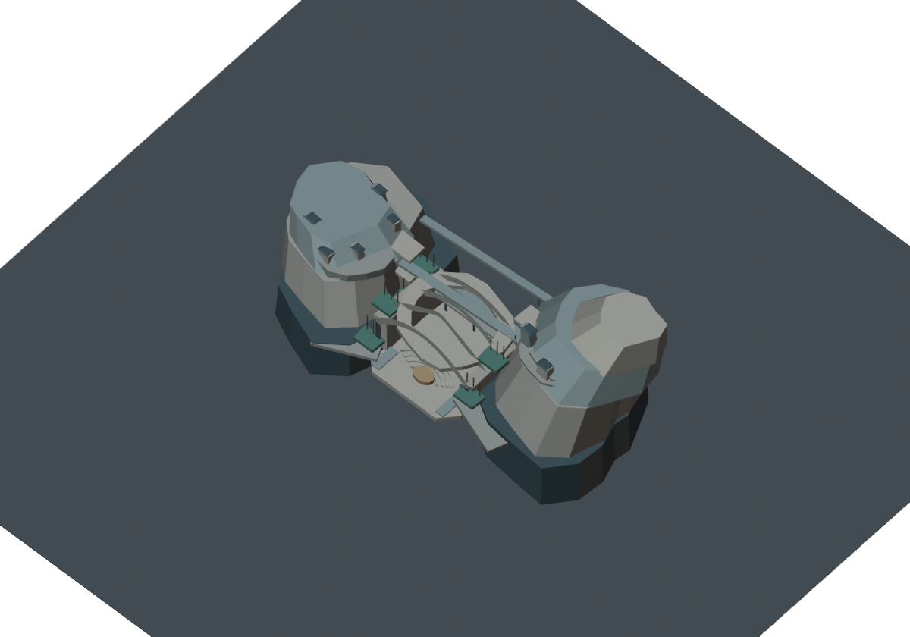
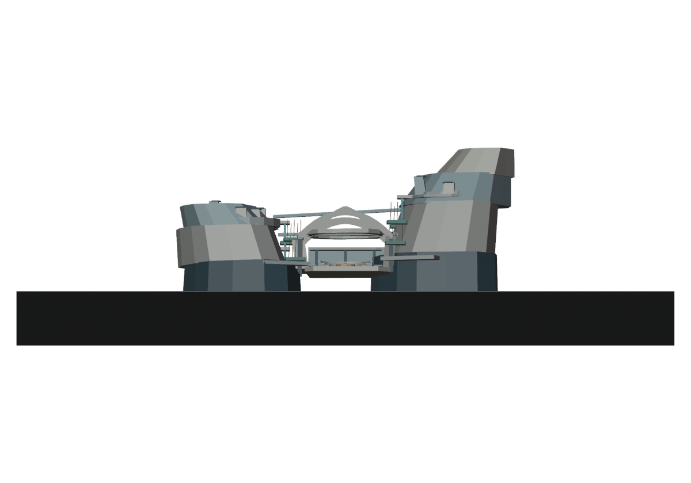
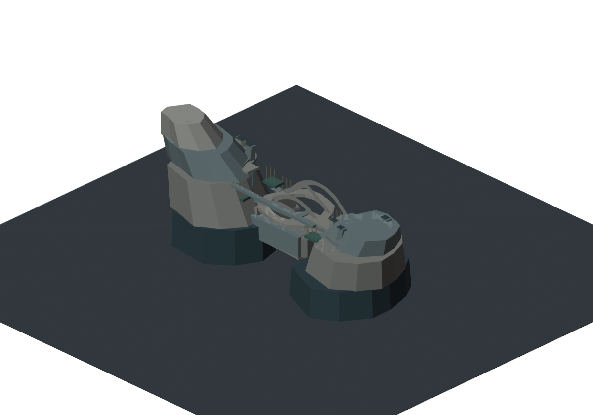
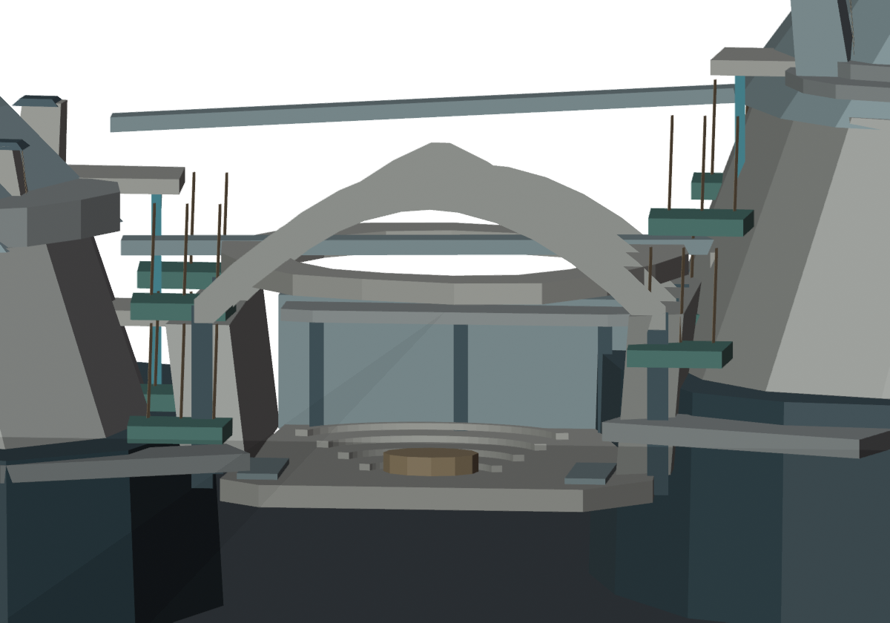
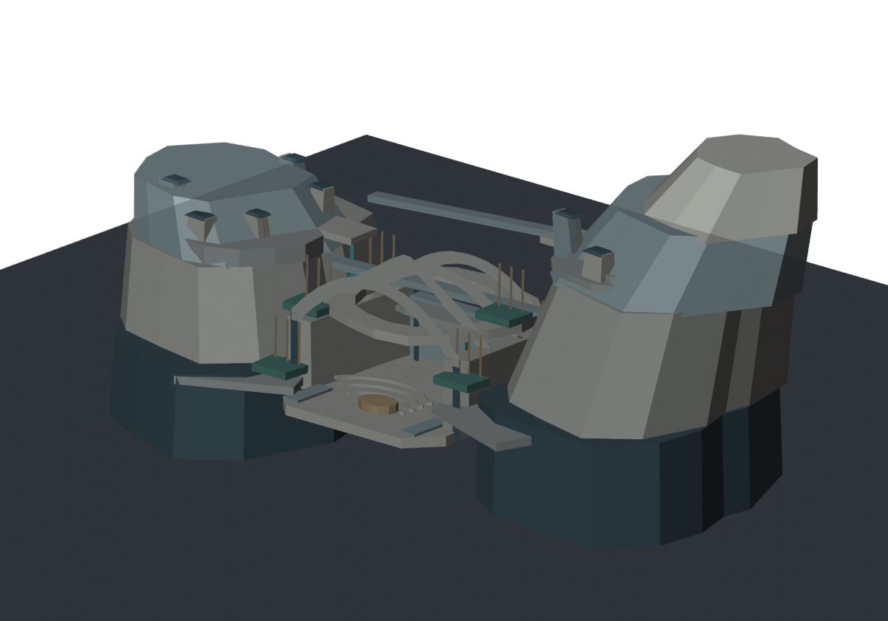

# CELESTIAL HALO-9 — J7-R5 実Blender建築断面試作・美術反証

**2026-10-24 JST / Draft研究 / NONCANONICAL / ART REJECT / Minecraft施工HOLD**

## 0. 対象と正式基準
mainのPROJECT_CONSTITUTION / CITY_MASTER_3D_STANDARD / AGENTS.mdに従い、約10km統合都市詳細3D完成が施工前のLOCKED要件。一般建物の私的内部のみ簡略化可。中央M247-Cは正式研究方向として保護、完成美術採択0件、W0/H1–H6/SB01–SB16/HERO4原本とMinecraft正式ワールド、mainは変更しない。

**このR5は中央の一局所を模した非正式3D研究であり、10km都市全域の代替ではない。** 施設の公式Minecraft座標を暗黙に設定していない。

## 1. 実際に行ったこと
Blender **4.0.2** をGitHub Actionsで実行し、新たに「非対称の居住都市断崖2地区＋大公共室＋採光用の真の開口＋街路付き中庭＋交換駅」を持つ編集可能な3D断面を制作した。Python/Blenderネイティブ APIで幾何を作り、**bmeshで既存の屋根20頂点を直接編集**した。ユーザーのローカルBlender GUIは操作していない。

R5-A（1回目）をBlenderで9視点レンダーしたところ、公共室が空白に見え、遠景が左右の丸い塔・橋に見えると判定した。

R5-B（2回目）は同じ研究ソースを実修正し、公共室に**開いた扇形の実段床4帯、集会用ステージ、北側の中二階と支持柱、入口の床**を新規メッシュとして加えた。9視点をすべて再レンダーして、GLBも再書出し・再インポート。

## 2. 実体測定／本当の証拠
- **J7-R5-B実GLB**：Blenderメッシュ152件、頂点2,258、三角形3,936、246,400バイト。
- **Blender編集可能BLEND**：146,995バイト。実際にGitHub研究ブランチへ保存。
- GLBを別シーンに再インポートした後も152メッシュであることをBlenderで確認。
- **Blender Workbenchでの実レンダー9枚**：7枚の10km固定視野（この研究のカメラ規約。旧R3-R4と同一画角・同じターゲットである保証はない）＋公共室局所1枚＋地区斜視1枚。
- GLBの各オブジェクト変換を反映した非公式建築モデル寸法の独立計測（10km参考地面を除く）：**約5.146 × 2.502 × 2.380 km**（X × 研究Y奥行 × 研究Z高さ）。GLBバイナリではY-upのため、trimeshではこの奥行と高さが異なる軸に格納される。
- R5-A→R5-Bで、実画像のRGB8閾値差画素率：公共室局所**3.58%**、地区断面**0.55%**、都市正面**0.17%**。これは画面上に変更が反映された証拠だが、**美術が良くなった割合ではない**。
- 正式W0地形モデル、正規H/SB配置、高品質な一般建物の全棟外観、地下交通、室内の実用性、階段・転落安全・勾配・床支持・大型部材の結合、歩行アクセスは**未検証**。

## 3. 美術結果 — REJECT
局所公共室の内部で立体的な集会空間が増えたことは技術的進歩。だが、正面・俯瞰・背面の見た目が**二つの巨大な丸い塔を細い公共施設で結んだ構図**から脱却できていない。少数の大きな凸面の組合せに見え、外形に刻み込まれた生きた街路・実際の居住密度が不足。Z高さ2km超でも中央巨大都市にふさわしい「文明の質量」には見えない。

R5-Bの修正は公開ホール内で確かに変わったが、中央スカイラインをほとんど変えていない。ここで窓・部品・部材を増やして「完成」と扱うことを**停止**。正式中央美術採択：0件。Minecraft施工：HOLD。

## 4. Blenderの進捗を正確に表現する
- **実施済み**：Blender本体の起動、モデル新規制作、bmesh実メッシュ編集、9方向の同一モデルレンダリング、編集可能BLEND保存、GLB再輸出・再読込、再描画して修正、GitHubへ全画像・バイナリ保存。
- **未実施**：Blender GUIをAIが人間と同様に操作してスカルプトする作業、実ビューポートのクリック操作、AIが形を見ながら手動ブラシ修正する能力の証明。これはAPI経由のプログラム編集＋実画像フィードバックである。
- R5-A→Bの視覚確認ループは実施。ただし視覚的に根本改善を達成できていないため、美術PASSとしては扱わない。

## 5. 改善計画
次の制作では**R5の両側の塔の形を延長・装飾することを禁止（既存研究アーカイブは保全）**。

1. **都市断面から外観を逆設計**：まず街路と巨大公共室とそれに接する居住街区を2〜3方向の実断面で成立させ、見た目のための丸い大ボリュームを後付けしない。
2. **非対称な大きい居住地形そのものを中央主形状**にする。都市の正面を彫刻的な単純殻にしない。隣接する全都市構成は公式台帳を確認して接合。
3. Blenderの現行CIは**実編集と視覚QAが可能な制作経路**として保持し、ユーザーが高度な手作業をする前提にしない。GUI経由の直接編集に明確な追加価値があるなら、承認を確認して別途検証。
4. 10km統合マスター全詳細義務は引き続きLOCKED。局所断面の試作に関わらずW0/H/SB等の座標と接合研究も進める。

## 6. GitHub成果（すべてR5-B時点）
- `outputs/J7R5_INHABITED_CIVIC_SECTION_NONCANONICAL.blend`
- `outputs/J7R5_INHABITED_CIVIC_SECTION_NONCANONICAL.glb`
- `outputs/J7R5_BLENDER_MODEL_EVIDENCE.json`
- `outputs/01_CITY_FRONT.png` 〜 `outputs/09_DISTRICT_SECTION.png`
- `build_blender_civic_section.py`（Blender実行と再現コード）
- `.github/workflows/halo9-j7-r5-blender.yml`（Blender実行、厳格CI、GitHub保存）

検証済み実行：[Actions #40079315470](https://github.com/ryomashibaba/celestial-halo-9/actions/runs/40079315470)。J7-R5研究ブランチ以外の原本変更、PRマージは行っていない。

## 実モデルからの画像（GitHub内のR5-B）
| Front | Oblique | Side |
|---|---|---|
|  |  |  |
| Rear | Aerial | Ground |
|  |  |  |
| Reverse | Nave interior | District cutaway |
|  |  |  |
