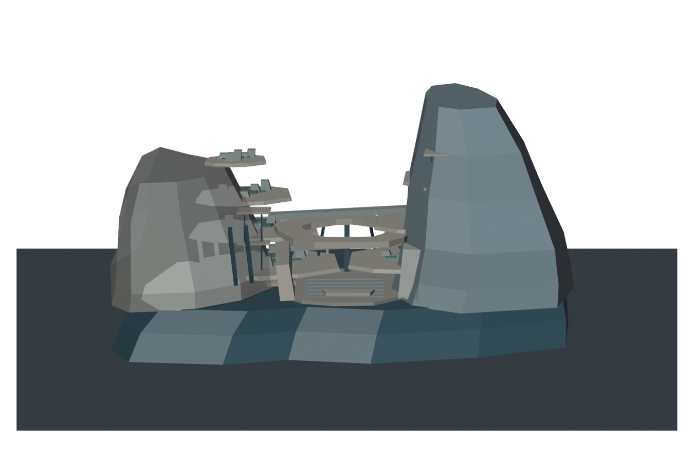
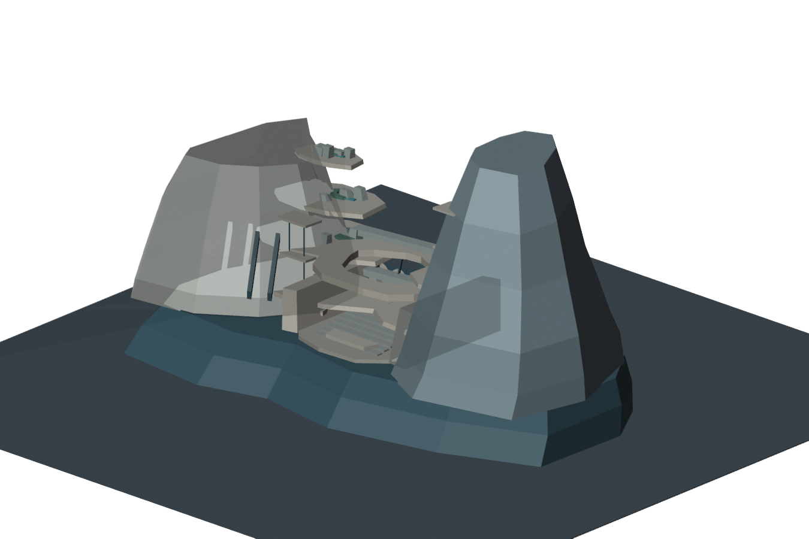
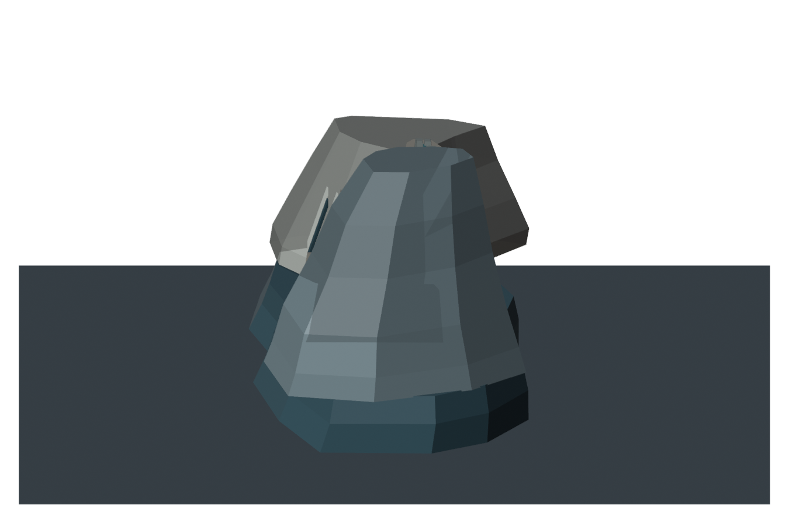
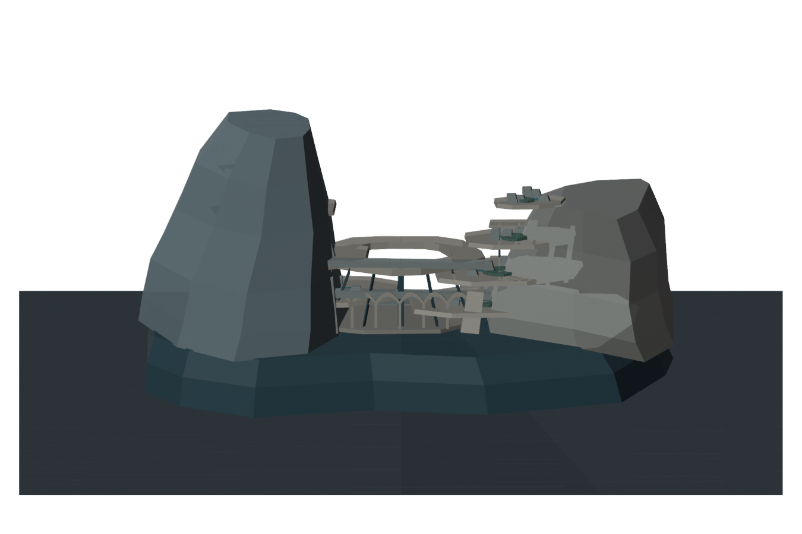
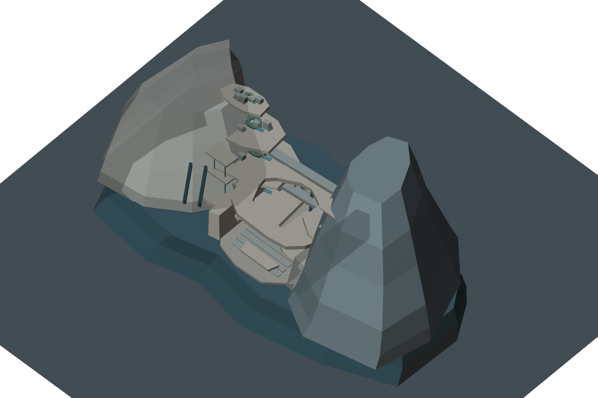
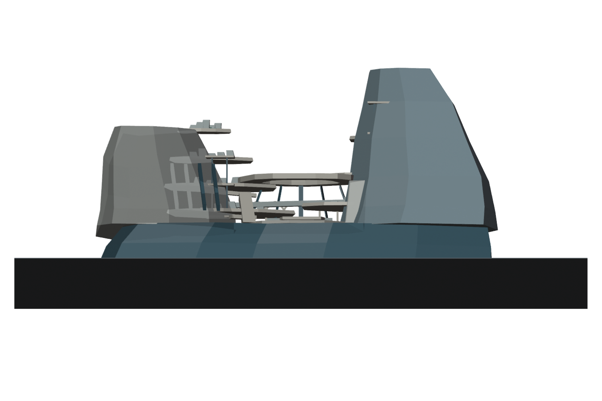
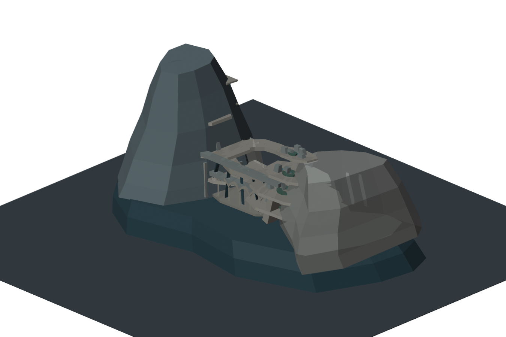
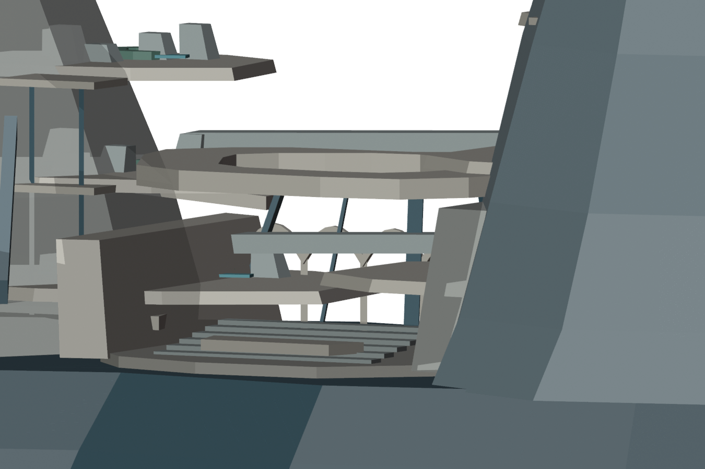
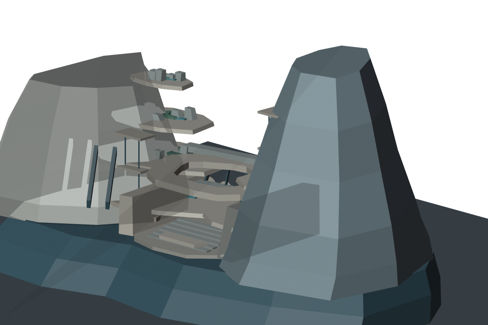

# CELESTIAL HALO-9 — M3D-1S/J7-R6 実Blender研究報告

**2026-10-24 JST / 独立研究 / NONCANONICAL / 美術REJECT / 施工HOLD**

## 0. 正式ルール
mainのSTART_HERE / PROJECT_CONSTITUTION / CITY_MASTER_3D_STANDARD / AGENTS.mdを参照。CITY MASTER 3D FIRST：Minecraft施工前に約10km全体の編集可能な詳細実3Dを完成。**唯一の簡略化例外は一般建物の私的内部**。W0・H1–H6・SB01–SB16（HERO4含む）、全公共建築内部、全外観・地形・都市交通・素材・照明は詳細が必要。研究用R6はこれらの完成を主張しない。正式中央美術採択0件／Minecraft施工HOLD。M247-Cなど既存研究は保護。

## 1. 今回の実作業
**実Blender 4.0.2**をGitHub Actions上で実行（Python/bpy API、GUI直接クリックなし）。
J7-R5の「左右の塔＋細い橋」から脱却する目的で、共通の厚い都市基盤を出発点に、西側の低く幅広い居住断崖・東側の高い居住断崖・広幅の中央公開集会場を一体の研究シーンとして新規造形した。

研究モデルには、1共通都市基盤、2つの巨大都市断崖形状、計8帯の高層街路床、40個の略式居住建物外形、8個の高層中庭リング、実フロアを持つ中央集会場、公共回廊・ポルティコ、6本の集会段床、駅・交通ガイドが別々の編集可能実メッシュとしてある。

**注意：**リング状の中庭は上部の開口メッシュであり、その下に重なる断崖ボリュームまで本当に貫通した空洞になっているかは未証明。美術・利用可能性の根拠として誇張しない。

## 2. 実体の再確認
[GitHub Actions実行](https://github.com/ryomashibaba/celestial-halo-9/actions/runs/40080369793)が全ステップPASS。保存済み実Blenderの独立出力JSONを読み返した値：
- 本物のBlenderシーン：**163メッシュ、1895頂点、3174三角形**
- R6都市断面部分の研究用実寸：**約7018 × 3732 × 3585 m**（非公式、10km参照平面を除外）
- ネイティブBLEND **147502 bytes**、保存したGLB **230784 bytes**、BlenderからのGLB再インポートで**163メッシュ一致**
- 同一実Blenderシーンから9 PNGを出力。都市広域固定10km視野7方向＋局所公共室と断面2方向。**R5と完全一致のカメラで比較したとは主張しない。**
- 全ファイル（Blender原本・GLB・9枚の実レンダー・エビデンスJSON）をGitHub当該研究ブランチへ保存。GitHubファイル一覧とJSONを読戻し確認。

## 3. 実際の9視点を見た美術判断：REJECT
R5より土台は一体化したが、**視覚的には再び「２つの巨大で無地の直立石塊＋中央に小さい階段・展示物」**になっている。絶対寸法を何kmにしても、高度な超未来居住都市・壮麗な中央本体には見えない。

- **正面・斜視**：公共空間は形としてあるが、その規模に対し石塊の無地面が卓越。建築内部が主要な外観を生む構成になっていない。
- **側面**：大きな単純な角柱状の斜面に隠され、街路の層がほぼ見えない。都市らしい厚み・室内露出・奥行感が見えない。
- **背面**：巨壁の背後構成が見え、主要集会空間が読み取れない。
- **俯瞰・地上**：小さな張り出しテラスや近距離の組合せが都市密度・巨大な文明のスケールを支えていない。
- **公共室局所**：屋根開口・集会段床・構造材を確認できるが、出入口・建築機能・可到達性は検査していない。
- 40個の建物は概形のみで詳細な全棟外観に達していない。全16施設や6空中地区の設計でもない。

**重要な失敗として確定：**R5で二塊＋橋を問題視してR6で共通基盤を入れても、見える主質量が依然として二塊のまま。**これ以上同じ数式・ロフト・柱状斜面を生成しても中央美術の向上を期待しない**。窓・照明を大量配置して「完成」にしない。

## 4. 制作効率と次工程のSTOPゲート
R1=棚、R2=岩塊、R3=翼、R5=二塔、R6=二石柱。形状を自動生成する方式そのものが、意図した建築美術の実現を妨げている。Blender本体が使えることはR4で実証済みだが、**Blenderをbpyで動かすだけでは美術の独創性が生まれない**。

次の美術工程はR6の原本の細密化ではなく、最初に1つの中央公共空間を実際の都市の主構成として建築設計し、建築の内外を同時にデザインする必要がある。GUIの画面を見て直接形状編集するWork/Computer Use等の経路は、AGENTS.md上でその都度ユーザー承認が必要。未承認のWorkやGUI操作を実施したと主張しない。

直近の具体的な次ゲートは、**Blenderを視覚的に操作できる制作ループの可用性確認 → 1個の公共室と街区の実建築品質向上 → 同一スケールの正面・側・背・内部比較 → 失敗したらマクロへの自動拡大停止**。もしGUI直接編集が使えなければ、まずアートディレクションと空間の断面図レベルの形態要件を確定し、別の自動数式で代替しない。

## 5. GitHub上の検証素材
- `outputs/J7R6_TENKAKU_SECTION_NONCANONICAL.blend` — 編集可能なBlenderプロジェクト
- `outputs/J7R6_TENKAKU_SECTION_NONCANONICAL.glb` — 実形状
- `outputs/J7R6_MODEL_EVIDENCE.json` — 読込・寸法・9画像一覧
- `outputs/01_FRONT.png`〜`outputs/09_URBAN_SECTION.png` — 実Blender9視点
- `build_blender_tenkaku.py` — 研究用モデリング・9視点再現スクリプト
- `.github/workflows/halo9-j7-r6-blender.yml` — GitHub Actions用実Blenderスクリプト

正式美術採択0／Minecraft施工HOLD。R5、M247-C、過去データ、main、W0等の原本を上書きしていない。

## 6. 実レンダーのレビュー
| 正面 | 斜視 | 側面 |
|---|---|---|
|  |  |  |
| 背面 | 俯瞰 | 地上 |
|  |  |  |
| 逆斜視 | 公共室 | 地区断面 |
|  |  |  |
