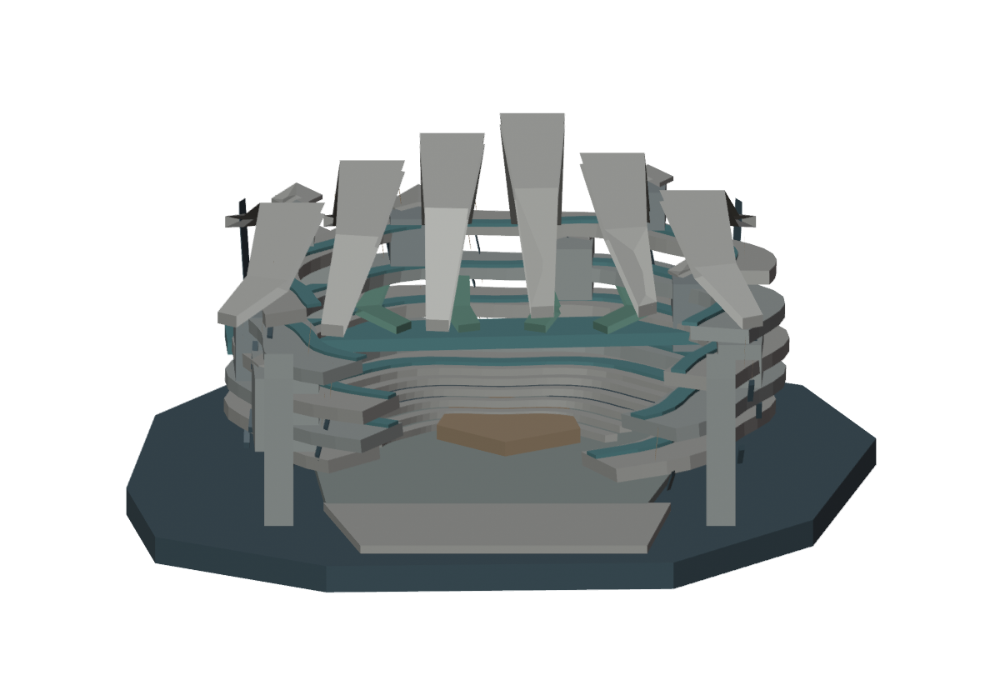
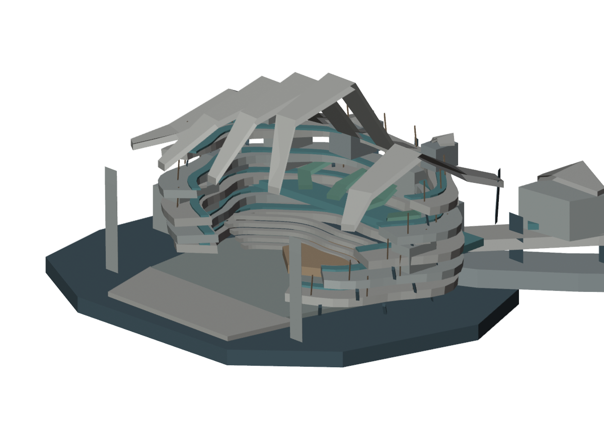
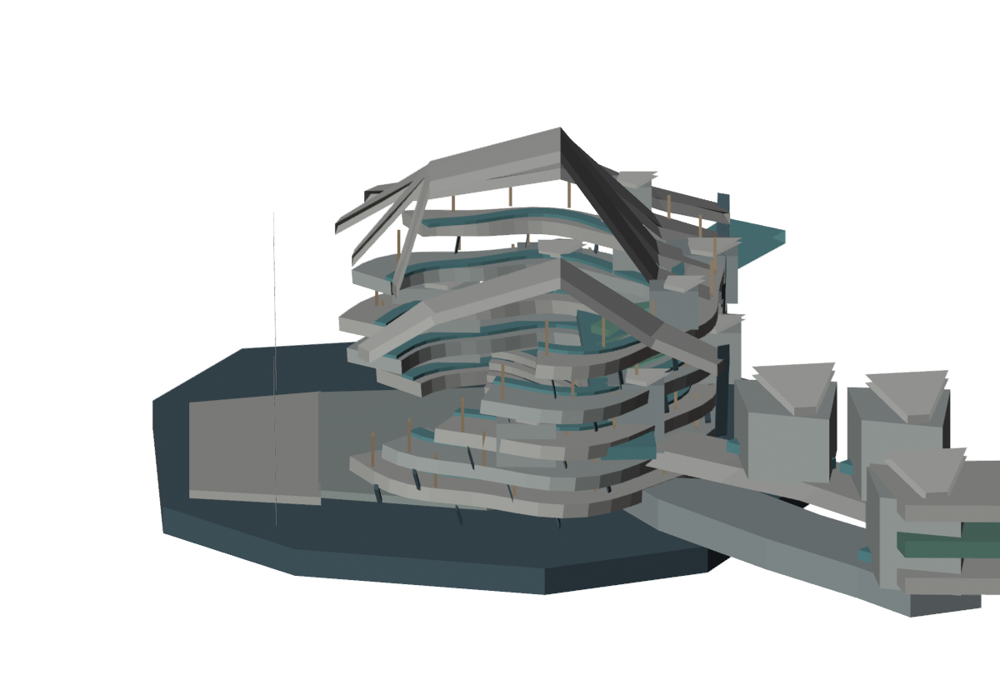
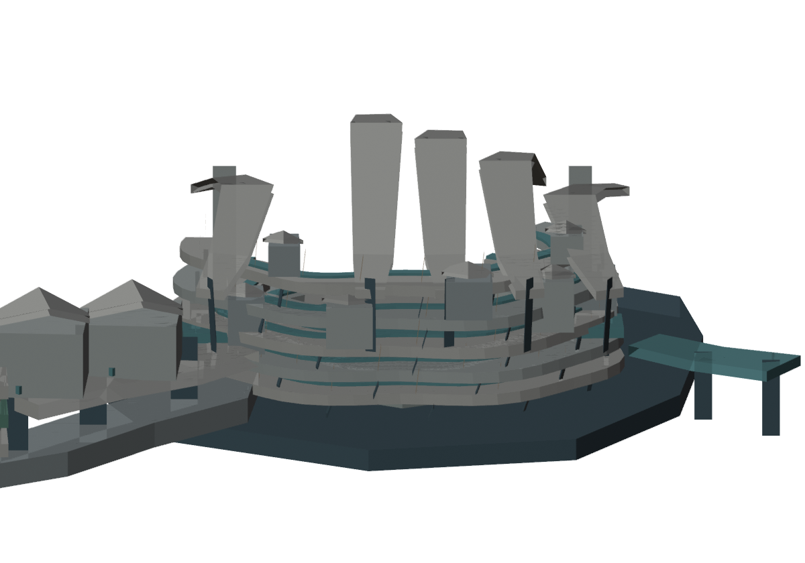
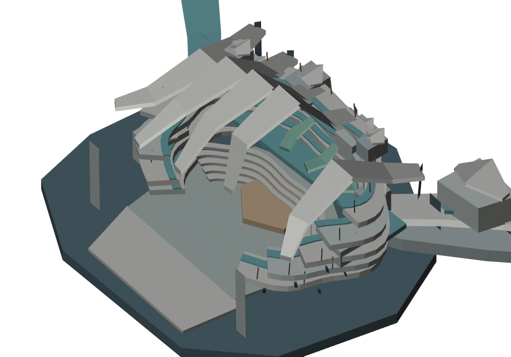
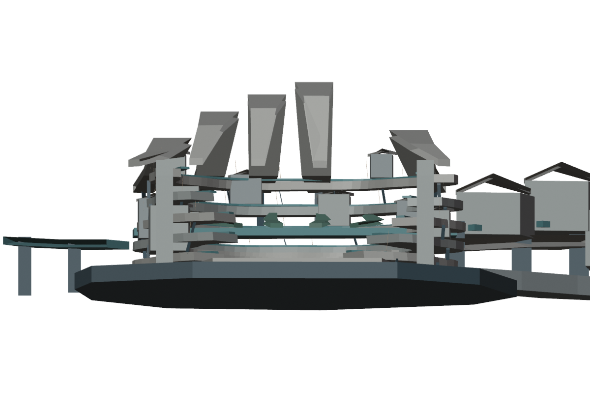
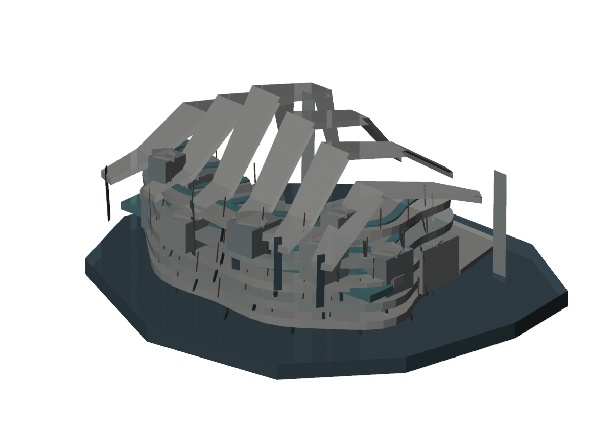
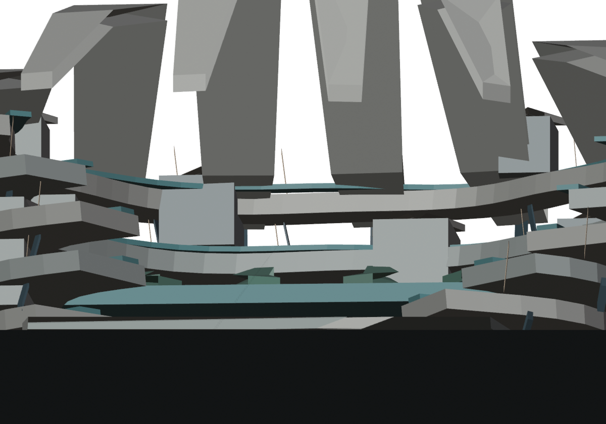
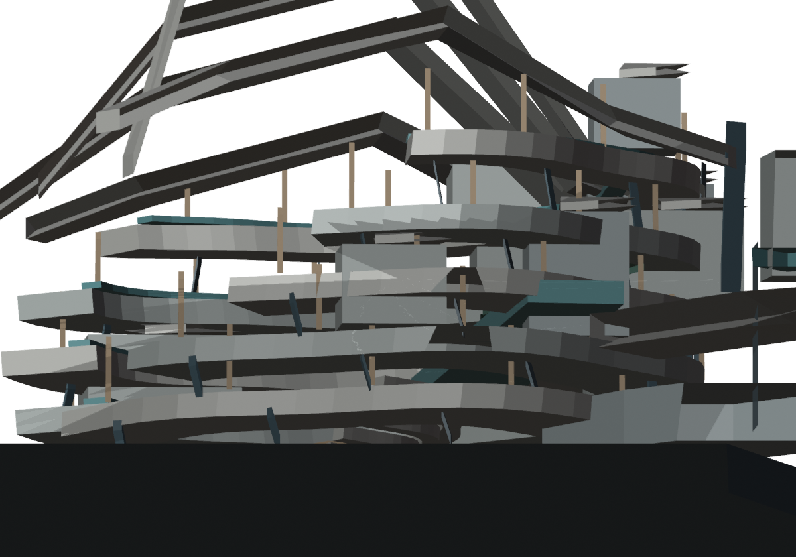

# CELESTIAL HALO-9 — J7-R8「CIVIC LENS」実建築試作・レビュー

2026-10-24 JST / 独立美術研究・局所都市断面 / 非正式・非施工・原本保護

## 0. 正式方針との整合
mainのPROJECT_CONSTITUTION/CITY_MASTER_3D_STANDARD/AGENTS.mdとR7最新を読み、ART-FIRST、Macro Impact First、約10km全域のCITY MASTER 3D FIRSTを維持。一般建物の私的内部のみ簡略化可。W0、H1–H6、SB01–SB16、HERO4、M247-C研究方向、公式ワールドやFreezeは一切変更なし。今回のR8は約2kmの**局所研究モデル**で、完成中央美術でも10km統合City Masterでもない。正式中央美術採択0／Minecraft施工HOLD。

## 1. 実制作内容（A→Bと実レンダリング評価）
- R1〜R6の「箱棚・岩塊・翼・二塔・二石柱」路線を破棄して、公共室の内部形態から外観を逆設計。
- R8-A：開いた中央集会場の床、5段の本当の環状集会床、5段の居住用回廊、露出した屋根梁／リブ、実床を持つ公的広場、周囲の公共施設／仮ファサードを実Blender4.0.2で建築。9方向実レンダーから**閉じた円形競技場に見える**と評価した。
- R8-B：同じBlenderソースを修正し、非対称の公共街路（片側に延びる公共棟、入口、公共床、構造支持）、外部居住地区への都市延長と反復屋根の非対称化を追加。モデルを再生成・GLB再インポート・9方向再レンダー。
- 修正後は「左右の巨大な石柱」より**読める公共室・複数階の街路・屋根の独立形態**を持つようになった。ただし、まだ**大きな競技場風の複合文化施設**に近く、未来文明全体を代表する巨大中央美術とは読めない。

## 2. 実測（R8-B）
GitHubに保存されたBlender実行JSONから読戻し：
- Blender **4.0.2**、実メッシュ **190**、頂点 **4,148**、三角形 **7,536**。
- 公共室を含む研究モデルの軸平行サイズ：**約2,155 × 1,670 × 696.5 m**。公式Minecraft座標未確定。
- 編集可能BLEND **173,798 bytes**、実GLB **436,240 bytes**、GLB再インポート**190/190 meshes**。
- 都市スケールを代表しない局所断面の**9つの同一シーン実Blenderレンダリング**。7方向は同じ1900m ortho scale（R8内の比較のみ）、公共室・街路2方向は別の局所カメラ。
- 施設内部の歩行、回廊の連結・床連続・構造支持、住居としての使用可能性、実窓開口、地形・都市全体への正式接合、全16巨大施設との接続は**未証明**。真の中央公開室は屋根部材間が開いた空間だが、全ての線が歩行可能という意味ではない。

## 3. 美術（R8-B 9視点を画像で実際に審査）
**中央美術判定：REJECT / 局所モチーフ：HOLD（再研究価値あり）**。
- 改善：正面で公開室が視認でき、周囲に多層の街路と公的施設が連続。2個の孤立巨岩より空間として伝わりやすい。
- 欠点：円形競技場／文化センターの独立施設に見える。街区延長を足しても「都市全体の主役」が凝縮したような巨大な連続都市基盤と高密度生活は見えない。
- 側面・背面は回廊床の重なりが多く、建築内部への入口・用途・居住密度をまだ説明できていない。
- 屋根の6本の反復リブは抽象的な模型状で、建物用途に基づく採光・屋根・外部都市ランドマークとしての多方向の意味が不足する。
- 各棟外観は仮形式。一般建物を含む全棟外観の詳細完成と混同しない。
- よってR8-Bの主形状をそのまま拡張して「中央完成」にしない。

## 4. Blender GUI追加修正ゲート
前工程R7のGUI成功を踏まえ、R8-Bの実BLENDをBlender GUIウィンドウ上で開き、外郭を覆う屋根リブの**頂部の一部だけ**を選択してZ方向+120m編集する専用研究手順を作成。選択外の根元を残し、編集前後GUIスクリーンショット、BLEND保存、別Blenderプロセスで厳密な頂点検証、最終モデルを同一9視点レンダーする。

重要：上記はR8-Bの別工程で、**GitHubの実行ログ・JSONで成功確認できるまでGUI編集成功と断定しない**。機能実証は正式美術合格を意味しない。

## 5. 改善計画（形をむやみに巨大化しない）
次段階は、中心大公共室が単なるアリーナではなく、複数階の公共プログラム・都市交通・生活回廊の**連続した都市組織**として周辺W0/H/SBの全体設計に接続するかを試す。
美術採用条件：正面・側面・背面・俯瞰・室内それぞれで、用途のある巨大公共空間と居住可能な街区がひとつの大建築として読めること。窓やライトを増やすだけで合格にしない。

## 6. 正確な研究ファイル位置
- ソース：`studies/M3D-1S/J7/R8/build_civic_lens.py`
- Blender CI：`.github/workflows/halo9-j7-r8-civic-lens.yml`
- Blender Native：`studies/M3D-1S/J7/R8/outputs/J7R8_CIVIC_LENS_ART_STUDY.blend`
- 研究用GLB：`studies/M3D-1S/J7/R8/outputs/J7R8_CIVIC_LENS_ART_STUDY.glb`
- 数値証拠：`studies/M3D-1S/J7/R8/outputs/J7R8_REAL_BLENDER_EVIDENCE.json`
- 9画像：`studies/M3D-1S/J7/R8/outputs/01_FRONT.png`〜`09_CITY_STREET.png`。
- Blender GUI試験：`studies/M3D-1S/J7/R8/gui/`以下。
- A実行：[Actions #40083645732](https://github.com/ryomashibaba/celestial-halo-9/actions/runs/40083645732)
- B実行：[Actions #40083897810](https://github.com/ryomashibaba/celestial-halo-9/actions/runs/40083897810)

### B実モデルからの多視点
| front | oblique | side |
|---|---|---|
|  |  |  |
| rear | aerial | ground |
|  |  |  |
| reverse | nave interior | streets |
|  |  |  |

## 7. R8-C：Blender GUI実編集の最終監査（2026-10-24）

**最終GUI修正：技術PASS、正式中央美術REJECT、局所建築方法の研究成果として保存。**

[GitHub Actions #40084519373](https://github.com/ryomashibaba/celestial-halo-9/actions/runs/40084519373) 全ステップ成功。ウィンドウ付きBlender4.0.2をX11/Xvfb上で起動し、既存R8-BのBLENDに含まれる屋根 `SIX_CIVIC_VAULT_SPINES_2` を編集モードで変更。脚・根元を残したまま、頂部 **8 / 20頂点だけをZ方向+120m** 持ち上げ、GUIのCtrl+Sで独立BLENDコピーへ保存。

- 屋根リブ上端Z：**621.5m→741.5m**。未選択12頂点も、他189メッシュの全頂点も変更なし。
- GUIスクリーンショット実画像2枚（`gui/outputs/01_ACTUAL_GUI_BEFORE.png`と`02_ACTUAL_GUI_AFTER.png`）。実フレームバッファ由来の画像でありオフライン生成画像ではない。
- 変更後シーンをBlenderの別プロセスで再読込し、同一R8カメラから9枚再レンダー。
- GUI編集後GLB `gui/outputs/J7R8_GUI_RESCULPTED_ACTUAL.glb` **436,588 bytes**。別Blenderシーンでの再インポート **190/190メッシュ一致**。
- 編集前後のネイティブBLEND `gui/outputs/J7R8_GUI_BEFORE.blend`, `J7R8_GUI_AFTER.blend` 保存。
- 詳細実測JSON `gui/outputs/J7R8_REAL_GUI_EDIT_EVIDENCE.json` に再現可能な監査を保存。

失敗も記録：GUI初回テストはBlender APIの `bpy.tool_settings` 参照エラー、2回目はObject ModeのVertex.selectだけではEdit BMesh内の頂点選択が限定されず全20頂点が動いて失敗。**Edit Modeのbmeshを直接選択し直す方法へ変更**し、最後の実行で頂部8頂点だけの編集に成功した。いずれもCIが失敗を検出し、誤った成功判定を防いだ。

ただし、GUIで屋根を変形できたことは芸術的独創性の証明ではない。9視点を再観察するとモデルはまだ「円形公共施設＋一部外部地区」の印象が強く、完成された超未来中央都市には見えない。**局所建築空間の制作・画面での直接編集技術が向上した**と限定評価する。正式美術採択0・施工HOLD・City Master 3D First変更なし。

R8の結果を踏まえた次の重要判断：**R9ではリング状建築の装飾を増やすのではなく、都市の街路・用途のある公共建築内部・地域接続を先に設計し、建築形態をそこから成立させること**。GUI操作技術の反復実験ではなく、視覚的な質のゲートを厳格に守る。
