# CELESTIAL HALO-9 — J7-R9 天縫街（TENNU）実Blender都市断面研究

2026-10-24 JST / 独立研究 / **美術REJECT、局所機能研究HOLD、Minecraft施工HOLD**

## 0. 最上位方針
本研究開始時にGitHub **main** の START_HERE / PROJECT_CONSTITUTION / CITY_MASTER_3D_STANDARD / CURRENT_STATUS / AGENTS.mdを確認。ART-FIRST／Macro Impact First／CITY MASTER 3D FIRST厳守。Minecraft正式施工より前に約10km都市全域の編集可能な詳細3Dモデルが必要で、一般建物の**私的内部だけ**が簡略化例外。W0、H1〜H6、SB01〜SB16、HERO4、都市交通、地形、全施設外観・公共内部は省略不可。

今回の研究は**研究用座標**での部分都市断面。公式Minecraft座標やW0/H/SB配置、10km完成、正式中央美術採択は**一切主張しない**。正規ワールド、main、過去M247-C等の研究原本、Freeze、正式W0/H/SBアセットには変更なし。Work/ユーザーローカルPC未利用。

## 1. 今回の制作方法の違い
J7-R1〜R6の巨大岩塊／二塔・J7-R8の楕円形独立文化施設を、単純な装飾追加や拡大で延長することをSTOP。建築輪郭より先に、用途を持つ**6つの公共拠点**と街路を仮定し、都市の断面が主役の模型を新設した。

都市大路は C0南入口→C1交通交換駅→C2集会・公会堂→C3市民記録図書館→C4公共庭園・居住街区→C5北都市出口の6拠点。街路の研究用平面長・標高差から5区間の勾配を計算、概ね**4.57～6.96%**。ただし歩行可否やアクセシビリティ基準への合致を意味しない（必要な有効幅、縦勾配の区間、踊り場、バリアフリー、他メッシュとの衝突、実測ナビゲーション未審査）。

実3D化した研究機能：複数レベルの実道路床、交換駅の5プラットフォームと大きな屋根、集会室の段床・舞台・柱と開放屋根、市民図書館の公開読書層・書棚プロキシ・天窓、街区7クラスター・建物外観約36件、水平／垂直の公共交通構造、都市高架の上層公共床、屋上庭園。**いずれも完成度の高い施設内部・生活動線の最終設計ではない**。

## 2. A→B：本物のBlender画像で確認して修正
- **R9-A**：Blender4.0.2により531メッシュ、4658頂点、7192三角形の局所都市断面を作り、実GLB、編集可能BLEND、11方向の実レンダーを保存。主大路の起伏が表現されたが、11画像では**巨大な円弧状の屋根の下におもちゃサイズの建物がぶら下がる**印象が強かった。美術REJECT。
- **R9-B**：Aの全データを`A_baseline/`としてGitHubに保全した後、屋根の山を下げ、建物の実メッシュに外壁・窓の開口・複数階を追加。さらに上層公共回廊へ用途を持つ都市床と建物を統合した。Bの実Blenderは**979メッシュ／47,474頂点／71,436三角形**、GLB **4,037,828 bytes**、BLEND **613,078 bytes**、GLB再インポート979/979、11枚再レンダー。研究モデルの全体軸寸法は**約2,200 × 2,790 × 906m**。
- A→B同一カメラのRGB8超画素差は、正面**8.18%**、斜視**9.333%**、側面**6.246%**、背面**9.15%**、俯瞰**10.689%**、集会室**25.923%**、図書館内部**46.155%**、近景街路**32.293%**。**これらは「画素の変化率」であり美術品質評価ではない**。
- Bを再審査すると、住居らしい外壁・複数階が読みやすくなった一方、「巨大高架建築の上にミニチュアの街」がある印象。**中央超未来都市を代表する圧倒的な建築美術は依然としてREJECT**。文字上の都市規模やメッシュ数では改善を判断しない。
- Bの全実Blender成果物も`B_baseline/`へ保全し、その後のCによる道の修復とは明確に分離。

## 3. C：主大路の本当のメッシュ連結検証
A/Bは5区間の床を各々別の路面メッシュにしていたため、中心点が共通でも、曲がり角で局所的な未接合・隙間が生じ得た。**実際の道路連続が成立したと強く主張できない**設計だった。

J7-R9-Cでは、主大路5区間を**1つのスウィープ路面メッシュ**に変更し、6節点の上面頂点が実研究座標と一致し、各区間の上面4頂点が隣接と共有されることを厳密な頂点・ポリゴン集合で確認するコードを追加した。5本の別メッシュより有意な構造QA向上。**ただし曲がり角の地形交差・縁への転落・幅・実物荷重・障害物回避・実歩行テストまでは未認証**。副道の接合も未検証。

R9-Cの正式PASSは`outputs/J7R9_BLENDER_SPATIAL_EVIDENCE.json`の`road_mesh_topological_edge_chain_test`、`glb_reimport_mesh_count`、実レンダーを確認した時点で初めて確定する。

## 4. 美術審査：中央はREJECT、研究資料としては保存
**残った失敗**
- 建物の多数の階や窓は見えるようになっても、街路と街区の造形がまだ模式的で、高架下に細柱が散在。壮大な都市の断面・質量・生活の密度として不足。
- C1の駅、C2の集会室、C3の図書館は「名称に相当するメッシュと床」を備えるが、人間尺度の用途・内装・多視点体験の詳細完成には遠い。
- 研究座標の道路・支柱・居住床は正式なW0地形へ接地・接続していない。これを巨大都市マスターの完成比率として扱わない。
- 遠景は橋・骨組み・単体建物の集合という感じが残る。光・仕上げだけで正式合格にはしない。

**有益な進歩**
- 旧R6の無地の巨壁やR8の独立アリーナから、街路と用途を先行させる設計方法へ本当に転換した。
- 1つのモデルの中で、6拠点、正面側面背面、集会室内部、図書館、街路、高架都市景観を切替えてチェックできる。
- A→B→CをGitHubに原本を保全して比較できる。体裁だけの工程反復はしない。

## 5. 次の重要ゲート
**次工程の目的は、新しい巨大なメッシュを量産することではない。** 1つの都市公共室（たとえば図書館か公会堂）と接続する街路の**人間尺度・内部詳細・入口・実移動**をまずBlenderの画面で確実に成立させる。形状の意味と建築美術が改善した時にだけ中央の都市全体へ展開する。Work/ローカルComputer Useは別途権限境界を確認。CITY MASTER 3D FIRSTと正式施工HOLDは永久維持。

## 6. 調査・出力リンク
- `01_ART_AND_SPACE_CONTRACT_JA.md`：都市から先に決めた建築条件。
- `build_tennu_blender.py`：Blender実3D・11視点・研究ルートの計算・実GLB再インポート。
- `A_baseline/`：A初回11画像＋GLB＋BLEND＋JSONの完全原本。
- `B_baseline/`：B変更後の完全原本。
- `outputs/`：C最終成果の実BLEND／GLB／11枚レンダー／証拠JSON。
- [R9-A Actions](https://github.com/ryomashibaba/celestial-halo-9/actions/runs/40085404457)
- [R9-B Actions](https://github.com/ryomashibaba/celestial-halo-9/actions/runs/40085912422)
- [R9-C Actions](https://github.com/ryomashibaba/celestial-halo-9/actions/runs/40086189528)

### Blender C実モデルによる確認パネル
| 正面 | 斜視 | 側面 |
|---|---|---|
| 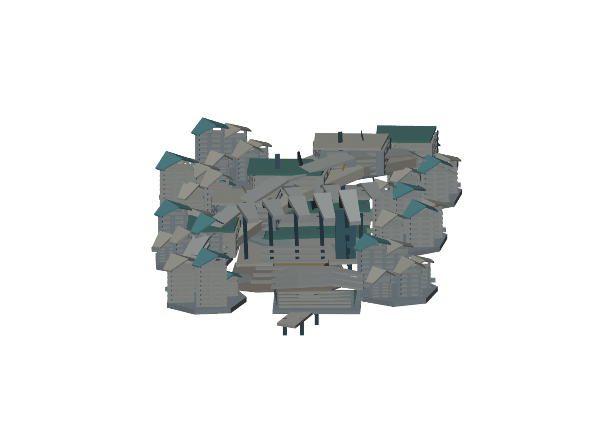 | 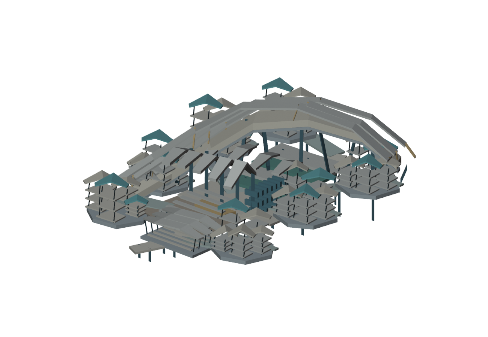 | 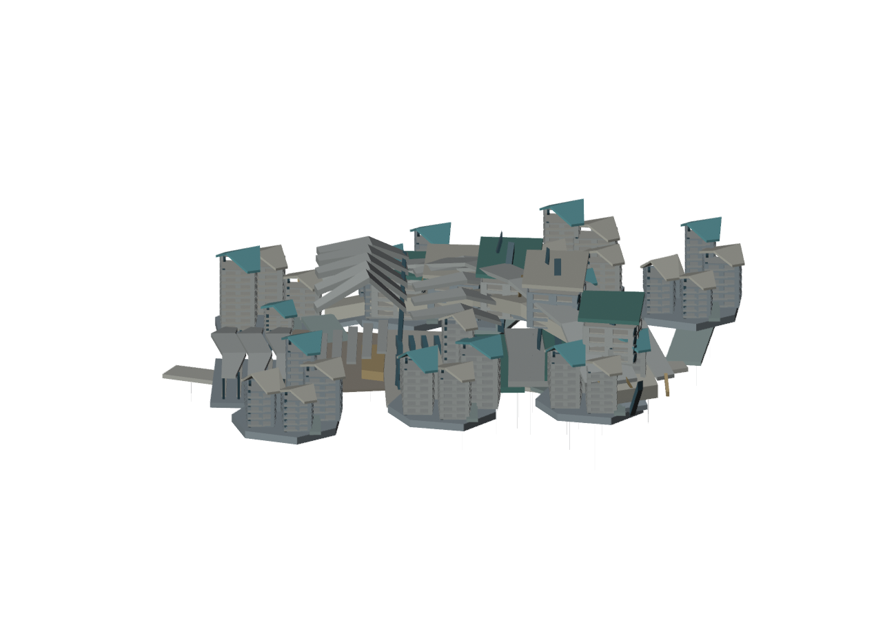 |
| 背面 | 俯瞰 | 地上 |
| 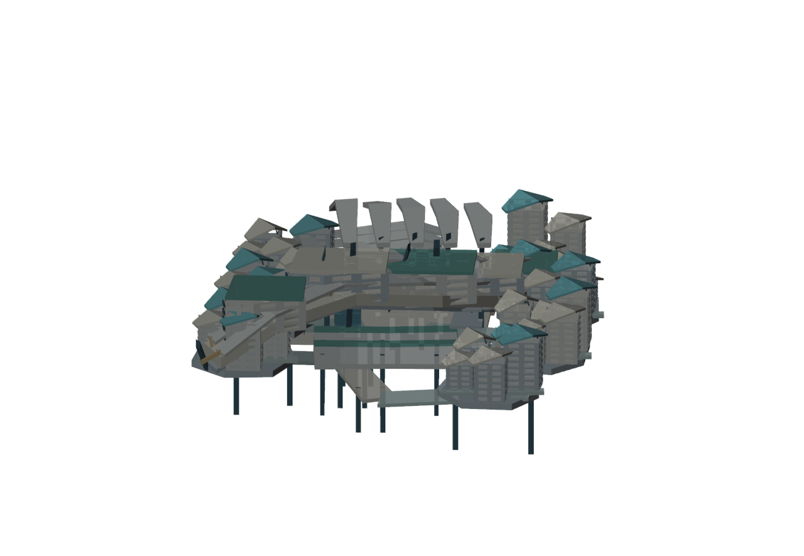 | 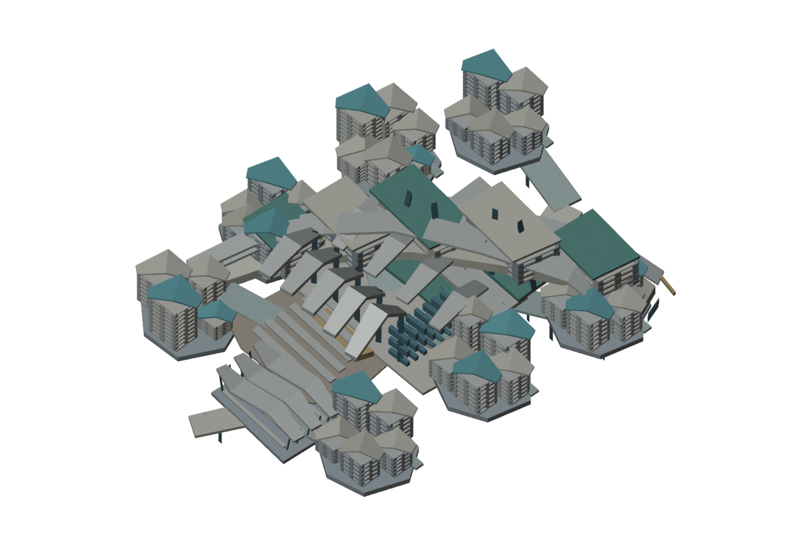 | 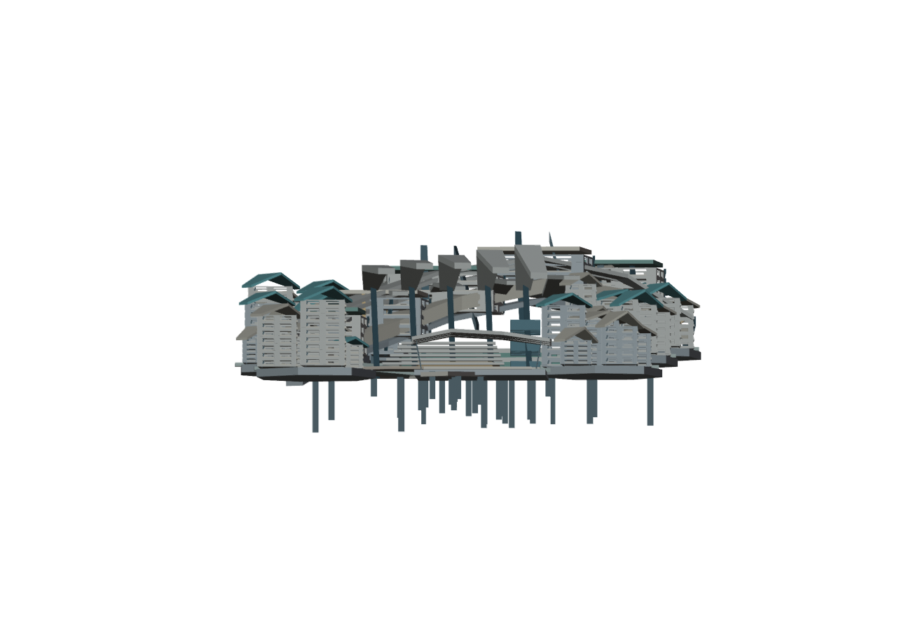 |
| 逆斜視 | 公会堂 | 図書館 |
| 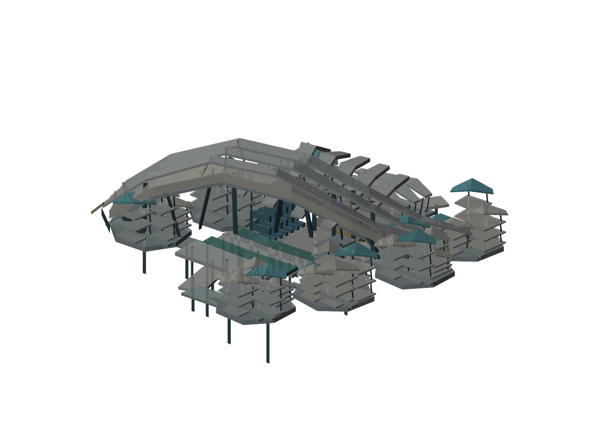 | 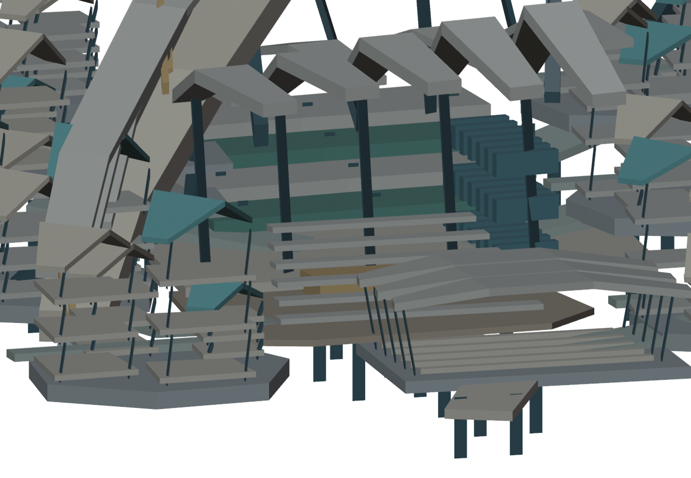 | 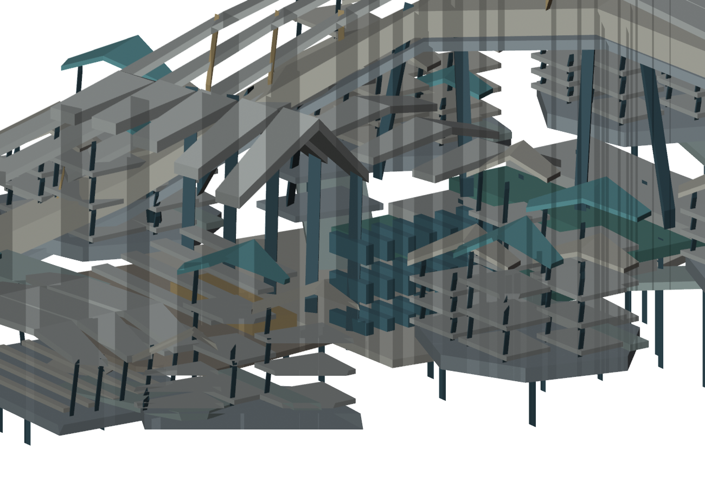 |
| 街路 | 都市上層 |
|---|---|
| 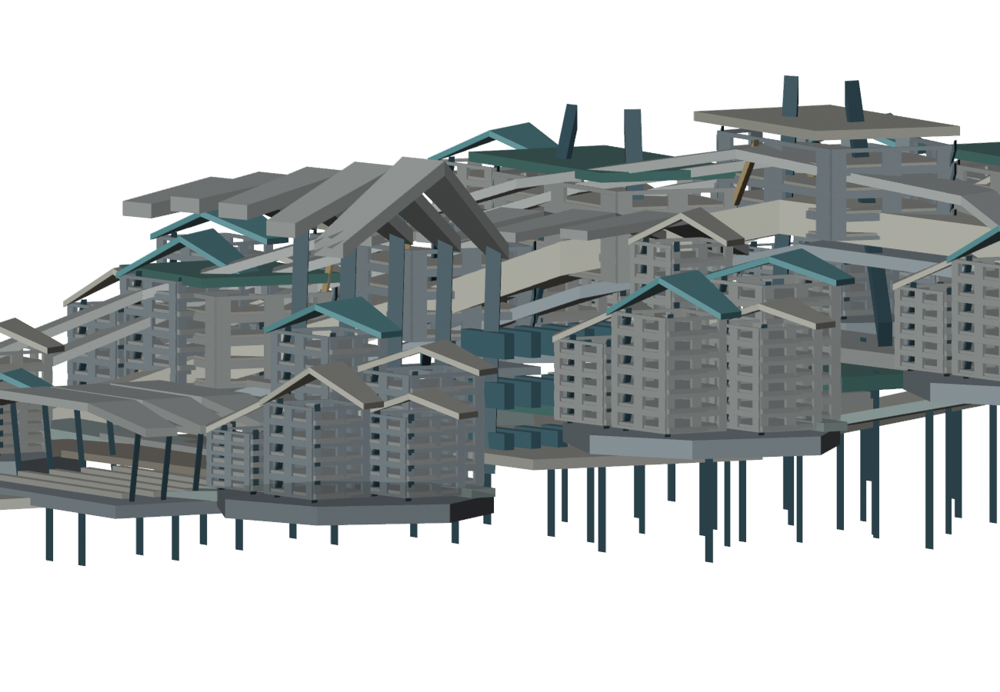 | 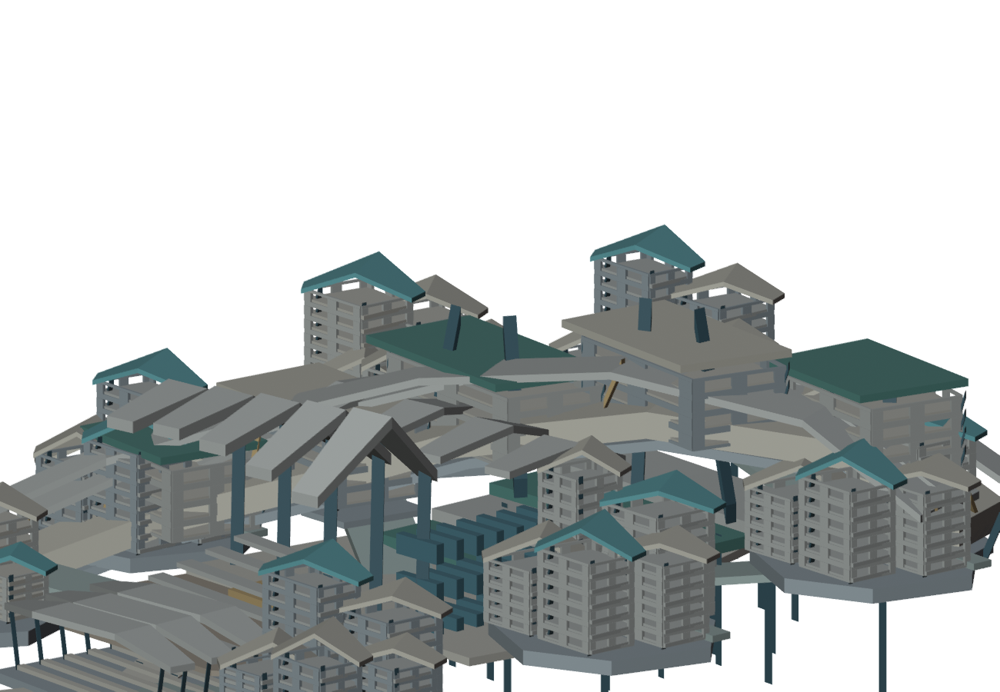 |
